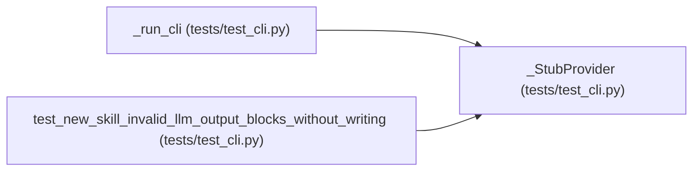

# _StubProvider

**Location:** `tests/test_cli.py:74`
**Kind:** Class
**Bases:** —
**Module:** [test_cli](../modules/test_cli.md)

## Description

Deterministic LLMProvider.complete stand-in.

## Attributes

*No annotated attributes found.*

## Methods

| Method | Signature | Decorators | Description |
|--------|-----------|------------|-------------|
| `__init__` | `(response: str) -> None` | — | — |
| `complete` | *(async)* `(*, model, prompt, max_tokens, system = None) -> str` | — | — |

## Relationships

<!-- Auto-generated relationship summary. Do not edit by hand. -->

### Summary

| Module | Methods | Attributes |
|---|---:|---|
| [test_cli](../modules/test_cli.md) | 2 | — |

### References

| Reference | Kind | Source | Call sites |
|---|---|---|---:|
| `_run_cli` | call | [test_cli](../modules/test_cli.md) | 1 |
| `test_new_skill_invalid_llm_output_blocks_without_writing` | call | [test_cli](../modules/test_cli.md) | 1 |
