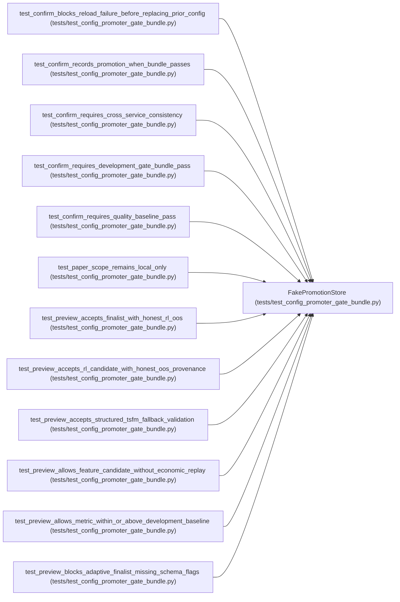

# FakePromotionStore

**Location:** `tests/test_config_promoter_gate_bundle.py:22`
**Kind:** Class
**Bases:** —
**Module:** [test_config_promoter_gate_bundle](../modules/test_config_promoter_gate_bundle.md)

## Description

_Auto-generated from `FakePromotionStore` in `tests/test_config_promoter_gate_bundle.py`._

## Attributes

*No annotated attributes found.*

## Methods

| Method | Signature | Decorators | Description |
|--------|-----------|------------|-------------|
| `__init__` | `(best: dict, model_type: str = 'direction', promotions: list[dict] \| None = None, iterations: list[dict] \| None = None) -> None` | — | — |
| `get_session` | *(async)* `(research_id: str)` | — | — |
| `get_best_iteration` | *(async)* `(research_id: str)` | — | — |
| `get_iterations` | *(async)* `(research_id: str)` | — | — |
| `get_iteration` | *(async)* `(research_id: str, iteration: int)` | — | — |
| `record_promotion` | *(async)* `(**kwargs)` | — | — |
| `list_promotions` | *(async)* `()` | — | — |
| `get_latest_promotion` | *(async)* `(*, model_type: str, instrument: str, timeframe: str, scope: str)` | — | — |
| `get_latest_development_promotion` | *(async)* `(*, model_type: str, instrument: str, timeframe: str)` | — | — |

## Relationships

<!-- Auto-generated relationship summary. Do not edit by hand. -->

### Summary

| Module | Methods | Attributes |
|---|---:|---|
| [test_config_promoter_gate_bundle](../modules/test_config_promoter_gate_bundle.md) | 9 | — |

### References

| Reference | Kind | Source | Call sites |
|---|---|---|---:|
| `test_confirm_blocks_reload_failure_before_replacing_prior_config` | call | [test_config_promoter_gate_bundle](../modules/test_config_promoter_gate_bundle.md) | 1 |
| `test_confirm_records_promotion_when_bundle_passes` | call | [test_config_promoter_gate_bundle](../modules/test_config_promoter_gate_bundle.md) | 1 |
| `test_confirm_requires_cross_service_consistency` | call | [test_config_promoter_gate_bundle](../modules/test_config_promoter_gate_bundle.md) | 1 |
| `test_confirm_requires_development_gate_bundle_pass` | call | [test_config_promoter_gate_bundle](../modules/test_config_promoter_gate_bundle.md) | 1 |
| `test_confirm_requires_quality_baseline_pass` | call | [test_config_promoter_gate_bundle](../modules/test_config_promoter_gate_bundle.md) | 1 |
| `test_paper_scope_remains_local_only` | call | [test_config_promoter_gate_bundle](../modules/test_config_promoter_gate_bundle.md) | 1 |
| `test_preview_accepts_finalist_with_honest_rl_oos` | call | [test_config_promoter_gate_bundle](../modules/test_config_promoter_gate_bundle.md) | 1 |
| `test_preview_accepts_rl_candidate_with_honest_oos_provenance` | call | [test_config_promoter_gate_bundle](../modules/test_config_promoter_gate_bundle.md) | 1 |
| `test_preview_accepts_structured_tsfm_fallback_validation` | call | [test_config_promoter_gate_bundle](../modules/test_config_promoter_gate_bundle.md) | 1 |
| `test_preview_allows_feature_candidate_without_economic_replay` | call | [test_config_promoter_gate_bundle](../modules/test_config_promoter_gate_bundle.md) | 1 |
| `test_preview_allows_metric_within_or_above_development_baseline` | call | [test_config_promoter_gate_bundle](../modules/test_config_promoter_gate_bundle.md) | 1 |
| `test_preview_blocks_adaptive_finalist_missing_schema_flags` | call | [test_config_promoter_gate_bundle](../modules/test_config_promoter_gate_bundle.md) | 1 |

> References: showing 12 of 40 logical references; 28 omitted by the 12-row generated summary limit.
