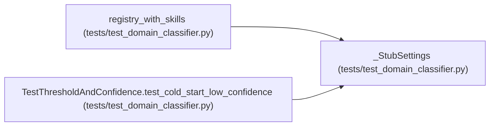

# _StubSettings

**Location:** `tests/test_domain_classifier.py:67`
**Kind:** Class
**Bases:** —
**Module:** [test_domain_classifier](../modules/test_domain_classifier.md)

## Description

Minimal settings object (the manifests here use no {settings.*} refs).

## Attributes

*No annotated attributes found.*

## Methods

*No public methods. Inherits from base classes.*

## Relationships

<!-- Auto-generated relationship summary. Do not edit by hand. -->

### Summary

| Module | Methods | Attributes |
|---|---:|---|
| [test_domain_classifier](../modules/test_domain_classifier.md) | 0 | — |

### References

| Reference | Kind | Source | Call sites |
|---|---|---|---:|
| `registry_with_skills` | call | [test_domain_classifier](../modules/test_domain_classifier.md) | 1 |
| `TestThresholdAndConfidence.test_cold_start_low_confidence` | call | [test_domain_classifier](../modules/test_domain_classifier.md) | 1 |
