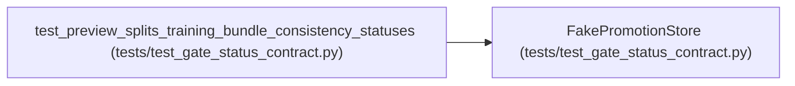

# FakePromotionStore

**Location:** `tests/test_gate_status_contract.py:15`
**Kind:** Class
**Bases:** —
**Module:** [test_gate_status_contract](../modules/test_gate_status_contract.md)

## Description

_Auto-generated from `FakePromotionStore` in `tests/test_gate_status_contract.py`._

## Attributes

*No annotated attributes found.*

## Methods

| Method | Signature | Decorators | Description |
|--------|-----------|------------|-------------|
| `__init__` | `(best: Dict[str, Any]) -> None` | — | — |
| `get_session` | *(async)* `(research_id: str) -> Dict[str, Any]` | — | — |
| `get_iterations` | *(async)* `(research_id: str) -> list` | — | — |
| `get_best_iteration` | *(async)* `(research_id, **kwargs) -> Dict[str, Any]` | — | — |

## Relationships

<!-- Auto-generated relationship summary. Do not edit by hand. -->

### Summary

| Module | Methods | Attributes |
|---|---:|---|
| [test_gate_status_contract](../modules/test_gate_status_contract.md) | 4 | — |

### References

| Reference | Kind | Source | Call sites |
|---|---|---|---:|
| `test_preview_splits_training_bundle_consistency_statuses` | call | [test_gate_status_contract](../modules/test_gate_status_contract.md) | 1 |
