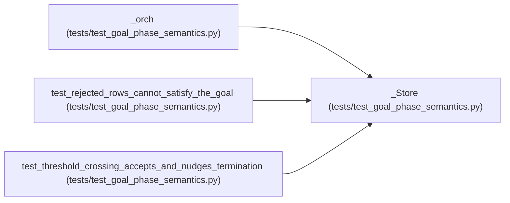

# _Store

**Location:** `tests/test_goal_phase_semantics.py:185`
**Kind:** Class
**Bases:** —
**Module:** [test_goal_phase_semantics](../modules/test_goal_phase_semantics.md)

## Description

_Auto-generated from `_Store` in `tests/test_goal_phase_semantics.py`._

## Attributes

*No annotated attributes found.*

## Methods

| Method | Signature | Decorators | Description |
|--------|-----------|------------|-------------|
| `__init__` | `(rows, session = None)` | — | — |
| `get_session` | *(async)* `(research_id: str)` | — | — |
| `get_iterations` | *(async)* `(research_id: str)` | — | — |

## Relationships

<!-- Auto-generated relationship summary. Do not edit by hand. -->

### Summary

| Module | Methods | Attributes |
|---|---:|---|
| [test_goal_phase_semantics](../modules/test_goal_phase_semantics.md) | 3 | — |

### References

| Reference | Kind | Source | Call sites |
|---|---|---|---:|
| `_orch` | call | [test_goal_phase_semantics](../modules/test_goal_phase_semantics.md) | 1 |
| `test_rejected_rows_cannot_satisfy_the_goal` | call | [test_goal_phase_semantics](../modules/test_goal_phase_semantics.md) | 1 |
| `test_threshold_crossing_accepts_and_nudges_termination` | call | [test_goal_phase_semantics](../modules/test_goal_phase_semantics.md) | 1 |
