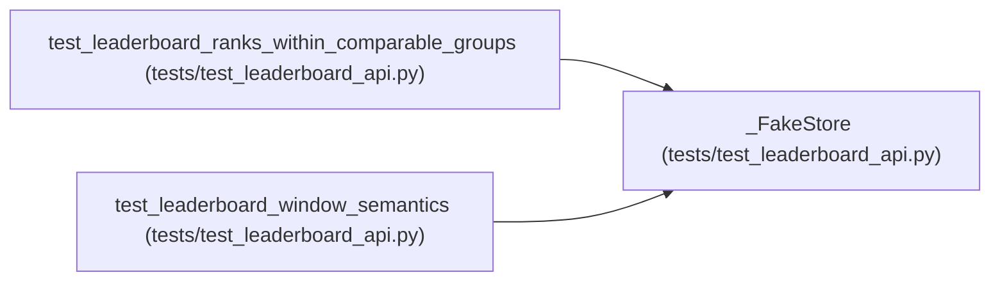

# _FakeStore

**Location:** `tests/test_leaderboard_api.py:20`
**Kind:** Class
**Bases:** —
**Module:** [test_leaderboard_api](../modules/test_leaderboard_api.md)

## Description

Ranking double: grouped, direction-aware, windowed rows.

## Attributes

*No annotated attributes found.*

## Methods

| Method | Signature | Decorators | Description |
|--------|-----------|------------|-------------|
| `__init__` | `() -> None` | — | — |
| `rank_leaderboard_groups` | *(async)* `(*, model_types, direction = 'maximize', limit = 20, offset = 0)` | — | — |

## Relationships

<!-- Auto-generated relationship summary. Do not edit by hand. -->

### Summary

| Module | Methods | Attributes |
|---|---:|---|
| [test_leaderboard_api](../modules/test_leaderboard_api.md) | 2 | — |

### References

| Reference | Kind | Source | Call sites |
|---|---|---|---:|
| `test_leaderboard_ranks_within_comparable_groups` | call | [test_leaderboard_api](../modules/test_leaderboard_api.md) | 1 |
| `test_leaderboard_window_semantics` | call | [test_leaderboard_api](../modules/test_leaderboard_api.md) | 1 |
