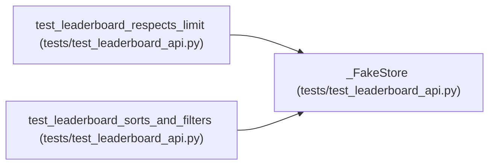

# _FakeStore

**Location:** `tests/test_leaderboard_api.py:20`
**Kind:** Class
**Bases:** —
**Module:** [test_leaderboard_api](../modules/test_leaderboard_api.md)

## Description

Minimal list_sessions double: two scored sessions + one unscored.

## Attributes

*No annotated attributes found.*

## Methods

| Method | Signature | Decorators | Description |
|--------|-----------|------------|-------------|
| `__init__` | `() -> None` | — | — |
| `list_sessions` | *(async)* `(status = None, model_type = None, instrument = None, status_in = None, limit = None, offset = 0, cursor = None, reverse = False)` | — | — |

## Relationships

<!-- Auto-generated relationship summary. Do not edit by hand. -->

### Summary

| Module | Methods | Attributes |
|---|---:|---|
| [test_leaderboard_api](../modules/test_leaderboard_api.md) | 2 | — |

### References

| Reference | Kind | Source | Call sites |
|---|---|---|---:|
| `test_leaderboard_respects_limit` | call | [test_leaderboard_api](../modules/test_leaderboard_api.md) | 1 |
| `test_leaderboard_sorts_and_filters` | call | [test_leaderboard_api](../modules/test_leaderboard_api.md) | 1 |
