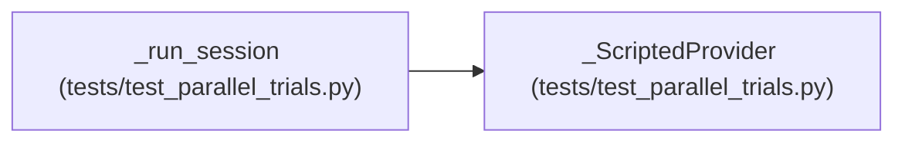

# _ScriptedProvider

**Location:** `tests/test_parallel_trials.py:159`
**Kind:** Class
**Bases:** —
**Module:** [test_parallel_trials](../modules/test_parallel_trials.md)

## Description

Issues two sanctioned eval commands in one turn, then terminates.

## Attributes

*No annotated attributes found.*

## Methods

| Method | Signature | Decorators | Description |
|--------|-----------|------------|-------------|
| `__init__` | `(commands: list[str]) -> None` | — | — |
| `messages_create` | *(async)* `(*, model, system, messages, tools, max_tokens, temperature = None, stop_sequences = None) -> ProviderResponse` | — | — |
| `complete` | *(async)* `(*, model, prompt, max_tokens, system = None) -> str` | — | — |
| `estimate_cost` | `(model, usage) -> float` | — | — |
| `capabilities` | `() -> ProviderCapabilities` | — | — |
| `classify_error` | `(exc: Exception) -> ErrorClass` | — | — |

## Relationships

<!-- Auto-generated relationship summary. Do not edit by hand. -->

### Summary

| Module | Methods | Attributes |
|---|---:|---|
| [test_parallel_trials](../modules/test_parallel_trials.md) | 6 | — |

### References

| Reference | Kind | Source | Call sites |
|---|---|---|---:|
| `_run_session` | call | [test_parallel_trials](../modules/test_parallel_trials.md) | 1 |
