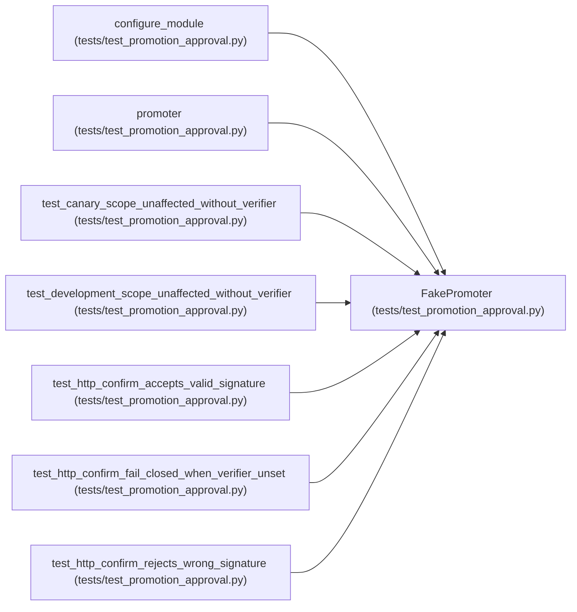

# FakePromoter

**Location:** `tests/test_promotion_approval.py:129`
**Kind:** Class
**Bases:** —
**Module:** [test_promotion_approval](../modules/test_promotion_approval.md)

## Description

Records confirm() invocations so tests can assert it was/wasn't reached.

## Attributes

*No annotated attributes found.*

## Methods

| Method | Signature | Decorators | Description |
|--------|-----------|------------|-------------|
| `__init__` | `() -> None` | — | — |
| `confirm` | *(async)* `(research_id: str, **kwargs)` | — | — |
| `preview` | *(async)* `(research_id: str, **kwargs)` | — | — |

## Relationships

<!-- Auto-generated relationship summary. Do not edit by hand. -->

### Summary

| Module | Methods | Attributes |
|---|---:|---|
| [test_promotion_approval](../modules/test_promotion_approval.md) | 3 | — |

### References

| Reference | Kind | Source | Call sites |
|---|---|---|---:|
| `configure_module` | call | [test_promotion_approval](../modules/test_promotion_approval.md) | 1 |
| `promoter` | type_reference | [test_promotion_approval](../modules/test_promotion_approval.md) | — |
| `test_canary_scope_unaffected_without_verifier` | type_reference | [test_promotion_approval](../modules/test_promotion_approval.md) | — |
| `test_development_scope_unaffected_without_verifier` | type_reference | [test_promotion_approval](../modules/test_promotion_approval.md) | — |
| `test_http_confirm_accepts_valid_signature` | type_reference | [test_promotion_approval](../modules/test_promotion_approval.md) | — |
| `test_http_confirm_fail_closed_when_verifier_unset` | type_reference | [test_promotion_approval](../modules/test_promotion_approval.md) | — |
| `test_http_confirm_rejects_wrong_signature` | type_reference | [test_promotion_approval](../modules/test_promotion_approval.md) | — |
