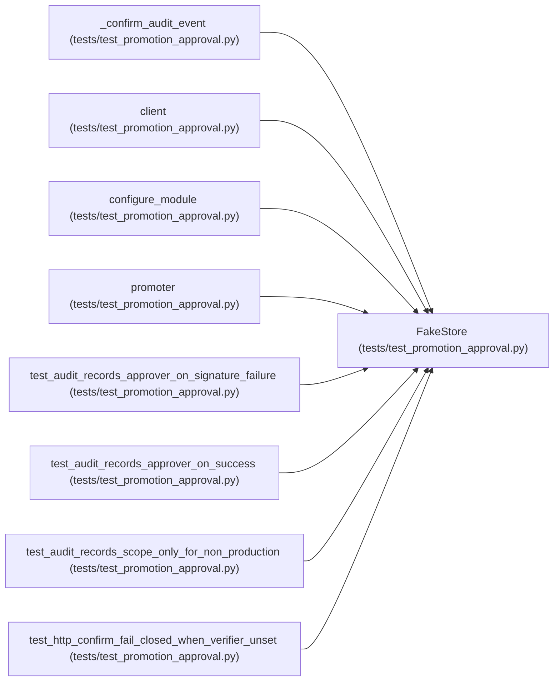

# FakeStore

**Location:** `tests/test_promotion_approval.py:110`
**Kind:** Class
**Bases:** —
**Module:** [test_promotion_approval](../modules/test_promotion_approval.md)

## Description

Captures audit events so AC #4 can inspect the recorded approver.

## Attributes

*No annotated attributes found.*

## Methods

| Method | Signature | Decorators | Description |
|--------|-----------|------------|-------------|
| `__init__` | `() -> None` | — | — |
| `list_promotions` | *(async)* `(**kwargs)` | — | — |
| `record_audit_event` | *(async)* `(**kwargs)` | — | — |

## Relationships

<!-- Auto-generated relationship summary. Do not edit by hand. -->

### Summary

| Module | Methods | Attributes |
|---|---:|---|
| [test_promotion_approval](../modules/test_promotion_approval.md) | 3 | — |

### References

| Reference | Kind | Source | Call sites |
|---|---|---|---:|
| `_confirm_audit_event` | type_reference | [test_promotion_approval](../modules/test_promotion_approval.md) | — |
| `client` | type_reference | [test_promotion_approval](../modules/test_promotion_approval.md) | — |
| `configure_module` | call | [test_promotion_approval](../modules/test_promotion_approval.md) | 1 |
| `promoter` | type_reference | [test_promotion_approval](../modules/test_promotion_approval.md) | — |
| `test_audit_records_approver_on_signature_failure` | type_reference | [test_promotion_approval](../modules/test_promotion_approval.md) | — |
| `test_audit_records_approver_on_success` | type_reference | [test_promotion_approval](../modules/test_promotion_approval.md) | — |
| `test_audit_records_scope_only_for_non_production` | type_reference | [test_promotion_approval](../modules/test_promotion_approval.md) | — |
| `test_http_confirm_fail_closed_when_verifier_unset` | type_reference | [test_promotion_approval](../modules/test_promotion_approval.md) | — |
