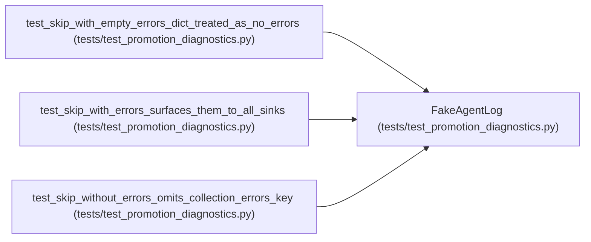

# FakeAgentLog

**Location:** `tests/test_promotion_diagnostics.py:40`
**Kind:** Class
**Bases:** —
**Module:** [test_promotion_diagnostics](../modules/test_promotion_diagnostics.md)

## Description

_Auto-generated from `FakeAgentLog` in `tests/test_promotion_diagnostics.py`._

## Attributes

*No annotated attributes found.*

## Methods

| Method | Signature | Decorators | Description |
|--------|-----------|------------|-------------|
| `__init__` | `() -> None` | — | — |
| `append` | *(async)* `(level: str, message: str) -> None` | — | — |

## Relationships

<!-- Auto-generated relationship summary. Do not edit by hand. -->

### Summary

| Module | Methods | Attributes |
|---|---:|---|
| [test_promotion_diagnostics](../modules/test_promotion_diagnostics.md) | 2 | — |

### References

| Reference | Kind | Source | Call sites |
|---|---|---|---:|
| `test_skip_with_empty_errors_dict_treated_as_no_errors` | call | [test_promotion_diagnostics](../modules/test_promotion_diagnostics.md) | 1 |
| `test_skip_with_errors_surfaces_them_to_all_sinks` | call | [test_promotion_diagnostics](../modules/test_promotion_diagnostics.md) | 1 |
| `test_skip_without_errors_omits_collection_errors_key` | call | [test_promotion_diagnostics](../modules/test_promotion_diagnostics.md) | 1 |
