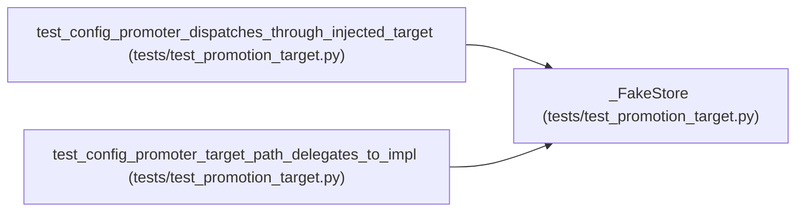

# _FakeStore

**Location:** `tests/test_promotion_target.py:143`
**Kind:** Class
**Bases:** —
**Module:** [test_promotion_target](../modules/test_promotion_target.md)

## Description

_Auto-generated from `_FakeStore` in `tests/test_promotion_target.py`._

## Attributes

*No annotated attributes found.*

## Methods

*No public methods. Inherits from base classes.*

## Relationships

<!-- Auto-generated relationship summary. Do not edit by hand. -->

### Summary

| Module | Methods | Attributes |
|---|---:|---|
| [test_promotion_target](../modules/test_promotion_target.md) | 0 | — |

### References

| Reference | Kind | Source | Call sites |
|---|---|---|---:|
| `test_config_promoter_dispatches_through_injected_target` | call | [test_promotion_target](../modules/test_promotion_target.md) | 1 |
| `test_config_promoter_target_path_delegates_to_impl` | call | [test_promotion_target](../modules/test_promotion_target.md) | 1 |
