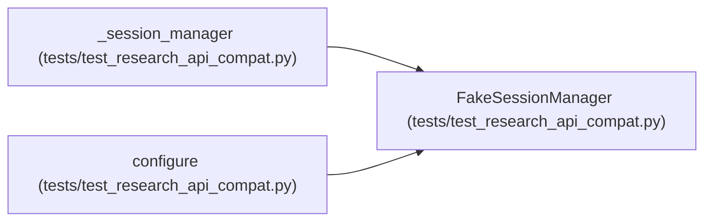

# FakeSessionManager

**Location:** `tests/test_research_api_compat.py:29`
**Kind:** Class
**Bases:** —
**Module:** [test_research_api_compat](../modules/test_research_api_compat.md)

## Description

Minimal stub — returns a canned session dict for start_session.

## Attributes

| Name | Type | Default | Description |
|------|------|---------|-------------|
| `_active_pipelines` | `dict[str, object]` | `{}` | — |

## Methods

| Method | Signature | Decorators | Description |
|--------|-----------|------------|-------------|
| `__init__` | `() -> None` | — | — |
| `start_session` | *(async)* `(**kwargs: Any) -> Dict[str, Any]` | — | — |
| `start_pipeline` | *(async)* `(**kwargs: Any) -> Dict[str, Any]` | — | — |

## Relationships

<!-- Auto-generated relationship summary. Do not edit by hand. -->

### Summary

| Module | Methods | Attributes |
|---|---:|---|
| [test_research_api_compat](../modules/test_research_api_compat.md) | 3 | `_active_pipelines` |

### References

| Reference | Kind | Source | Call sites |
|---|---|---|---:|
| `_session_manager` | type_reference | [test_research_api_compat](../modules/test_research_api_compat.md) | — |
| `configure` | call | [test_research_api_compat](../modules/test_research_api_compat.md) | 1 |
