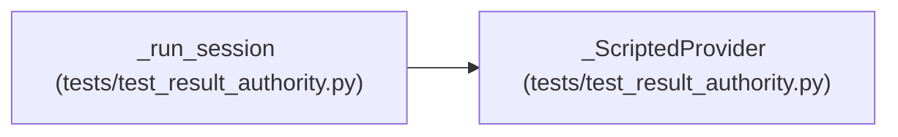

# _ScriptedProvider

**Location:** `tests/test_result_authority.py:75`
**Kind:** Class
**Bases:** —
**Module:** [test_result_authority](../modules/test_result_authority.md)

## Description

Emits a fixed sequence of turns, then terminates.

## Attributes

*No annotated attributes found.*

## Methods

| Method | Signature | Decorators | Description |
|--------|-----------|------------|-------------|
| `__init__` | `(turns: list[_Turn]) -> None` | — | — |
| `messages_create` | *(async)* `(*, model, system, messages, tools, max_tokens, temperature = None, stop_sequences = None)` | — | — |
| `complete` | *(async)* `(*, model, prompt, max_tokens, system = None) -> str` | — | — |
| `estimate_cost` | `(model, usage) -> float` | — | — |
| `capabilities` | `()` | — | — |
| `classify_error` | `(exc)` | — | — |

## Relationships

<!-- Auto-generated relationship summary. Do not edit by hand. -->

### Summary

| Module | Methods | Attributes |
|---|---:|---|
| [test_result_authority](../modules/test_result_authority.md) | 6 | — |

### References

| Reference | Kind | Source | Call sites |
|---|---|---|---:|
| `_run_session` | call | [test_result_authority](../modules/test_result_authority.md) | 1 |
