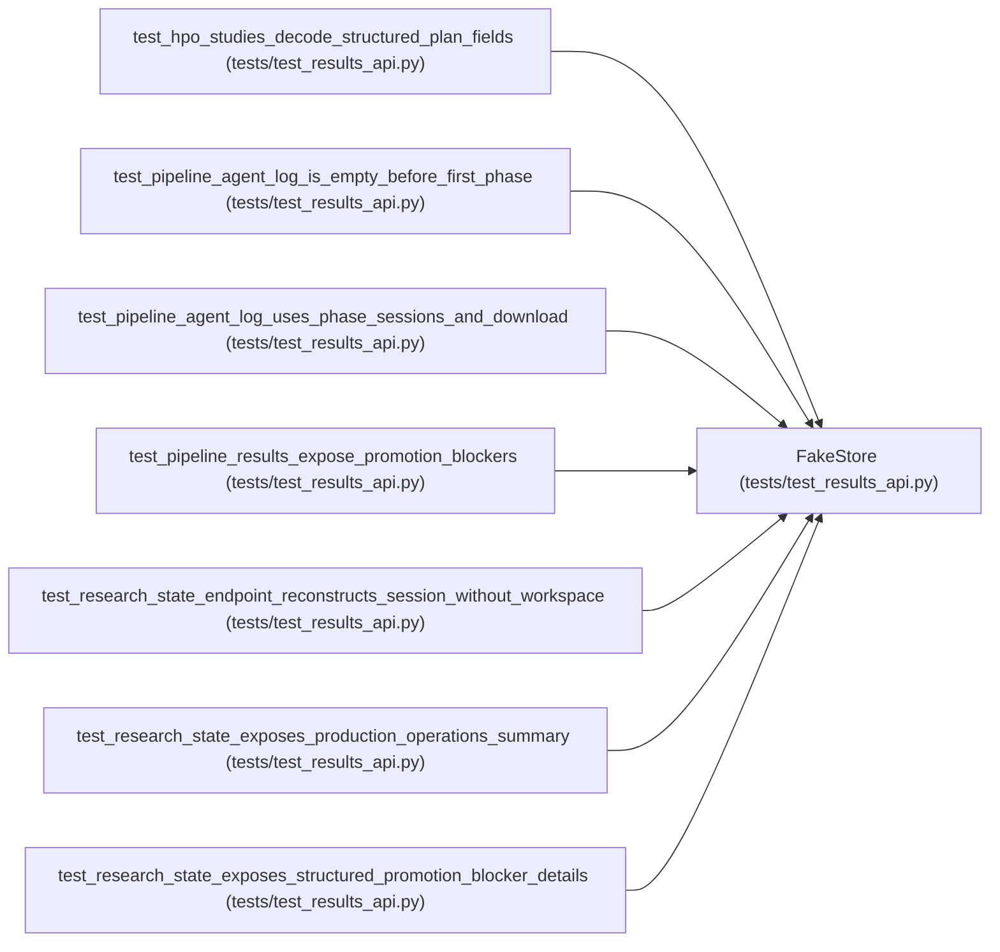

# FakeStore

**Location:** `tests/test_results_api.py:11`
**Kind:** Class
**Bases:** —
**Module:** [test_results_api](../modules/test_results_api.md)

## Description

_Auto-generated from `FakeStore` in `tests/test_results_api.py`._

## Attributes

*No annotated attributes found.*

## Methods

| Method | Signature | Decorators | Description |
|--------|-----------|------------|-------------|
| `__init__` | `() -> None` | — | — |
| `get_pipeline` | *(async)* `(pipeline_id: str)` | — | — |
| `get_session` | *(async)* `(session_id: str)` | — | — |
| `get_iterations` | *(async)* `(research_id: str)` | — | — |
| `get_iteration` | *(async)* `(research_id: str, iteration: int)` | — | — |
| `get_best_iteration` | *(async)* `(research_id, **kwargs)` | — | — |
| `get_hpo_studies` | *(async)* `(research_id: str)` | — | — |
| `get_planned_trials` | *(async)* `(research_id: str)` | — | — |
| `list_promotions` | *(async)* `()` | — | — |
| `list_audit_events` | *(async)* `(*, limit: int = 100, action: str \| None = None, research_id: str \| None = None, pipeline_id: str \| None = None)` | — | — |

## Relationships

<!-- Auto-generated relationship summary. Do not edit by hand. -->

### Summary

| Module | Methods | Attributes |
|---|---:|---|
| [test_results_api](../modules/test_results_api.md) | 10 | — |

### References

| Reference | Kind | Source | Call sites |
|---|---|---|---:|
| `test_hpo_studies_decode_structured_plan_fields` | call | [test_results_api](../modules/test_results_api.md) | 1 |
| `test_pipeline_agent_log_is_empty_before_first_phase` | call | [test_results_api](../modules/test_results_api.md) | 1 |
| `test_pipeline_agent_log_uses_phase_sessions_and_download` | call | [test_results_api](../modules/test_results_api.md) | 1 |
| `test_pipeline_results_expose_promotion_blockers` | call | [test_results_api](../modules/test_results_api.md) | 1 |
| `test_research_state_endpoint_reconstructs_session_without_workspace` | call | [test_results_api](../modules/test_results_api.md) | 1 |
| `test_research_state_exposes_production_operations_summary` | call | [test_results_api](../modules/test_results_api.md) | 1 |
| `test_research_state_exposes_structured_promotion_blocker_details` | call | [test_results_api](../modules/test_results_api.md) | 1 |
