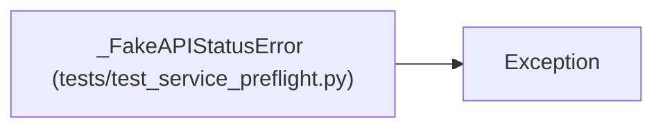

# _FakeAPIStatusError

**Location:** `tests/test_service_preflight.py:21`
**Kind:** Class
**Bases:** `Exception`
**Module:** [test_service_preflight](../modules/test_service_preflight.md)

## Description

_Auto-generated from `_FakeAPIStatusError` in `tests/test_service_preflight.py`._

## Attributes

*No annotated attributes found.*

## Methods

*No public methods. Inherits from base classes.*

## Relationships

<!-- Auto-generated relationship summary. Do not edit by hand. -->

### Summary

| Module | Methods | Attributes |
|---|---:|---|
| [test_service_preflight](../modules/test_service_preflight.md) | 0 | — |

### Structure

| Kind | Entity | Module |
|---|---|---|
| Base | `Exception` | — |
