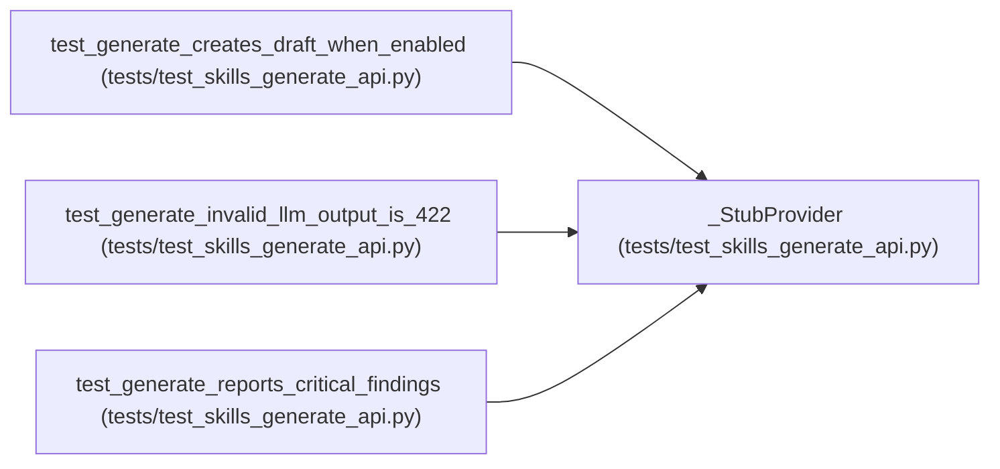

# _StubProvider

**Location:** `tests/test_skills_generate_api.py:40`
**Kind:** Class
**Bases:** —
**Module:** [test_skills_generate_api](../modules/test_skills_generate_api.md)

## Description

_Auto-generated from `_StubProvider` in `tests/test_skills_generate_api.py`._

## Attributes

*No annotated attributes found.*

## Methods

| Method | Signature | Decorators | Description |
|--------|-----------|------------|-------------|
| `__init__` | `(response: str) -> None` | — | — |
| `complete` | *(async)* `(*, model, prompt, max_tokens, system = None) -> str` | — | — |

## Relationships

<!-- Auto-generated relationship summary. Do not edit by hand. -->

### Summary

| Module | Methods | Attributes |
|---|---:|---|
| [test_skills_generate_api](../modules/test_skills_generate_api.md) | 2 | — |

### References

| Reference | Kind | Source | Call sites |
|---|---|---|---:|
| `test_generate_creates_draft_when_enabled` | call | [test_skills_generate_api](../modules/test_skills_generate_api.md) | 1 |
| `test_generate_invalid_llm_output_is_422` | call | [test_skills_generate_api](../modules/test_skills_generate_api.md) | 1 |
| `test_generate_reports_critical_findings` | call | [test_skills_generate_api](../modules/test_skills_generate_api.md) | 1 |
