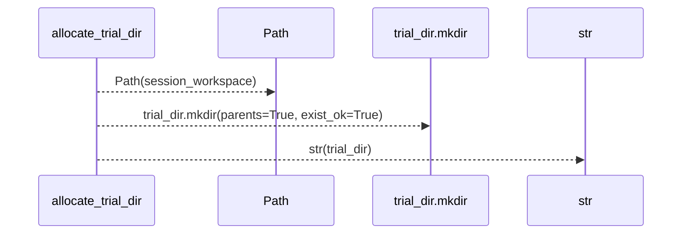
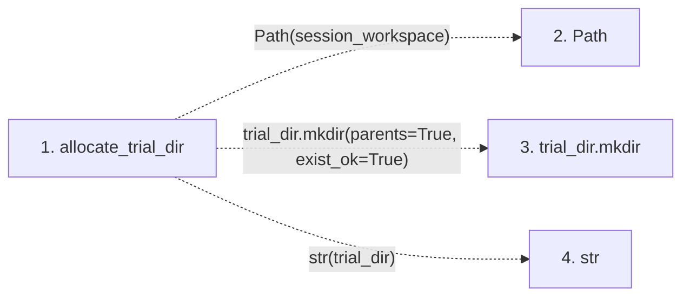

# allocate_trial_dir

**Entry point:** `allocate_trial_dir` (`api`)
**Source:** [trial_workspace](../modules/trial_workspace.md)
**Modules touched:** [trial_workspace](../modules/trial_workspace.md)

## Call sequence

> Static overview in presentation order, not runtime execution order. Arrows retain captured callers; representative internal continuations and boundary examples precede repeated helper detail.

<!-- Auto-generated from static call edges. Dashed arrows are external or unresolved calls. Reviewed runtime conditions and side effects belong in Behavior. -->

> Call sequence diagram shows 3 of 3 interactions; 0 omitted to keep the visualization within the 30-interaction and generated-diagram limits, with uncertain identities omitted rather than inferred.

> Captured boundary calls: external 2 of 2 (0 omitted); unresolved 1 of 1 (0 omitted). These counts cover the captured static trace.
> Detailed flow queries retain their own coverage and limits; omitted paths may execute at runtime.

## Data flow

<!-- Auto-generated static analysis. Treat values and boundaries as best-effort hints, not runtime proof. -->

### Step data

| Step | Inputs | Reads | Writes | Returns |
|---|---|---|---|---|
| `allocate_trial_dir` | `session_workspace: str`, `turn: int`, `seq: int` | `TRIALS_DIRNAME` | - | `str(...)` |
| `Path` | - | - | - | - |
| `trial_dir.mkdir` | - | - | - | - |
| `str` | - | - | - | - |

### Call data

| From | To | Line | Call |
|---|---|---:|---|
| allocate_trial_dir | Path | 102 | `Path(session_workspace)` |
| allocate_trial_dir | trial_dir.mkdir | 104 | `trial_dir.mkdir(parents=True, exist_ok=True)` |
| allocate_trial_dir | str | 105 | `str(trial_dir)` |

### Boundary effects

*No boundary effects detected.*

### Static analysis gaps

| Kind | Step | Target | Line |
|---|---|---|---:|
| unresolved_call | `allocate_trial_dir` | `trial_dir.mkdir` | 104 |

## Behavior

This flow starts at `allocate_trial_dir` and is classified as `api`. The generated call and data-flow sections are bounded static projections; runtime conditions and side effects require source-level confirmation.
