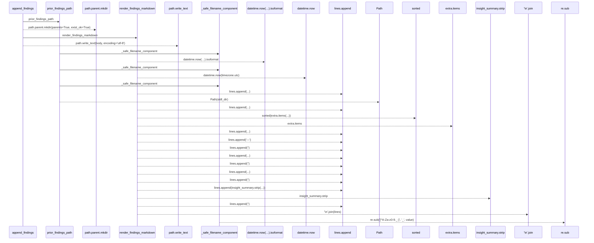
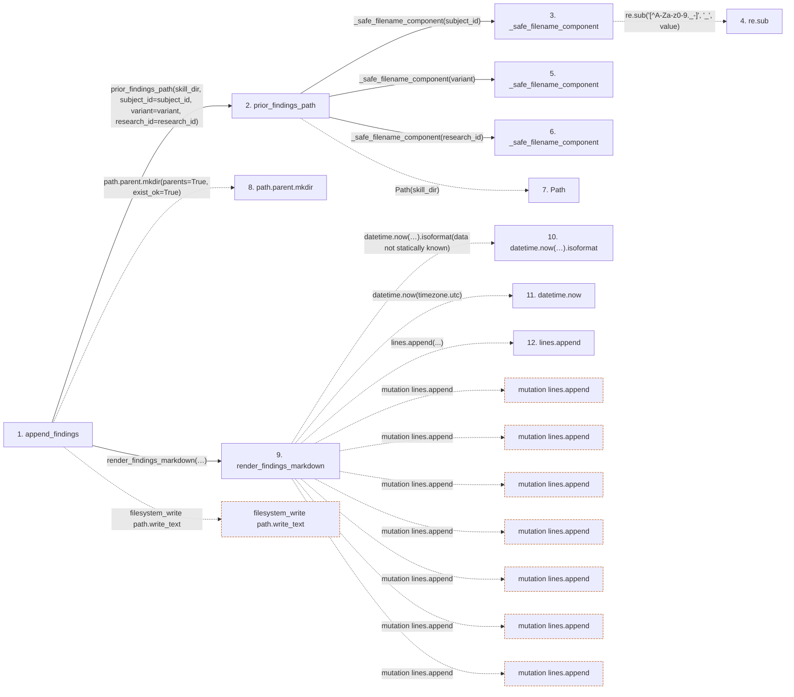

# append_findings

**Entry point:** `append_findings` (`api`)
**Source:** [insights_feedback](../modules/insights_feedback.md)
**Modules touched:** [insights_feedback](../modules/insights_feedback.md)

## Call sequence

> Static overview in presentation order, not runtime execution order. Arrows retain captured callers; representative internal continuations and boundary examples precede repeated helper detail.

<!-- Auto-generated from static call edges. Dashed arrows are external or unresolved calls. Reviewed runtime conditions and side effects belong in Behavior. -->

> Call sequence diagram shows 26 of 26 interactions; 0 omitted to keep the visualization within the 30-interaction and generated-diagram limits, with uncertain identities omitted rather than inferred.

> Captured boundary calls: external 4 of 4 (0 omitted); unresolved 17 of 17 (0 omitted). These counts cover the captured static trace.
> Detailed flow queries retain their own coverage and limits; omitted paths may execute at runtime.

## Data flow

<!-- Auto-generated static analysis. Treat values and boundaries as best-effort hints, not runtime proof. -->

### Step data

| Step | Inputs | Reads | Writes | Returns |
|---|---|---|---|---|
| `append_findings` | `skill_dir: Path`, `skill_id: str`, `subject_id: str`, `variant: str`, `research_id: str`, `insight_summary: str`, `primary_metric: Optional[float]`, `metric_name: Optional[str]` | - | - | `path` |
| `prior_findings_path` | `skill_dir: Path`, `subject_id: str`, `variant: str`, `research_id: str` | - | - | `...` |
| `_safe_filename_component` | `value: str` | - | - | `...` |
| `re.sub` | - | - | - | - |
| `_safe_filename_component` | `value: str` | - | - | `...` |
| `_safe_filename_component` | `value: str` | - | - | `...` |
| `Path` | - | - | - | - |
| `path.parent.mkdir` | - | - | - | - |
| `render_findings_markdown` | `skill_id: str`, `subject_id: str`, `variant: str`, `research_id: str`, `insight_summary: str`, `primary_metric: Optional[float]`, `metric_name: Optional[str]`, `iterations: int` | - | - | `...` |
| `datetime.now(…).isoformat` | - | - | - | - |
| `datetime.now` | - | - | - | - |
| `lines.append` | - | - | - | - |

### Call data

| From | To | Line | Call |
|---|---|---:|---|
| append_findings | prior_findings_path | 126 | `prior_findings_path(skill_dir, subject_id=subject_id, variant=variant, research_id=research_id)` |
| prior_findings_path | _safe_filename_component | 47 | `_safe_filename_component(subject_id)` |
| _safe_filename_component | re.sub | 32 | `re.sub('[^A-Za-z0-9._-]', '_', value)` |
| prior_findings_path | _safe_filename_component | 48 | `_safe_filename_component(variant)` |
| prior_findings_path | _safe_filename_component | 49 | `_safe_filename_component(research_id)` |
| prior_findings_path | Path | 51 | `Path(skill_dir)` |
| append_findings | path.parent.mkdir | 129 | `path.parent.mkdir(parents=True, exist_ok=True)` |
| append_findings | render_findings_markdown | 130 | `render_findings_markdown(skill_id=skill_id, subject_id=subject_id, variant=variant, research_id=research_id, insight_summary=insight_summary, primary_metric=primary_metric, metric_name=metric_name, iterations=iterations, completed_at=completed_at, extra=extra)` |
| render_findings_markdown | datetime.now(…).isoformat | 78 | `datetime.now(timezone.utc).isoformat(data not statically known)` |
| render_findings_markdown | datetime.now | 78 | `datetime.now(timezone.utc)` |
| render_findings_markdown | lines.append | 89 | `lines.append(...)` |

### Boundary effects

| Kind | Target | Step | Line |
|---|---|---|---:|
| filesystem_write | `path.write_text` | `append_findings` | 142 |
| mutation | `lines.append` | `render_findings_markdown` | 89 |
| mutation | `lines.append` | `render_findings_markdown` | 91 |
| mutation | `lines.append` | `render_findings_markdown` | 94 |
| mutation | `lines.append` | `render_findings_markdown` | 95 |
| mutation | `lines.append` | `render_findings_markdown` | 96 |
| mutation | `lines.append` | `render_findings_markdown` | 97 |
| mutation | `lines.append` | `render_findings_markdown` | 98 |

### Static analysis gaps

| Kind | Step | Target | Line |
|---|---|---|---:|
| external_call | `_safe_filename_component` | `re.sub` | 32 |
| unresolved_call | `append_findings` | `path.parent.mkdir` | 129 |
| unresolved_call | `render_findings_markdown` | `datetime.now(timezone.utc).isoformat` | 78 |
| external_call | `render_findings_markdown` | `datetime.now` | 78 |
| step_limit | `append_findings` | `first 12 steps` | 0 |

## Behavior

This flow starts at `append_findings` and is classified as `api`. The generated call and data-flow sections are bounded static projections; runtime conditions and side effects require source-level confirmation.
