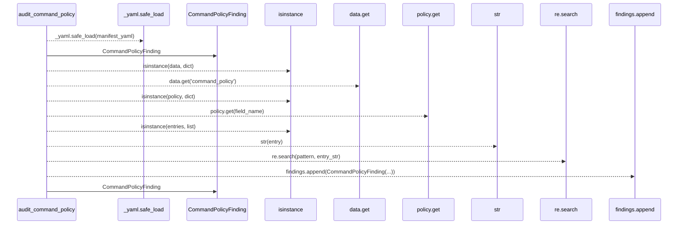
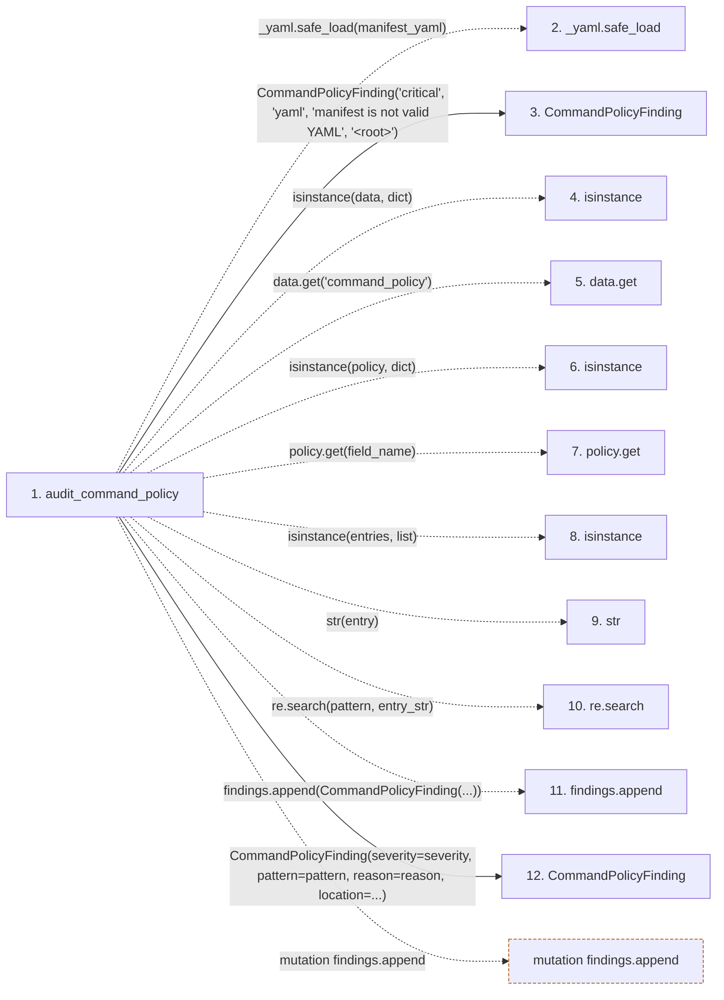

# audit_command_policy

**Entry point:** `audit_command_policy` (`api`)
**Source:** [skill_generator](../modules/skill_generator.md)
**Modules touched:** [skill_generator](../modules/skill_generator.md)

## Call sequence

> Static overview in presentation order, not runtime execution order. Arrows retain captured callers; representative internal continuations and boundary examples precede repeated helper detail.

<!-- Auto-generated from static call edges. Dashed arrows are external or unresolved calls. Reviewed runtime conditions and side effects belong in Behavior. -->

> Call sequence diagram shows 11 of 11 interactions; 0 omitted to keep the visualization within the 30-interaction and generated-diagram limits, with uncertain identities omitted rather than inferred.

> Captured boundary calls: external 6 of 6 (0 omitted); unresolved 3 of 3 (0 omitted). These counts cover the captured static trace.
> Detailed flow queries retain their own coverage and limits; omitted paths may execute at runtime.

## Data flow

<!-- Auto-generated static analysis. Treat values and boundaries as best-effort hints, not runtime proof. -->

### Step data

| Step | Inputs | Reads | Writes | Returns |
|---|---|---|---|---|
| `audit_command_policy` | `manifest_yaml: str` | `_OVERPERMISSIVE_PATTERNS` | - | `[...]`, `findings`, `findings`, `findings` |
| `_yaml.safe_load` | - | - | - | - |
| `CommandPolicyFinding` | - | - | - | - |
| `isinstance` | - | - | - | - |
| `data.get` | - | - | - | - |
| `isinstance` | - | - | - | - |
| `policy.get` | - | - | - | - |
| `isinstance` | - | - | - | - |
| `str` | - | - | - | - |
| `re.search` | - | - | - | - |
| `findings.append` | - | - | - | - |
| `CommandPolicyFinding` | - | - | - | - |

### Call data

| From | To | Line | Call |
|---|---|---:|---|
| audit_command_policy | _yaml.safe_load | 117 | `_yaml.safe_load(manifest_yaml)` |
| audit_command_policy | CommandPolicyFinding | 119 | `CommandPolicyFinding('critical', 'yaml', 'manifest is not valid YAML', '<root>')` |
| audit_command_policy | isinstance | 120 | `isinstance(data, dict)` |
| audit_command_policy | data.get | 122 | `data.get('command_policy')` |
| audit_command_policy | isinstance | 123 | `isinstance(policy, dict)` |
| audit_command_policy | policy.get | 129 | `policy.get(field_name)` |
| audit_command_policy | isinstance | 130 | `isinstance(entries, list)` |
| audit_command_policy | str | 133 | `str(entry)` |
| audit_command_policy | re.search | 135 | `re.search(pattern, entry_str)` |
| audit_command_policy | findings.append | 136 | `findings.append(CommandPolicyFinding(...))` |
| audit_command_policy | CommandPolicyFinding | 137 | `CommandPolicyFinding(severity=severity, pattern=pattern, reason=reason, location=...)` |

### Boundary effects

| Kind | Target | Step | Line |
|---|---|---|---:|
| mutation | `findings.append` | `audit_command_policy` | 136 |

### Static analysis gaps

| Kind | Step | Target | Line |
|---|---|---|---:|
| external_call | `audit_command_policy` | `_yaml.safe_load` | 117 |
| external_call | `audit_command_policy` | `isinstance` | 120 |
| unresolved_call | `audit_command_policy` | `data.get` | 122 |
| external_call | `audit_command_policy` | `isinstance` | 123 |
| unresolved_call | `audit_command_policy` | `policy.get` | 129 |
| external_call | `audit_command_policy` | `isinstance` | 130 |
| external_call | `audit_command_policy` | `re.search` | 135 |

## Behavior

This flow starts at `audit_command_policy` and is classified as `api`. The generated call and data-flow sections are bounded static projections; runtime conditions and side effects require source-level confirmation.
