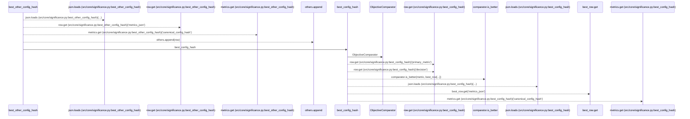
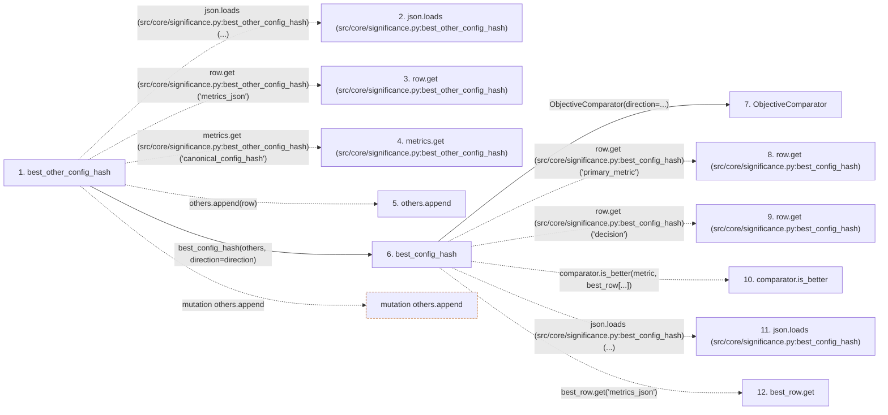

# best_other_config_hash

**Entry point:** `best_other_config_hash` (`api`)
**Source:** [significance](../modules/significance.md)
**Modules touched:** [objective_comparator](../modules/objective_comparator.md), [significance](../modules/significance.md)

## Call sequence

> Static overview in presentation order, not runtime execution order. Arrows retain captured callers; representative internal continuations and boundary examples precede repeated helper detail.

<!-- Auto-generated from static call edges. Dashed arrows are external or unresolved calls. Reviewed runtime conditions and side effects belong in Behavior. -->

> Call sequence diagram shows 12 of 12 interactions; 0 omitted to keep the visualization within the 30-interaction and generated-diagram limits, with uncertain identities omitted rather than inferred.

> Captured boundary calls: external 2 of 2 (0 omitted); unresolved 8 of 8 (0 omitted). These counts cover the captured static trace.
> Detailed flow queries retain their own coverage and limits; omitted paths may execute at runtime.

## Data flow

<!-- Auto-generated static analysis. Treat values and boundaries as best-effort hints, not runtime proof. -->

### Step data

| Step | Inputs | Reads | Writes | Returns |
|---|---|---|---|---|
| `best_other_config_hash` | `rows: Sequence[dict]`, `exclude_hash: Optional[str]`, `direction: str` | - | - | `best_config_hash(...)` |
| `json.loads (src/core/significance.py:best_other_config_hash)` | - | - | - | - |
| `row.get (src/core/significance.py:best_other_config_hash)` | - | - | - | - |
| `metrics.get (src/core/significance.py:best_other_config_hash)` | - | - | - | - |
| `others.append` | - | - | - | - |
| `best_config_hash` | `rows: Sequence[dict]`, `direction: str` | - | - | `None`, `None`, `...` |
| `ObjectiveComparator` | - | - | - | - |
| `row.get (src/core/significance.py:best_config_hash)` | - | - | - | - |
| `row.get (src/core/significance.py:best_config_hash)` | - | - | - | - |
| `comparator.is_better` | - | - | - | - |
| `json.loads (src/core/significance.py:best_config_hash)` | - | - | - | - |
| `best_row.get` | - | - | - | - |

### Call data

| From | To | Line | Call |
|---|---|---:|---|
| best_other_config_hash | json.loads (src/core/significance.py:best_other_config_hash) | 181 | `json.loads(...)` |
| best_other_config_hash | row.get (src/core/significance.py:best_other_config_hash) | 181 | `row.get('metrics_json')` |
| best_other_config_hash | metrics.get (src/core/significance.py:best_other_config_hash) | 184 | `metrics.get('canonical_config_hash')` |
| best_other_config_hash | others.append | 185 | `others.append(row)` |
| best_other_config_hash | best_config_hash | 186 | `best_config_hash(others, direction=direction)` |
| best_config_hash | ObjectiveComparator | 141 | `ObjectiveComparator(direction=...)` |
| best_config_hash | row.get (src/core/significance.py:best_config_hash) | 146 | `row.get('primary_metric')` |
| best_config_hash | row.get (src/core/significance.py:best_config_hash) | 147 | `row.get('decision')` |
| best_config_hash | comparator.is_better | 152 | `comparator.is_better(metric, best_row[...])` |
| best_config_hash | json.loads (src/core/significance.py:best_config_hash) | 159 | `json.loads(...)` |
| best_config_hash | best_row.get | 159 | `best_row.get('metrics_json')` |

### Boundary effects

| Kind | Target | Step | Line |
|---|---|---|---:|
| mutation | `others.append` | `best_other_config_hash` | 185 |

### Static analysis gaps

| Kind | Step | Target | Line |
|---|---|---|---:|
| external_call | `best_other_config_hash` | `json.loads` | 181 |
| unresolved_call | `best_other_config_hash` | `row.get` | 181 |
| unresolved_call | `best_other_config_hash` | `metrics.get` | 184 |
| unresolved_call | `best_config_hash` | `row.get` | 146 |
| unresolved_call | `best_config_hash` | `row.get` | 147 |
| unresolved_call | `best_config_hash` | `comparator.is_better` | 152 |
| external_call | `best_config_hash` | `json.loads` | 159 |
| unresolved_call | `best_config_hash` | `best_row.get` | 159 |
| step_limit | `best_other_config_hash` | `first 12 steps` | 0 |

## Behavior

This flow starts at `best_other_config_hash` and is classified as `api`. The generated call and data-flow sections are bounded static projections; runtime conditions and side effects require source-level confirmation.
