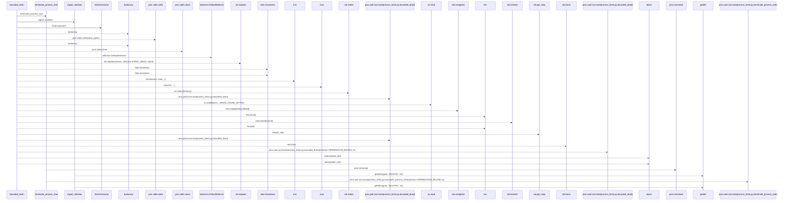
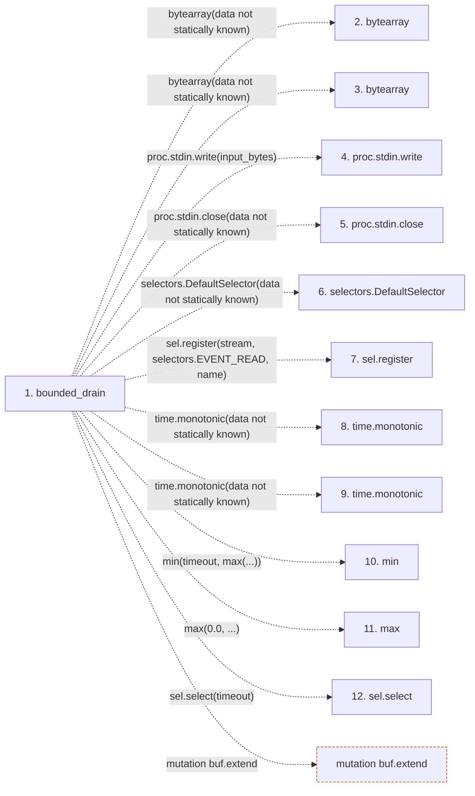

# bounded_drain

**Entry point:** `bounded_drain` (`api`)
**Source:** [process_limits](../modules/process_limits.md)
**Modules touched:** [process_limits](../modules/process_limits.md)

## Call sequence

> Static overview in presentation order, not runtime execution order. Arrows retain captured callers; representative internal continuations and boundary examples precede repeated helper detail.

<!-- Auto-generated from static call edges. Dashed arrows are external or unresolved calls. Reviewed runtime conditions and side effects belong in Behavior. -->

> Call sequence diagram shows 30 of 44 interactions; 14 omitted to keep the visualization within the 30-interaction and generated-diagram limits, with uncertain identities omitted rather than inferred.

> Captured boundary calls: external 14 of 14 (0 omitted); unresolved 13 of 26 (13 omitted). These counts cover the captured static trace.

Omitted captured detail, grouped by actual caller occurrence and target module:

| Caller | Parent step | Target module | Kind | Omitted interactions |
| --- | --- | --- | --- | --- |
| `src/core/process_limits.py:terminate_process_tree` | 22 | - | unresolved | 13 |
| `src/core/process_limits.py:bounded_drain` | 1 | [src/core/process_limits.py](../modules/process_limits.md) | internal | 1 |
> Detailed flow queries retain their own coverage and limits; omitted paths may execute at runtime.

## Data flow

<!-- Auto-generated static analysis. Treat values and boundaries as best-effort hints, not runtime proof. -->

### Step data

| Step | Inputs | Reads | Writes | Returns |
|---|---|---|---|---|
| `bounded_drain` | `proc: 'subprocess.Popen'`, `input_bytes: Optional[bytes]`, `caps: ProcessResourceCaps`, `guard: Optional[TreeResourceGuard]` | `selectors`, `_DRAIN_CHUNK_BYTES`, `TERMINATION_BOUND_S`, `subprocess` | - | `DrainOutcome(...)` |
| `bytearray` | - | - | - | - |
| `bytearray` | - | - | - | - |
| `proc.stdin.write` | - | - | - | - |
| `proc.stdin.close` | - | - | - | - |
| `selectors.DefaultSelector` | - | - | - | - |
| `sel.register` | - | - | - | - |
| `time.monotonic` | - | - | - | - |
| `time.monotonic` | - | - | - | - |
| `min` | - | - | - | - |
| `max` | - | - | - | - |
| `sel.select` | - | - | - | - |

### Call data

| From | To | Line | Call |
|---|---|---:|---|
| bounded_drain | bytearray | 277 | `bytearray(data not statically known)` |
| bounded_drain | bytearray | 278 | `bytearray(data not statically known)` |
| bounded_drain | proc.stdin.write | 288 | `proc.stdin.write(input_bytes)` |
| bounded_drain | proc.stdin.close | 289 | `proc.stdin.close(data not statically known)` |
| bounded_drain | selectors.DefaultSelector | 293 | `selectors.DefaultSelector(data not statically known)` |
| bounded_drain | sel.register | 296 | `sel.register(stream, selectors.EVENT_READ, name)` |
| bounded_drain | time.monotonic | 298 | `time.monotonic(data not statically known)` |
| bounded_drain | time.monotonic | 305 | `time.monotonic(data not statically known)` |
| bounded_drain | min | 312 | `min(timeout, max(...))` |
| bounded_drain | max | 312 | `max(0.0, ...)` |
| bounded_drain | sel.select | 313 | `sel.select(timeout)` |

### Boundary effects

| Kind | Target | Step | Line |
|---|---|---|---:|
| mutation | `buf.extend` | `bounded_drain` | 336 |

### Static analysis gaps

| Kind | Step | Target | Line |
|---|---|---|---:|
| external_call | `bounded_drain` | `bytearray` | 277 |
| external_call | `bounded_drain` | `bytearray` | 278 |
| unresolved_call | `bounded_drain` | `proc.stdin.write` | 288 |
| unresolved_call | `bounded_drain` | `proc.stdin.close` | 289 |
| external_call | `bounded_drain` | `selectors.DefaultSelector` | 293 |
| unresolved_call | `bounded_drain` | `sel.register` | 296 |
| external_call | `bounded_drain` | `time.monotonic` | 298 |
| external_call | `bounded_drain` | `time.monotonic` | 305 |
| external_call | `bounded_drain` | `min` | 312 |
| external_call | `bounded_drain` | `max` | 312 |
| unresolved_call | `bounded_drain` | `sel.select` | 313 |
| step_limit | `bounded_drain` | `first 12 steps` | 0 |

## Behavior

This flow starts at `bounded_drain` and is classified as `api`. The generated call and data-flow sections are bounded static projections; runtime conditions and side effects require source-level confirmation.
