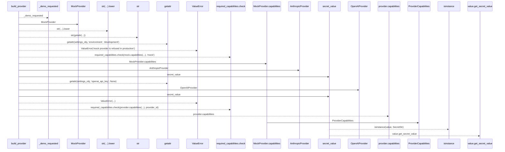
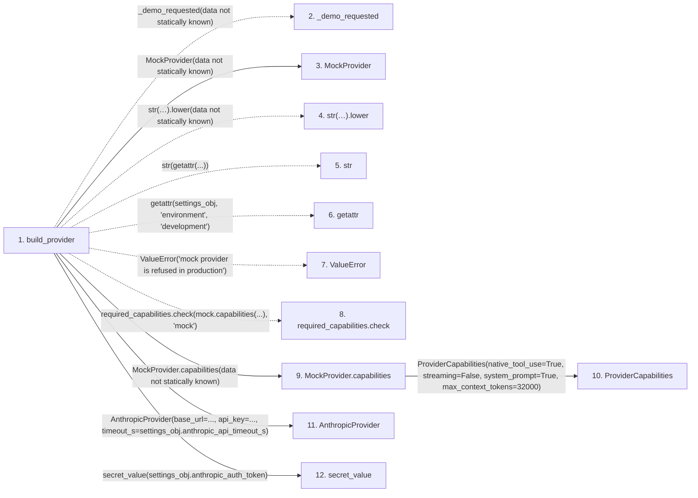

# build_provider

**Entry point:** `build_provider` (`api`)
**Source:** [llm_provider](../modules/llm_provider.md)
**Modules touched:** [config](../modules/config.md), [llm_provider](../modules/llm_provider.md)

## Call sequence

> Static overview in presentation order, not runtime execution order. Arrows retain captured callers; representative internal continuations and boundary examples precede repeated helper detail.

<!-- Auto-generated from static call edges. Dashed arrows are external or unresolved calls. Reviewed runtime conditions and side effects belong in Behavior. -->

> Call sequence diagram shows 19 of 19 interactions; 0 omitted to keep the visualization within the 30-interaction and generated-diagram limits, with uncertain identities omitted rather than inferred.

> Captured boundary calls: external 6 of 6 (0 omitted); unresolved 6 of 6 (0 omitted). These counts cover the captured static trace.
> Detailed flow queries retain their own coverage and limits; omitted paths may execute at runtime.

## Data flow

<!-- Auto-generated static analysis. Treat values and boundaries as best-effort hints, not runtime proof. -->

### Step data

| Step | Inputs | Reads | Writes | Returns |
|---|---|---|---|---|
| `build_provider` | `provider_id: str`, `settings_obj: Any`, `required_capabilities: Optional[RequiredCapabilities]` | - | - | `mock`, `provider` |
| `_demo_requested` | - | - | - | - |
| `MockProvider` | - | - | - | - |
| `str(…).lower` | - | - | - | - |
| `str` | - | - | - | - |
| `getattr` | - | - | - | - |
| `ValueError` | - | - | - | - |
| `required_capabilities.check` | - | - | - | - |
| `MockProvider.capabilities` | - | - | - | `ProviderCapabilities(...)` |
| `ProviderCapabilities` | - | - | - | - |
| `AnthropicProvider` | - | - | - | - |
| `secret_value` | `value: SecretStr \| str \| None` | `SecretStr` | - | `value.get_secret_value(...)`, `value` |

### Call data

| From | To | Line | Call |
|---|---|---:|---|
| build_provider | _demo_requested | 1149 | `_demo_requested(data not statically known)` |
| build_provider | MockProvider | 1150 | `MockProvider(data not statically known)` |
| build_provider | str(…).lower | 1151 | `str(getattr(settings_obj, 'environment', 'development')).lower(data not statically known)` |
| build_provider | str | 1151 | `str(getattr(...))` |
| build_provider | getattr | 1151 | `getattr(settings_obj, 'environment', 'development')` |
| build_provider | ValueError | 1155 | `ValueError('mock provider is refused in production')` |
| build_provider | required_capabilities.check | 1157 | `required_capabilities.check(mock.capabilities(...), 'mock')` |
| build_provider | MockProvider.capabilities | 1157 | `mock.capabilities(data not statically known)` |
| MockProvider.capabilities | ProviderCapabilities | 1044 | `ProviderCapabilities(native_tool_use=True, streaming=False, system_prompt=True, max_context_tokens=32000)` |
| build_provider | AnthropicProvider | 1160 | `AnthropicProvider(base_url=..., api_key=..., timeout_s=settings_obj.anthropic_api_timeout_s)` |
| build_provider | secret_value | 1162 | `secret_value(settings_obj.anthropic_auth_token)` |

### Boundary effects

*No boundary effects detected.*

### Static analysis gaps

| Kind | Step | Target | Line |
|---|---|---|---:|
| unresolved_call | `build_provider` | `_demo_requested` | 1149 |
| unresolved_call | `build_provider` | `str(getattr(settings_obj, 'environment', 'development')).lower` | 1151 |
| external_call | `build_provider` | `getattr` | 1151 |
| external_call | `build_provider` | `ValueError` | 1155 |
| unresolved_call | `build_provider` | `required_capabilities.check` | 1157 |
| step_limit | `build_provider` | `first 12 steps` | 0 |

## Behavior

This flow starts at `build_provider` and is classified as `api`. The generated call and data-flow sections are bounded static projections; runtime conditions and side effects require source-level confirmation.
