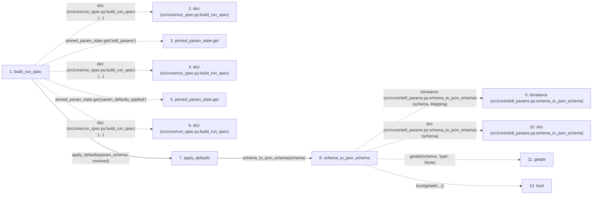

# build_run_spec

**Entry point:** `build_run_spec` (`api`)
**Source:** [run_spec](../modules/run_spec.md)
**Modules touched:** [run_spec](../modules/run_spec.md), [skill_params](../modules/skill_params.md)

## Call sequence

> Static overview in presentation order, not runtime execution order. Arrows retain captured callers; representative internal continuations and boundary examples precede repeated helper detail.

```mermaid
sequenceDiagram
    participant p0 as build_run_spec
    participant p1 as apply_defaults
    participant p2 as split_secret_params
    participant p3 as package_digests
    participant p4 as file_digests
    participant p5 as runtime_identity
    participant p6 as canonical_spec_json
    participant p7 as _apply_defaults_at
    participant p8 as schema_to_json_schema
    participant p9 as is_secret_param_name
    participant p10 as _param_env_var
    participant p11 as dict (src/core/run_spec.py:build_run_spec)
    participant p12 as pinned_param_state.get
    participant p13 as resolved.items
    participant p14 as package.get
    participant p15 as hashlib.sha256(…).hexdigest (src/core/run_spec.py:build_run_spec)
    participant p16 as hashlib.sha256 (src/core/run_spec.py:build_run_spec)
    participant p17 as canonical_spec_json(…).encode
    participant p18 as sorted (src/core/run_spec.py:split_secret_params)
    participant p19 as Path (src/core/run_spec.py:package_digests)
    participant p20 as sorted (src/core/run_spec.py:file_digests)
    participant p21 as platform.python_version
    p0->>p1: apply_defaults
    p0->>p2: split_secret_params
    p0->>p3: package_digests
    p0->>p4: file_digests
    p0->>p5: runtime_identity
    p0->>p6: canonical_spec_json
    p1->>p7: _apply_defaults_at
    p1->>p8: schema_to_json_schema
    p2->>p9: is_secret_param_name
    p2->>p10: _param_env_var
    p0-->>p11: dict (src/core/run_spec.py:build_run_spec)(...)
    p0-->>p12: pinned_param_state.get('skill_params')
    p0-->>p11: dict (src/core/run_spec.py:build_run_spec)(...)
    p0-->>p12: pinned_param_state.get('param_defaults_applied')
    p0-->>p11: dict (src/core/run_spec.py:build_run_spec)(...)
    p0-->>p11: dict (src/core/run_spec.py:build_run_spec)(...)
    p0-->>p13: resolved.items
    p0-->>p11: dict (src/core/run_spec.py:build_run_spec)(objective_policy)
    p0-->>p11: dict (src/core/run_spec.py:build_run_spec)(policy)
    p0-->>p14: package.get('SKILL.yaml')
    p0-->>p11: dict (src/core/run_spec.py:build_run_spec)(effective_config)
    p0-->>p11: dict (src/core/run_spec.py:build_run_spec)(parent_snapshot)
    p0-->>p11: dict (src/core/run_spec.py:build_run_spec)(harness)
    p0-->>p15: hashlib.sha256(…).hexdigest (src/core/run_spec.py:build_run_spec)
    p0-->>p16: hashlib.sha256 (src/core/run_spec.py:build_run_spec)(...)
    p0-->>p17: canonical_spec_json(…).encode('utf-8')
    p2-->>p18: sorted (src/core/run_spec.py:split_secret_params)(resolved)
    p3-->>p19: Path (src/core/run_spec.py:package_digests)(skill_dir)
    p4-->>p20: sorted (src/core/run_spec.py:file_digests)(paths)
    p5-->>p21: platform.python_version
```

<!-- Auto-generated from static call edges. Dashed arrows are external or unresolved calls. Reviewed runtime conditions and side effects belong in Behavior. -->

> Call sequence diagram shows 30 of 88 interactions; 58 omitted to keep the visualization within the 30-interaction and generated-diagram limits, with uncertain identities omitted rather than inferred.

> Captured boundary calls: external 14 of 45 (31 omitted); unresolved 6 of 31 (25 omitted). These counts cover the captured static trace.

Omitted captured detail, grouped by actual caller occurrence and target module:

| Caller | Parent step | Target module | Kind | Omitted interactions |
| --- | --- | --- | --- | --- |
| `src/core/skill_params.py:schema_to_json_schema` | 8 | - | external | 11 |
| `src/core/skill_params.py:schema_to_json_schema` | 8 | - | unresolved | 4 |
| `src/core/skill_params.py:_apply_defaults_at` | 24 | - | external | 6 |
| `src/core/skill_params.py:_apply_defaults_at` | 24 | - | unresolved | 4 |
| `src/core/skill_params.py:_apply_defaults_at` | 24 | [src/core/skill_params.py](../modules/skill_params.md) | internal | 2 |
| `src/core/skill_params.py:apply_defaults` | 7 | - | external | 1 |
| `src/core/run_spec.py:is_secret_param_name` | 42 | - | unresolved | 1 |
| `src/core/run_spec.py:is_secret_param_name` | 42 | - | external | 2 |
> Omission summary shows 8 of 17 groups; 9 further groups are not expanded here. Counts above include all omitted interactions.
> Detailed flow queries retain their own coverage and limits; omitted paths may execute at runtime.

## Data flow

<!-- Auto-generated static analysis. Treat values and boundaries as best-effort hints, not runtime proof. -->

### Step data

| Step | Inputs | Reads | Writes | Returns |
|---|---|---|---|---|
| `build_run_spec` | `skill_params: Mapping[str, Any]`, `param_schema: Optional[Mapping[str, Any]]`, `skill_id: str`, `skill_version: Optional[str]`, `skill_dir: Optional[str]`, `objective_policy: Mapping[str, Any]`, `policy: Mapping[str, Any]`, `effective_config: Mapping[str, Any]` | `RUN_SPEC_SCHEMA_VERSION` | `spec[...]`, `spec[...]` | `spec` |
| `dict (src/core/run_spec.py:build_run_spec)` | - | - | - | - |
| `pinned_param_state.get` | - | - | - | - |
| `dict (src/core/run_spec.py:build_run_spec)` | - | - | - | - |
| `pinned_param_state.get` | - | - | - | - |
| `dict (src/core/run_spec.py:build_run_spec)` | - | - | - | - |
| `apply_defaults` | `schema: Any`, `value: Mapping[str, Any] \| None` | - | - | `_apply_defaults_at(...)` |
| `schema_to_json_schema` | `schema: Any` | `Mapping` | `out[...]`, `out[...]` | `dict(...)`, `out` |
| `isinstance (src/core/skill_params.py:schema_to_json_schema)` | - | - | - | - |
| `dict (src/core/skill_params.py:schema_to_json_schema)` | - | - | - | - |
| `getattr` | - | - | - | - |
| `bool` | - | - | - | - |

### Call data

| From | To | Line | Call |
|---|---|---:|---|
| build_run_spec | dict (src/core/run_spec.py:build_run_spec) | 166 | `dict(...)` |
| build_run_spec | pinned_param_state.get | 166 | `pinned_param_state.get('skill_params')` |
| build_run_spec | dict (src/core/run_spec.py:build_run_spec) | 167 | `dict(...)` |
| build_run_spec | pinned_param_state.get | 168 | `pinned_param_state.get('param_defaults_applied')` |
| build_run_spec | dict (src/core/run_spec.py:build_run_spec) | 171 | `dict(...)` |
| build_run_spec | apply_defaults | 174 | `apply_defaults(param_schema, resolved)` |
| apply_defaults | schema_to_json_schema | 104 | `schema_to_json_schema(schema)` |
| schema_to_json_schema | isinstance (src/core/skill_params.py:schema_to_json_schema) | 54 | `isinstance(schema, Mapping)` |
| schema_to_json_schema | dict (src/core/skill_params.py:schema_to_json_schema) | 55 | `dict(schema)` |
| schema_to_json_schema | getattr | 57 | `getattr(schema, 'type', None)` |
| schema_to_json_schema | bool | 58 | `bool(getattr(...))` |

### Boundary effects

*No boundary effects detected.*

### Static analysis gaps

| Kind | Step | Target | Line |
|---|---|---|---:|
| unresolved_call | `build_run_spec` | `pinned_param_state.get` | 166 |
| unresolved_call | `build_run_spec` | `pinned_param_state.get` | 168 |
| external_call | `schema_to_json_schema` | `isinstance` | 54 |
| external_call | `schema_to_json_schema` | `getattr` | 57 |
| step_limit | `build_run_spec` | `first 12 steps` | 0 |

## Behavior

This flow starts at `build_run_spec` and is classified as `api`. The generated call and data-flow sections are bounded static projections; runtime conditions and side effects require source-level confirmation.
