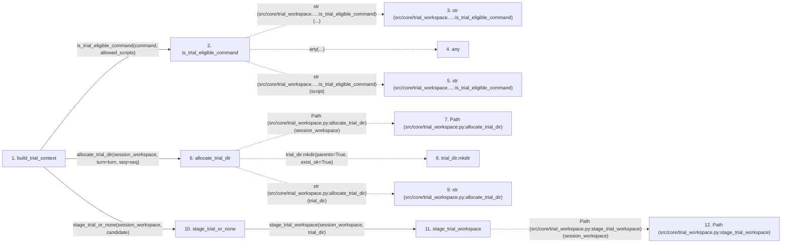

# build_trial_context

**Entry point:** `build_trial_context` (`api`)
**Source:** [trial_workspace](../modules/trial_workspace.md)
**Modules touched:** [fs_safety](../modules/fs_safety.md), [trial_workspace](../modules/trial_workspace.md)

## Call sequence

> Static overview in presentation order, not runtime execution order. Arrows retain captured callers; representative internal continuations and boundary examples precede repeated helper detail.

```mermaid
sequenceDiagram
    participant p0 as build_trial_context
    participant p1 as stage_trial_or_none
    participant p2 as is_trial_eligible_command
    participant p3 as allocate_trial_dir
    participant p4 as TrialContext
    participant p5 as stage_trial_workspace
    participant p6 as copy_tree_regular_files
    participant p7 as _open_root
    participant p8 as _copy_entry_at
    participant p9 as _copy_dir_at
    participant p10 as _write_at
    participant p11 as FilesystemSafetyError
    participant p12 as _leaf_denial_reason
    participant p13 as _unlink_quiet
    participant p14 as str (src/core/trial_workspace.…:is_trial_eligible_command)
    participant p15 as logger.info
    participant p16 as Path (src/core/trial_workspace.py:allocate_trial_dir)
    participant p17 as any
    participant p18 as trial_dir.mkdir
    participant p19 as logger.warning
    participant p20 as str (src/core/trial_workspace.py:allocate_trial_dir)
    participant p21 as Path (src/core/trial_workspace.py:stage_trial_workspace)
    participant p22 as dst.mkdir
    participant p23 as str (src/core/trial_workspace.py:stage_trial_workspace)
    participant p24 as os.makedirs
    participant p25 as sorted (src/core/fs_safety.py:copy_tree_regular_files)
    participant p26 as os.listdir (src/core/fs_safety.py:copy_tree_regular_files)
    participant p27 as on_skip (src/core/fs_safety.py:copy_tree_regular_files)
    p0->>p1: stage_trial_or_none
    p0->>p2: is_trial_eligible_command
    p0->>p3: allocate_trial_dir
    p0->>p4: TrialContext
    p1->>p5: stage_trial_workspace
    p5->>p6: copy_tree_regular_files
    p6->>p7: _open_root
    p6->>p8: _copy_entry_at
    p8->>p9: _copy_dir_at
    p8->>p10: _write_at
    p7->>p11: FilesystemSafetyError
    p10->>p12: _leaf_denial_reason
    p10->>p13: _unlink_quiet
    p2-->>p14: str (src/core/trial_workspace.…:is_trial_eligible_command)(...)
    p0-->>p15: logger.info('Research s turn d: staged trial workspace s', research_id, turn, trial_dir)
    p3-->>p16: Path (src/core/trial_workspace.py:allocate_trial_dir)(session_workspace)
    p2-->>p17: any(...)
    p3-->>p18: trial_dir.mkdir(parents=True, exist_ok=True)
    p1-->>p19: logger.warning('Trial staging failed for s ( s) falling back to the session workspace for this command', trial_dir, exc)
    p2-->>p14: str (src/core/trial_workspace.…:is_trial_eligible_command)(script)
    p3-->>p20: str (src/core/trial_workspace.py:allocate_trial_dir)(trial_dir)
    p5-->>p21: Path (src/core/trial_workspace.py:stage_trial_workspace)(session_workspace)
    p5-->>p21: Path (src/core/trial_workspace.py:stage_trial_workspace)(trial_dir)
    p5-->>p22: dst.mkdir(parents=True, exist_ok=True)
    p5-->>p23: str (src/core/trial_workspace.py:stage_trial_workspace)(src)
    p5-->>p23: str (src/core/trial_workspace.py:stage_trial_workspace)(dst)
    p6-->>p24: os.makedirs(dst_root, exist_ok=True)
    p6-->>p25: sorted (src/core/fs_safety.py:copy_tree_regular_files)(os.listdir(...))
    p6-->>p26: os.listdir (src/core/fs_safety.py:copy_tree_regular_files)(src_fd)
    p6-->>p27: on_skip (src/core/fs_safety.py:copy_tree_regular_files)(name, exc.reason)
```

<!-- Auto-generated from static call edges. Dashed arrows are external or unresolved calls. Reviewed runtime conditions and side effects belong in Behavior. -->

> Call sequence diagram shows 30 of 68 interactions; 38 omitted to keep the visualization within the 30-interaction and generated-diagram limits, with uncertain identities omitted rather than inferred.

> Captured boundary calls: external 12 of 36 (24 omitted); unresolved 5 of 10 (5 omitted). These counts cover the captured static trace.

Omitted captured detail, grouped by actual caller occurrence and target module:

| Caller | Parent step | Target module | Kind | Omitted interactions |
| --- | --- | --- | --- | --- |
| `src/core/fs_safety.py:_open_root` | 17 | - | external | 1 |
| `src/core/fs_safety.py:copy_tree_regular_files` | 15 | [src/core/fs_safety.py](../modules/fs_safety.md) | internal | 1 |
| `src/core/fs_safety.py:_copy_entry_at` | 23 | - | external | 12 |
| `src/core/fs_safety.py:_copy_entry_at` | 23 | [src/core/fs_safety.py](../modules/fs_safety.md) | internal | 3 |
| `src/core/fs_safety.py:_copy_dir_at` | 32 | - | external | 3 |
| `src/core/fs_safety.py:_copy_dir_at` | 32 | [src/core/fs_safety.py](../modules/fs_safety.md) | internal | 1 |
| `src/core/fs_safety.py:_copy_dir_at` | 32 | - | unresolved | 2 |
| `src/core/fs_safety.py:_copy_entry_at` | 23 | - | unresolved | 1 |
> Omission summary shows 8 of 13 groups; 5 further groups are not expanded here. Counts above include all omitted interactions.
> Detailed flow queries retain their own coverage and limits; omitted paths may execute at runtime.

> Trace truncated at the depth limit; deeper calls are omitted.

## Data flow

<!-- Auto-generated static analysis. Treat values and boundaries as best-effort hints, not runtime proof. -->

### Step data

| Step | Inputs | Reads | Writes | Returns |
|---|---|---|---|---|
| `build_trial_context` | `research_id: str`, `turn: int`, `seq: int`, `session_workspace: str`, `command: object`, `allowed_scripts: Optional[Iterable[str] \| Mapping[str, str]]`, `execution_concurrency: int` | - | - | `TrialContext(...)` |
| `is_trial_eligible_command` | `command: object`, `allowed_scripts: Optional[Iterable[str] \| Mapping[str, str]]` | - | - | `False`, `any(...)`, `False` |
| `str (src/core/trial_workspace.…:is_trial_eligible_command)` | - | - | - | - |
| `any` | - | - | - | - |
| `str (src/core/trial_workspace.…:is_trial_eligible_command)` | - | - | - | - |
| `allocate_trial_dir` | `session_workspace: str`, `turn: int`, `seq: int` | `TRIALS_DIRNAME` | - | `str(...)` |
| `Path (src/core/trial_workspace.py:allocate_trial_dir)` | - | - | - | - |
| `trial_dir.mkdir` | - | - | - | - |
| `str (src/core/trial_workspace.py:allocate_trial_dir)` | - | - | - | - |
| `stage_trial_or_none` | `session_workspace: str`, `trial_dir: str` | `fs_safety` | - | `trial_dir`, `None` |
| `stage_trial_workspace` | `session_workspace: str`, `trial_dir: str` | `_STAGE_IGNORE` | - | `fs_safety.copy_tree_regular_files(...)` |
| `Path (src/core/trial_workspace.py:stage_trial_workspace)` | - | - | - | - |

### Call data

| From | To | Line | Call |
|---|---|---:|---|
| build_trial_context | is_trial_eligible_command | 184 | `is_trial_eligible_command(command, allowed_scripts)` |
| is_trial_eligible_command | str (src/core/trial_workspace.…:is_trial_eligible_command) | 90 | `str(...)` |
| is_trial_eligible_command | any | 95 | `any(...)` |
| is_trial_eligible_command | str (src/core/trial_workspace.…:is_trial_eligible_command) | 95 | `str(script)` |
| build_trial_context | allocate_trial_dir | 187 | `allocate_trial_dir(session_workspace, turn=turn, seq=seq)` |
| allocate_trial_dir | Path (src/core/trial_workspace.py:allocate_trial_dir) | 102 | `Path(session_workspace)` |
| allocate_trial_dir | trial_dir.mkdir | 104 | `trial_dir.mkdir(parents=True, exist_ok=True)` |
| allocate_trial_dir | str (src/core/trial_workspace.py:allocate_trial_dir) | 105 | `str(trial_dir)` |
| build_trial_context | stage_trial_or_none | 188 | `stage_trial_or_none(session_workspace, candidate)` |
| stage_trial_or_none | stage_trial_workspace | 141 | `stage_trial_workspace(session_workspace, trial_dir)` |
| stage_trial_workspace | Path (src/core/trial_workspace.py:stage_trial_workspace) | 119 | `Path(session_workspace)` |

### Boundary effects

*No boundary effects detected.*

### Static analysis gaps

| Kind | Step | Target | Line |
|---|---|---|---:|
| external_call | `is_trial_eligible_command` | `any` | 95 |
| unresolved_call | `allocate_trial_dir` | `trial_dir.mkdir` | 104 |
| step_limit | `build_trial_context` | `first 12 steps` | 0 |
| truncated_flow | `build_trial_context` | `depth limit` | 0 |

## Behavior

This flow starts at `build_trial_context` and is classified as `api`. The generated call and data-flow sections are bounded static projections; runtime conditions and side effects require source-level confirmation.
