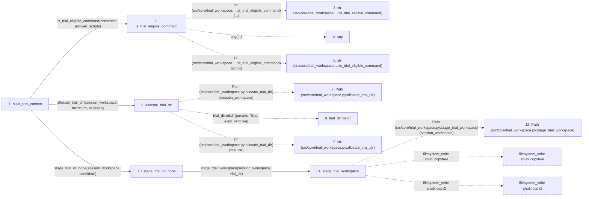

# build_trial_context

**Entry point:** `build_trial_context` (`api`)
**Source:** [trial_workspace](../modules/trial_workspace.md)
**Modules touched:** [trial_workspace](../modules/trial_workspace.md)

## Call sequence

> Static overview in presentation order, not runtime execution order. Arrows retain captured callers; representative internal continuations and boundary examples precede repeated helper detail.

```mermaid
sequenceDiagram
    participant p0 as build_trial_context
    participant p1 as is_trial_eligible_command
    participant p2 as allocate_trial_dir
    participant p3 as stage_trial_or_none
    participant p4 as logger.info
    participant p5 as TrialContext
    participant p6 as str (src/core/trial_workspace.…:is_trial_eligible_command)
    participant p7 as Path (src/core/trial_workspace.py:allocate_trial_dir)
    participant p8 as stage_trial_workspace
    participant p9 as any
    participant p10 as trial_dir.mkdir
    participant p11 as logger.warning (src/core/trial_workspace.py:stage_trial_or_none)
    participant p12 as str (src/core/trial_workspace.py:allocate_trial_dir)
    participant p13 as Path (src/core/trial_workspace.py:stage_trial_workspace)
    participant p14 as dst.mkdir
    participant p15 as sorted
    participant p16 as src.iterdir
    participant p17 as entry.is_dir
    participant p18 as shutil.copytree
    participant p19 as entry.is_file
    participant p20 as shutil.copy2
    participant p21 as logger.warning (src/core/trial_workspace.py:stage_trial_workspace)
    p0->>p1: is_trial_eligible_command
    p0->>p2: allocate_trial_dir
    p0->>p3: stage_trial_or_none
    p0-->>p4: logger.info('Research s turn d: staged trial workspace s', research_id, turn, trial_dir)
    p0->>p5: TrialContext
    p1-->>p6: str (src/core/trial_workspace.…:is_trial_eligible_command)(...)
    p2-->>p7: Path (src/core/trial_workspace.py:allocate_trial_dir)(session_workspace)
    p3->>p8: stage_trial_workspace
    p1-->>p9: any(...)
    p2-->>p10: trial_dir.mkdir(parents=True, exist_ok=True)
    p3-->>p11: logger.warning (src/core/trial_workspace.py:stage_trial_or_none)(…)
    p1-->>p6: str (src/core/trial_workspace.…:is_trial_eligible_command)(script)
    p2-->>p12: str (src/core/trial_workspace.py:allocate_trial_dir)(trial_dir)
    p8-->>p13: Path (src/core/trial_workspace.py:stage_trial_workspace)(session_workspace)
    p8-->>p13: Path (src/core/trial_workspace.py:stage_trial_workspace)(trial_dir)
    p8-->>p14: dst.mkdir(parents=True, exist_ok=True)
    p8-->>p15: sorted(src.iterdir(...))
    p8-->>p16: src.iterdir
    p8-->>p17: entry.is_dir
    p8-->>p18: shutil.copytree(entry, ..., dirs_exist_ok=True)
    p8-->>p19: entry.is_file
    p8-->>p20: shutil.copy2(entry, ...)
    p8-->>p21: logger.warning (src/core/trial_workspace.py:stage_trial_workspace)('Trial staging skipped s ( s) the trial may miss this state', entry, exc)
```

<!-- Auto-generated from static call edges. Dashed arrows are external or unresolved calls. Reviewed runtime conditions and side effects belong in Behavior. -->

> Call sequence diagram shows 23 of 23 interactions; 0 omitted to keep the visualization within the 30-interaction and generated-diagram limits, with uncertain identities omitted rather than inferred.

> Captured boundary calls: external 10 of 10 (0 omitted); unresolved 8 of 8 (0 omitted). These counts cover the captured static trace.
> Detailed flow queries retain their own coverage and limits; omitted paths may execute at runtime.

## Data flow

<!-- Auto-generated static analysis. Treat values and boundaries as best-effort hints, not runtime proof. -->

### Step data

| Step | Inputs | Reads | Writes | Returns |
|---|---|---|---|---|
| `build_trial_context` | `research_id: str`, `turn: int`, `seq: int`, `session_workspace: str`, `command: object`, `allowed_scripts: Optional[Iterable[str] \| Mapping[str, str]]`, `execution_concurrency: int` | - | - | `TrialContext(...)` |
| `is_trial_eligible_command` | `command: object`, `allowed_scripts: Optional[Iterable[str] \| Mapping[str, str]]` | - | - | `False`, `any(...)`, `False` |
| `str (src/core/trial_workspace.…:is_trial_eligible_command)` | - | - | - | - |
| `any` | - | - | - | - |
| `str (src/core/trial_workspace.…:is_trial_eligible_command)` | - | - | - | - |
| `allocate_trial_dir` | `session_workspace: str`, `turn: int`, `seq: int` | `TRIALS_DIRNAME` | - | `str(...)` |
| `Path (src/core/trial_workspace.py:allocate_trial_dir)` | - | - | - | - |
| `trial_dir.mkdir` | - | - | - | - |
| `str (src/core/trial_workspace.py:allocate_trial_dir)` | - | - | - | - |
| `stage_trial_or_none` | `session_workspace: str`, `trial_dir: str` | - | - | `trial_dir`, `None` |
| `stage_trial_workspace` | `session_workspace: str`, `trial_dir: str` | `_STAGE_IGNORE` | - | `staged` |
| `Path (src/core/trial_workspace.py:stage_trial_workspace)` | - | - | - | - |

### Call data

| From | To | Line | Call |
|---|---|---:|---|
| build_trial_context | is_trial_eligible_command | 187 | `is_trial_eligible_command(command, allowed_scripts)` |
| is_trial_eligible_command | str (src/core/trial_workspace.…:is_trial_eligible_command) | 88 | `str(...)` |
| is_trial_eligible_command | any | 93 | `any(...)` |
| is_trial_eligible_command | str (src/core/trial_workspace.…:is_trial_eligible_command) | 93 | `str(script)` |
| build_trial_context | allocate_trial_dir | 190 | `allocate_trial_dir(session_workspace, turn=turn, seq=seq)` |
| allocate_trial_dir | Path (src/core/trial_workspace.py:allocate_trial_dir) | 100 | `Path(session_workspace)` |
| allocate_trial_dir | trial_dir.mkdir | 102 | `trial_dir.mkdir(parents=True, exist_ok=True)` |
| allocate_trial_dir | str (src/core/trial_workspace.py:allocate_trial_dir) | 103 | `str(trial_dir)` |
| build_trial_context | stage_trial_or_none | 191 | `stage_trial_or_none(session_workspace, candidate)` |
| stage_trial_or_none | stage_trial_workspace | 144 | `stage_trial_workspace(session_workspace, trial_dir)` |
| stage_trial_workspace | Path (src/core/trial_workspace.py:stage_trial_workspace) | 114 | `Path(session_workspace)` |

### Boundary effects

| Kind | Target | Step | Line |
|---|---|---|---:|
| filesystem_write | `shutil.copytree` | `stage_trial_workspace` | 123 |
| filesystem_write | `shutil.copy2` | `stage_trial_workspace` | 125 |

### Static analysis gaps

| Kind | Step | Target | Line |
|---|---|---|---:|
| external_call | `is_trial_eligible_command` | `any` | 93 |
| unresolved_call | `allocate_trial_dir` | `trial_dir.mkdir` | 102 |
| step_limit | `build_trial_context` | `first 12 steps` | 0 |

## Behavior

This flow starts at `build_trial_context` and is classified as `api`. The generated call and data-flow sections are bounded static projections; runtime conditions and side effects require source-level confirmation.
