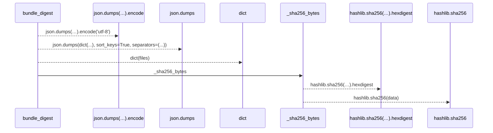
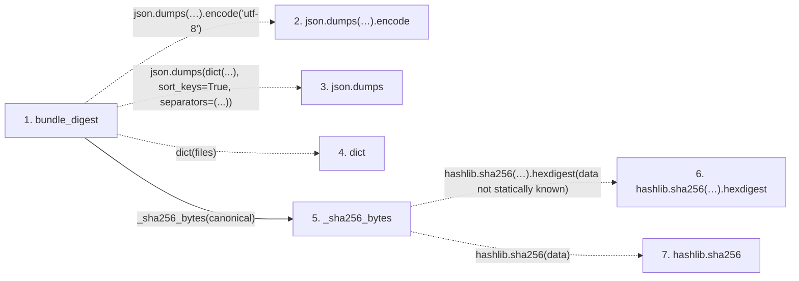

# bundle_digest

**Entry point:** `bundle_digest` (`api`)
**Source:** [run_artifacts](../modules/run_artifacts.md)
**Modules touched:** [run_artifacts](../modules/run_artifacts.md)

## Call sequence

> Static overview in presentation order, not runtime execution order. Arrows retain captured callers; representative internal continuations and boundary examples precede repeated helper detail.

<!-- Auto-generated from static call edges. Dashed arrows are external or unresolved calls. Reviewed runtime conditions and side effects belong in Behavior. -->

> Call sequence diagram shows 6 of 6 interactions; 0 omitted to keep the visualization within the 30-interaction and generated-diagram limits, with uncertain identities omitted rather than inferred.

> Captured boundary calls: external 3 of 3 (0 omitted); unresolved 2 of 2 (0 omitted). These counts cover the captured static trace.
> Detailed flow queries retain their own coverage and limits; omitted paths may execute at runtime.

## Data flow

<!-- Auto-generated static analysis. Treat values and boundaries as best-effort hints, not runtime proof. -->

### Step data

| Step | Inputs | Reads | Writes | Returns |
|---|---|---|---|---|
| `bundle_digest` | `files: Mapping[str, Mapping[str, Any]]` | - | - | `_sha256_bytes(...)` |
| `json.dumps(…).encode` | - | - | - | - |
| `json.dumps` | - | - | - | - |
| `dict` | - | - | - | - |
| `_sha256_bytes` | `data: bytes` | - | - | `...` |
| `hashlib.sha256(…).hexdigest` | - | - | - | - |
| `hashlib.sha256` | - | - | - | - |

### Call data

| From | To | Line | Call |
|---|---|---:|---|
| bundle_digest | json.dumps(…).encode | 71 | `json.dumps(dict(files), sort_keys=True, separators=(',', ':')).encode('utf-8')` |
| bundle_digest | json.dumps | 71 | `json.dumps(dict(...), sort_keys=True, separators=(...))` |
| bundle_digest | dict | 72 | `dict(files)` |
| bundle_digest | _sha256_bytes | 74 | `_sha256_bytes(canonical)` |
| _sha256_bytes | hashlib.sha256(…).hexdigest | 66 | `hashlib.sha256(data).hexdigest(data not statically known)` |
| _sha256_bytes | hashlib.sha256 | 66 | `hashlib.sha256(data)` |

### Boundary effects

*No boundary effects detected.*

### Static analysis gaps

| Kind | Step | Target | Line |
|---|---|---|---:|
| unresolved_call | `bundle_digest` | `json.dumps(dict(files), sort_keys=True, separators=(',', ':')).encode` | 71 |
| external_call | `bundle_digest` | `json.dumps` | 71 |
| unresolved_call | `_sha256_bytes` | `hashlib.sha256(data).hexdigest` | 66 |
| external_call | `_sha256_bytes` | `hashlib.sha256` | 66 |

## Behavior

This flow starts at `bundle_digest` and is classified as `api`. The generated call and data-flow sections are bounded static projections; runtime conditions and side effects require source-level confirmation.
