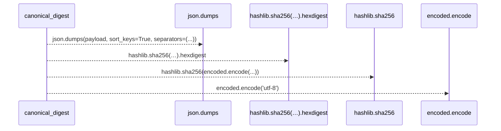
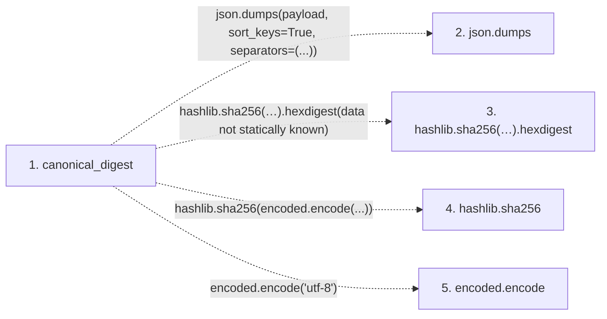

# canonical_digest

**Entry point:** `canonical_digest` (`api`)
**Source:** [execution_contracts](../modules/execution_contracts.md)
**Modules touched:** [execution_contracts](../modules/execution_contracts.md)

## Call sequence

> Static overview in presentation order, not runtime execution order. Arrows retain captured callers; representative internal continuations and boundary examples precede repeated helper detail.

<!-- Auto-generated from static call edges. Dashed arrows are external or unresolved calls. Reviewed runtime conditions and side effects belong in Behavior. -->

> Call sequence diagram shows 4 of 4 interactions; 0 omitted to keep the visualization within the 30-interaction and generated-diagram limits, with uncertain identities omitted rather than inferred.

> Captured boundary calls: external 2 of 2 (0 omitted); unresolved 2 of 2 (0 omitted). These counts cover the captured static trace.
> Detailed flow queries retain their own coverage and limits; omitted paths may execute at runtime.

## Data flow

<!-- Auto-generated static analysis. Treat values and boundaries as best-effort hints, not runtime proof. -->

### Step data

| Step | Inputs | Reads | Writes | Returns |
|---|---|---|---|---|
| `canonical_digest` | `payload: Mapping[str, Any]` | - | - | `...` |
| `json.dumps` | - | - | - | - |
| `hashlib.sha256(…).hexdigest` | - | - | - | - |
| `hashlib.sha256` | - | - | - | - |
| `encoded.encode` | - | - | - | - |

### Call data

| From | To | Line | Call |
|---|---|---:|---|
| canonical_digest | json.dumps | 220 | `json.dumps(payload, sort_keys=True, separators=(...))` |
| canonical_digest | hashlib.sha256(…).hexdigest | 221 | `hashlib.sha256(encoded.encode('utf-8')).hexdigest(data not statically known)` |
| canonical_digest | hashlib.sha256 | 221 | `hashlib.sha256(encoded.encode(...))` |
| canonical_digest | encoded.encode | 221 | `encoded.encode('utf-8')` |

### Boundary effects

*No boundary effects detected.*

### Static analysis gaps

| Kind | Step | Target | Line |
|---|---|---|---:|
| external_call | `canonical_digest` | `json.dumps` | 220 |
| unresolved_call | `canonical_digest` | `hashlib.sha256(encoded.encode('utf-8')).hexdigest` | 221 |
| external_call | `canonical_digest` | `hashlib.sha256` | 221 |
| unresolved_call | `canonical_digest` | `encoded.encode` | 221 |

## Behavior

This flow starts at `canonical_digest` and is classified as `api`. The generated call and data-flow sections are bounded static projections; runtime conditions and side effects require source-level confirmation.
