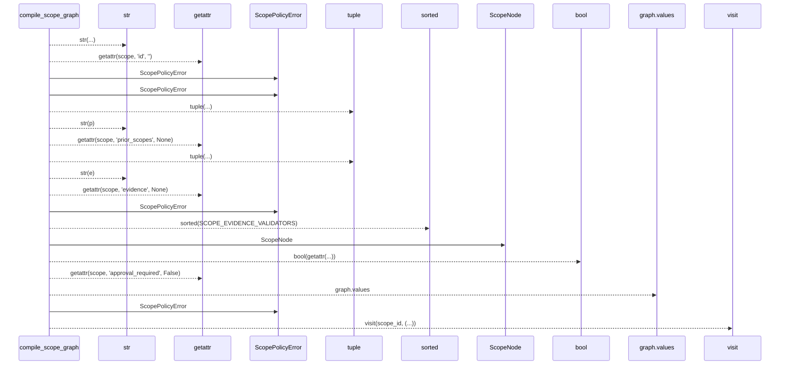
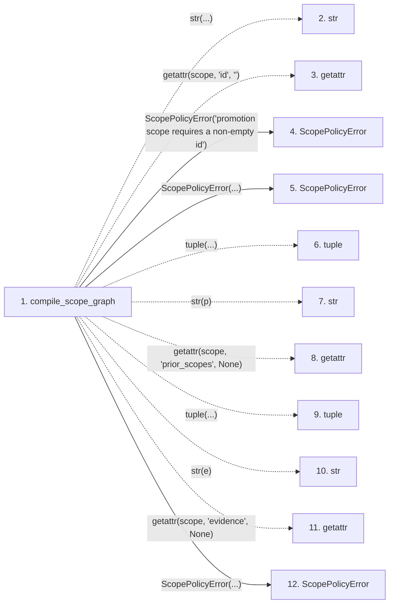

# compile_scope_graph

**Entry point:** `compile_scope_graph` (`api`)
**Source:** [promotion_policy](../modules/promotion_policy.md)
**Modules touched:** [promotion_policy](../modules/promotion_policy.md)

## Call sequence

> Static overview in presentation order, not runtime execution order. Arrows retain captured callers; representative internal continuations and boundary examples precede repeated helper detail.

<!-- Auto-generated from static call edges. Dashed arrows are external or unresolved calls. Reviewed runtime conditions and side effects belong in Behavior. -->

> Call sequence diagram shows 18 of 18 interactions; 0 omitted to keep the visualization within the 30-interaction and generated-diagram limits, with uncertain identities omitted rather than inferred.

> Captured boundary calls: external 11 of 11 (0 omitted); unresolved 2 of 2 (0 omitted). These counts cover the captured static trace.
> Detailed flow queries retain their own coverage and limits; omitted paths may execute at runtime.

## Data flow

<!-- Auto-generated static analysis. Treat values and boundaries as best-effort hints, not runtime proof. -->

### Step data

| Step | Inputs | Reads | Writes | Returns |
|---|---|---|---|---|
| `compile_scope_graph` | `scopes: Iterable[Any]` | `SCOPE_EVIDENCE_VALIDATORS`, `SCOPE_EVIDENCE_VALIDATORS` | `graph[...]` | `graph` |
| `str` | - | - | - | - |
| `getattr` | - | - | - | - |
| `ScopePolicyError` | - | - | - | - |
| `ScopePolicyError` | - | - | - | - |
| `tuple` | - | - | - | - |
| `str` | - | - | - | - |
| `getattr` | - | - | - | - |
| `tuple` | - | - | - | - |
| `str` | - | - | - | - |
| `getattr` | - | - | - | - |
| `ScopePolicyError` | - | - | - | - |

### Call data

| From | To | Line | Call |
|---|---|---:|---|
| compile_scope_graph | str | 61 | `str(...)` |
| compile_scope_graph | getattr | 61 | `getattr(scope, 'id', '')` |
| compile_scope_graph | ScopePolicyError | 63 | `ScopePolicyError('promotion scope requires a non-empty id')` |
| compile_scope_graph | ScopePolicyError | 65 | `ScopePolicyError(...)` |
| compile_scope_graph | tuple | 66 | `tuple(...)` |
| compile_scope_graph | str | 66 | `str(p)` |
| compile_scope_graph | getattr | 66 | `getattr(scope, 'prior_scopes', None)` |
| compile_scope_graph | tuple | 67 | `tuple(...)` |
| compile_scope_graph | str | 67 | `str(e)` |
| compile_scope_graph | getattr | 67 | `getattr(scope, 'evidence', None)` |
| compile_scope_graph | ScopePolicyError | 70 | `ScopePolicyError(...)` |

### Boundary effects

*No boundary effects detected.*

### Static analysis gaps

| Kind | Step | Target | Line |
|---|---|---|---:|
| external_call | `compile_scope_graph` | `getattr` | 61 |
| external_call | `compile_scope_graph` | `getattr` | 66 |
| external_call | `compile_scope_graph` | `getattr` | 67 |
| step_limit | `compile_scope_graph` | `first 12 steps` | 0 |

## Behavior

This flow starts at `compile_scope_graph` and is classified as `api`. The generated call and data-flow sections are bounded static projections; runtime conditions and side effects require source-level confirmation.
