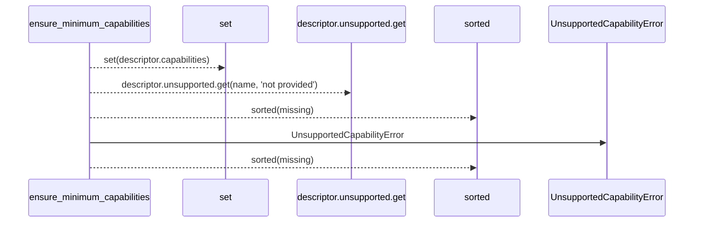
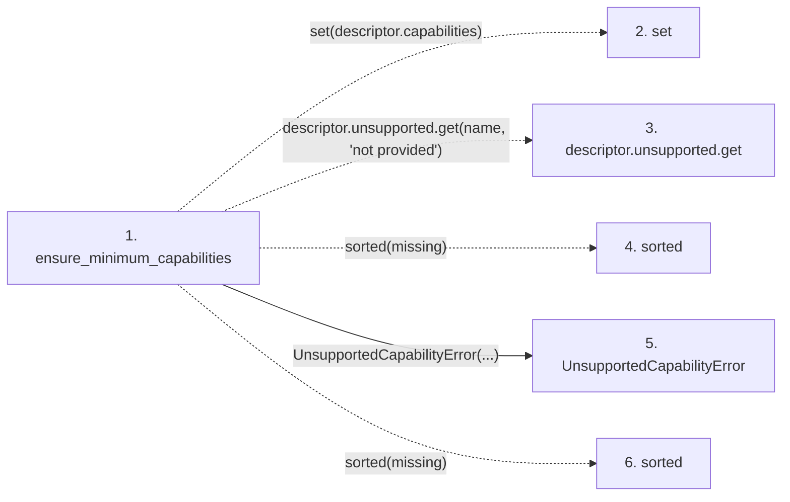

# ensure_minimum_capabilities

**Entry point:** `ensure_minimum_capabilities` (`api`)
**Source:** [execution_contracts](../modules/execution_contracts.md)
**Modules touched:** [execution_contracts](../modules/execution_contracts.md)

## Call sequence

> Static overview in presentation order, not runtime execution order. Arrows retain captured callers; representative internal continuations and boundary examples precede repeated helper detail.

<!-- Auto-generated from static call edges. Dashed arrows are external or unresolved calls. Reviewed runtime conditions and side effects belong in Behavior. -->

> Call sequence diagram shows 5 of 5 interactions; 0 omitted to keep the visualization within the 30-interaction and generated-diagram limits, with uncertain identities omitted rather than inferred.

> Captured boundary calls: external 3 of 3 (0 omitted); unresolved 1 of 1 (0 omitted). These counts cover the captured static trace.
> Detailed flow queries retain their own coverage and limits; omitted paths may execute at runtime.

## Data flow

<!-- Auto-generated static analysis. Treat values and boundaries as best-effort hints, not runtime proof. -->

### Step data

| Step | Inputs | Reads | Writes | Returns |
|---|---|---|---|---|
| `ensure_minimum_capabilities` | `descriptor: CapabilityDescriptor`, `required: frozenset[str]` | - | - | - |
| `set` | - | - | - | - |
| `descriptor.unsupported.get` | - | - | - | - |
| `sorted` | - | - | - | - |
| `UnsupportedCapabilityError` | - | - | - | - |
| `sorted` | - | - | - | - |

### Call data

| From | To | Line | Call |
|---|---|---:|---|
| ensure_minimum_capabilities | set | 484 | `set(descriptor.capabilities)` |
| ensure_minimum_capabilities | descriptor.unsupported.get | 487 | `descriptor.unsupported.get(name, 'not provided')` |
| ensure_minimum_capabilities | sorted | 487 | `sorted(missing)` |
| ensure_minimum_capabilities | UnsupportedCapabilityError | 489 | `UnsupportedCapabilityError(...)` |
| ensure_minimum_capabilities | sorted | 491 | `sorted(missing)` |

### Boundary effects

*No boundary effects detected.*

### Static analysis gaps

| Kind | Step | Target | Line |
|---|---|---|---:|
| unresolved_call | `ensure_minimum_capabilities` | `descriptor.unsupported.get` | 487 |
| external_call | `ensure_minimum_capabilities` | `sorted` | 487 |
| external_call | `ensure_minimum_capabilities` | `sorted` | 491 |

## Behavior

This flow starts at `ensure_minimum_capabilities` and is classified as `api`. The generated call and data-flow sections are bounded static projections; runtime conditions and side effects require source-level confirmation.
