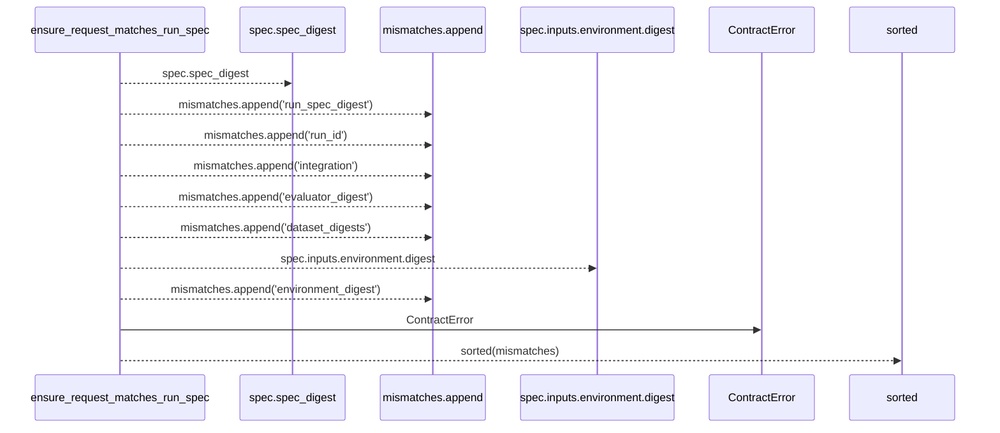
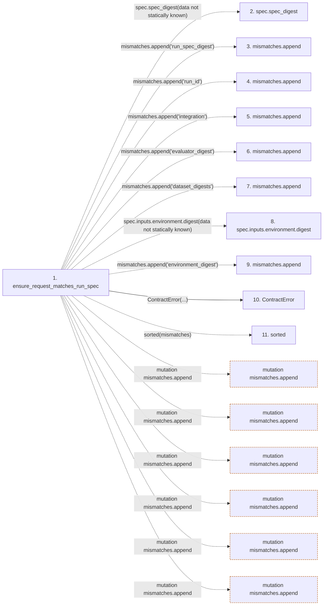

# ensure_request_matches_run_spec

**Entry point:** `ensure_request_matches_run_spec` (`api`)
**Source:** [execution_contracts](../modules/execution_contracts.md)
**Modules touched:** [execution_contracts](../modules/execution_contracts.md)

## Call sequence

> Static overview in presentation order, not runtime execution order. Arrows retain captured callers; representative internal continuations and boundary examples precede repeated helper detail.

<!-- Auto-generated from static call edges. Dashed arrows are external or unresolved calls. Reviewed runtime conditions and side effects belong in Behavior. -->

> Call sequence diagram shows 10 of 10 interactions; 0 omitted to keep the visualization within the 30-interaction and generated-diagram limits, with uncertain identities omitted rather than inferred.

> Captured boundary calls: external 1 of 1 (0 omitted); unresolved 8 of 8 (0 omitted). These counts cover the captured static trace.
> Detailed flow queries retain their own coverage and limits; omitted paths may execute at runtime.

## Data flow

<!-- Auto-generated static analysis. Treat values and boundaries as best-effort hints, not runtime proof. -->

### Step data

| Step | Inputs | Reads | Writes | Returns |
|---|---|---|---|---|
| `ensure_request_matches_run_spec` | `request: 'ExecutionRequest'`, `spec: RunSpec` | - | - | - |
| `spec.spec_digest` | - | - | - | - |
| `mismatches.append` | - | - | - | - |
| `mismatches.append` | - | - | - | - |
| `mismatches.append` | - | - | - | - |
| `mismatches.append` | - | - | - | - |
| `mismatches.append` | - | - | - | - |
| `spec.inputs.environment.digest` | - | - | - | - |
| `mismatches.append` | - | - | - | - |
| `ContractError` | - | - | - | - |
| `sorted` | - | - | - | - |

### Call data

| From | To | Line | Call |
|---|---|---:|---|
| ensure_request_matches_run_spec | spec.spec_digest | 915 | `spec.spec_digest(data not statically known)` |
| ensure_request_matches_run_spec | mismatches.append | 916 | `mismatches.append('run_spec_digest')` |
| ensure_request_matches_run_spec | mismatches.append | 918 | `mismatches.append('run_id')` |
| ensure_request_matches_run_spec | mismatches.append | 920 | `mismatches.append('integration')` |
| ensure_request_matches_run_spec | mismatches.append | 922 | `mismatches.append('evaluator_digest')` |
| ensure_request_matches_run_spec | mismatches.append | 924 | `mismatches.append('dataset_digests')` |
| ensure_request_matches_run_spec | spec.inputs.environment.digest | 925 | `spec.inputs.environment.digest(data not statically known)` |
| ensure_request_matches_run_spec | mismatches.append | 926 | `mismatches.append('environment_digest')` |
| ensure_request_matches_run_spec | ContractError | 928 | `ContractError(...)` |
| ensure_request_matches_run_spec | sorted | 930 | `sorted(mismatches)` |

### Boundary effects

| Kind | Target | Step | Line |
|---|---|---|---:|
| mutation | `mismatches.append` | `ensure_request_matches_run_spec` | 916 |
| mutation | `mismatches.append` | `ensure_request_matches_run_spec` | 918 |
| mutation | `mismatches.append` | `ensure_request_matches_run_spec` | 920 |
| mutation | `mismatches.append` | `ensure_request_matches_run_spec` | 922 |
| mutation | `mismatches.append` | `ensure_request_matches_run_spec` | 924 |
| mutation | `mismatches.append` | `ensure_request_matches_run_spec` | 926 |

### Static analysis gaps

| Kind | Step | Target | Line |
|---|---|---|---:|
| unresolved_call | `ensure_request_matches_run_spec` | `spec.spec_digest` | 915 |
| unresolved_call | `ensure_request_matches_run_spec` | `spec.inputs.environment.digest` | 925 |
| external_call | `ensure_request_matches_run_spec` | `sorted` | 930 |

## Behavior

This flow starts at `ensure_request_matches_run_spec` and is classified as `api`. The generated call and data-flow sections are bounded static projections; runtime conditions and side effects require source-level confirmation.
