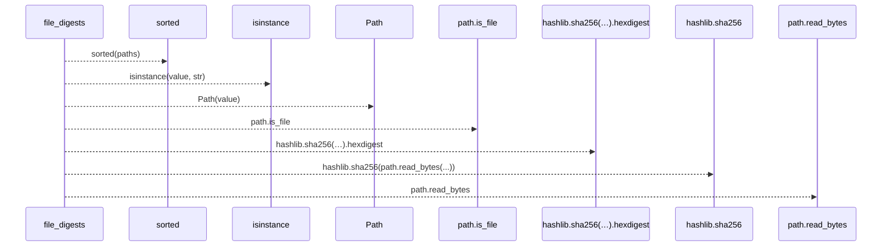
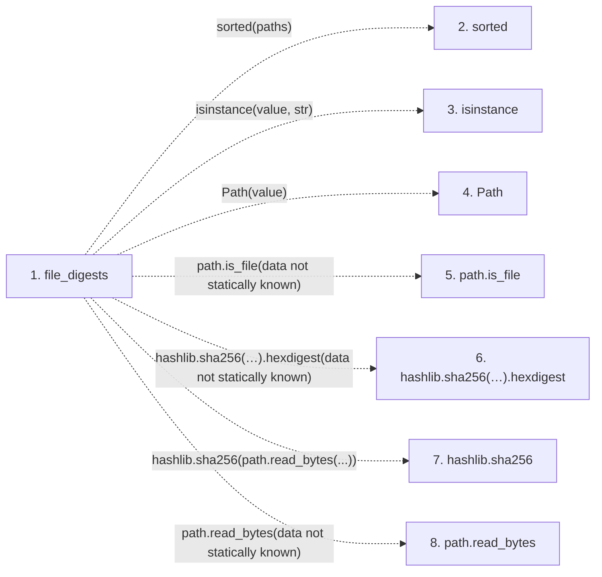

# file_digests

**Entry point:** `file_digests` (`api`)
**Source:** [run_spec](../modules/run_spec.md)
**Modules touched:** [run_spec](../modules/run_spec.md)

## Call sequence

> Static overview in presentation order, not runtime execution order. Arrows retain captured callers; representative internal continuations and boundary examples precede repeated helper detail.

<!-- Auto-generated from static call edges. Dashed arrows are external or unresolved calls. Reviewed runtime conditions and side effects belong in Behavior. -->

> Call sequence diagram shows 7 of 7 interactions; 0 omitted to keep the visualization within the 30-interaction and generated-diagram limits, with uncertain identities omitted rather than inferred.

> Captured boundary calls: external 4 of 4 (0 omitted); unresolved 3 of 3 (0 omitted). These counts cover the captured static trace.
> Detailed flow queries retain their own coverage and limits; omitted paths may execute at runtime.

## Data flow

<!-- Auto-generated static analysis. Treat values and boundaries as best-effort hints, not runtime proof. -->

### Step data

| Step | Inputs | Reads | Writes | Returns |
|---|---|---|---|---|
| `file_digests` | `paths: Mapping[str, Any]` | - | `digests[...]` | `digests` |
| `sorted` | - | - | - | - |
| `isinstance` | - | - | - | - |
| `Path` | - | - | - | - |
| `path.is_file` | - | - | - | - |
| `hashlib.sha256(…).hexdigest` | - | - | - | - |
| `hashlib.sha256` | - | - | - | - |
| `path.read_bytes` | - | - | - | - |

### Call data

| From | To | Line | Call |
|---|---|---:|---|
| file_digests | sorted | 83 | `sorted(paths)` |
| file_digests | isinstance | 85 | `isinstance(value, str)` |
| file_digests | Path | 87 | `Path(value)` |
| file_digests | path.is_file | 89 | `path.is_file(data not statically known)` |
| file_digests | hashlib.sha256(…).hexdigest | 90 | `hashlib.sha256(path.read_bytes()).hexdigest(data not statically known)` |
| file_digests | hashlib.sha256 | 90 | `hashlib.sha256(path.read_bytes(...))` |
| file_digests | path.read_bytes | 90 | `path.read_bytes(data not statically known)` |

### Boundary effects

*No boundary effects detected.*

### Static analysis gaps

| Kind | Step | Target | Line |
|---|---|---|---:|
| external_call | `file_digests` | `sorted` | 83 |
| external_call | `file_digests` | `isinstance` | 85 |
| unresolved_call | `file_digests` | `path.is_file` | 89 |
| unresolved_call | `file_digests` | `hashlib.sha256(path.read_bytes()).hexdigest` | 90 |
| external_call | `file_digests` | `hashlib.sha256` | 90 |
| unresolved_call | `file_digests` | `path.read_bytes` | 90 |

## Behavior

This flow starts at `file_digests` and is classified as `api`. The generated call and data-flow sections are bounded static projections; runtime conditions and side effects require source-level confirmation.
