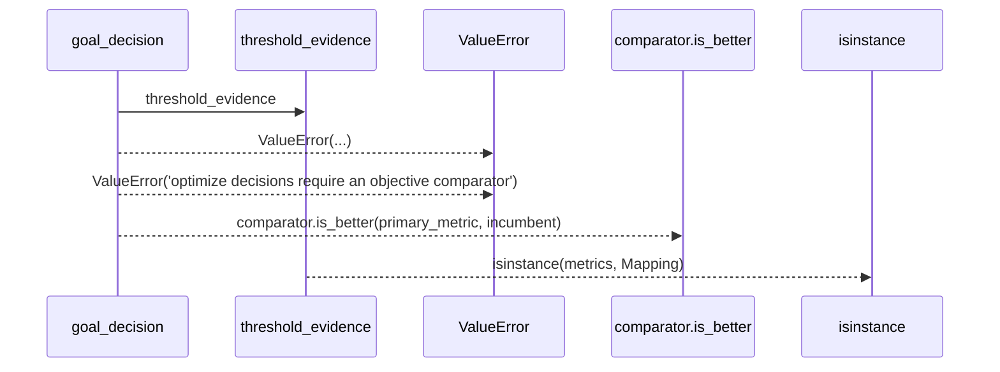
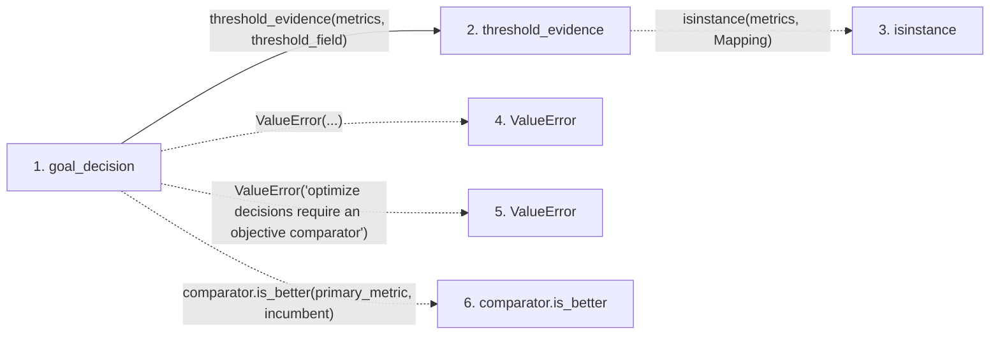

# goal_decision

**Entry point:** `goal_decision` (`api`)
**Source:** [goal_semantics](../modules/goal_semantics.md)
**Modules touched:** [goal_semantics](../modules/goal_semantics.md)

## Call sequence

> Static overview in presentation order, not runtime execution order. Arrows retain captured callers; representative internal continuations and boundary examples precede repeated helper detail.

<!-- Auto-generated from static call edges. Dashed arrows are external or unresolved calls. Reviewed runtime conditions and side effects belong in Behavior. -->

> Call sequence diagram shows 5 of 5 interactions; 0 omitted to keep the visualization within the 30-interaction and generated-diagram limits, with uncertain identities omitted rather than inferred.

> Captured boundary calls: external 3 of 3 (0 omitted); unresolved 1 of 1 (0 omitted). These counts cover the captured static trace.
> Detailed flow queries retain their own coverage and limits; omitted paths may execute at runtime.

## Data flow

<!-- Auto-generated static analysis. Treat values and boundaries as best-effort hints, not runtime proof. -->

### Step data

| Step | Inputs | Reads | Writes | Returns |
|---|---|---|---|---|
| `goal_decision` | `goal: str`, `metrics: Any`, `threshold_field: Optional[str]`, `gates_passed: bool`, `comparator: Any`, `primary_metric: Optional[float]`, `incumbent: Optional[float]` | `GOAL_SATISFICE`, `GOAL_OPTIMIZE` | - | `...`, `'discard'`, `'discard'`, `'keep'`, `'improve'`, `'discard'` |
| `threshold_evidence` | `metrics: Any`, `threshold_field: Optional[str]` | `Mapping` | - | `base`, `base`, `{...}` |
| `isinstance` | - | - | - | - |
| `ValueError` | - | - | - | - |
| `ValueError` | - | - | - | - |
| `comparator.is_better` | - | - | - | - |

### Call data

| From | To | Line | Call |
|---|---|---:|---|
| goal_decision | threshold_evidence | 89 | `threshold_evidence(metrics, threshold_field)` |
| threshold_evidence | isinstance | 58 | `isinstance(metrics, Mapping)` |
| goal_decision | ValueError | 94 | `ValueError(...)` |
| goal_decision | ValueError | 98 | `ValueError('optimize decisions require an objective comparator')` |
| goal_decision | comparator.is_better | 99 | `comparator.is_better(primary_metric, incumbent)` |

### Boundary effects

*No boundary effects detected.*

### Static analysis gaps

| Kind | Step | Target | Line |
|---|---|---|---:|
| external_call | `threshold_evidence` | `isinstance` | 58 |
| external_call | `goal_decision` | `ValueError` | 94 |
| external_call | `goal_decision` | `ValueError` | 98 |
| unresolved_call | `goal_decision` | `comparator.is_better` | 99 |

## Behavior

This flow starts at `goal_decision` and is classified as `api`. The generated call and data-flow sections are bounded static projections; runtime conditions and side effects require source-level confirmation.
