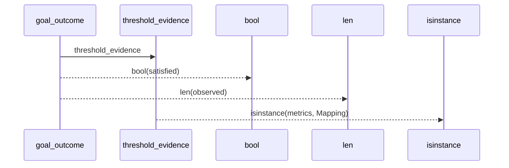
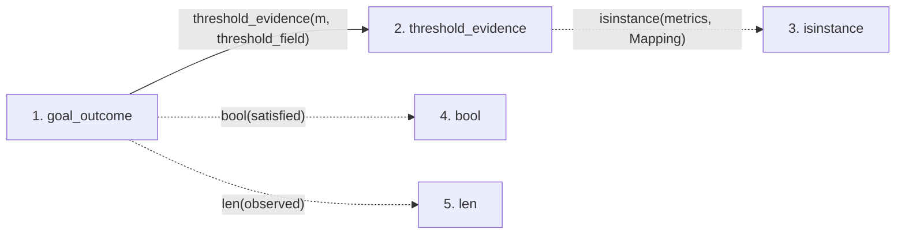

# goal_outcome

**Entry point:** `goal_outcome` (`api`)
**Source:** [goal_semantics](../modules/goal_semantics.md)
**Modules touched:** [goal_semantics](../modules/goal_semantics.md)

## Call sequence

> Static overview in presentation order, not runtime execution order. Arrows retain captured callers; representative internal continuations and boundary examples precede repeated helper detail.

<!-- Auto-generated from static call edges. Dashed arrows are external or unresolved calls. Reviewed runtime conditions and side effects belong in Behavior. -->

> Call sequence diagram shows 4 of 4 interactions; 0 omitted to keep the visualization within the 30-interaction and generated-diagram limits, with uncertain identities omitted rather than inferred.

> Captured boundary calls: external 3 of 3 (0 omitted); unresolved 0 of 0 (0 omitted). These counts cover the captured static trace.
> Detailed flow queries retain their own coverage and limits; omitted paths may execute at runtime.

## Data flow

<!-- Auto-generated static analysis. Treat values and boundaries as best-effort hints, not runtime proof. -->

### Step data

| Step | Inputs | Reads | Writes | Returns |
|---|---|---|---|---|
| `goal_outcome` | `goal: str`, `observations: Sequence[Any]`, `threshold_field: Optional[str]` | `GOAL_SATISFICE`, `GOAL_SATISFICED`, `GOAL_INCONCLUSIVE`, `GOAL_THRESHOLD_UNMET` | - | `{...}`, `{...}` |
| `threshold_evidence` | `metrics: Any`, `threshold_field: Optional[str]` | `Mapping` | - | `base`, `base`, `{...}` |
| `isinstance` | - | - | - | - |
| `bool` | - | - | - | - |
| `len` | - | - | - | - |

### Call data

| From | To | Line | Call |
|---|---|---:|---|
| goal_outcome | threshold_evidence | 128 | `threshold_evidence(m, threshold_field)` |
| threshold_evidence | isinstance | 58 | `isinstance(metrics, Mapping)` |
| goal_outcome | bool | 140 | `bool(satisfied)` |
| goal_outcome | len | 141 | `len(observed)` |

### Boundary effects

*No boundary effects detected.*

### Static analysis gaps

| Kind | Step | Target | Line |
|---|---|---|---:|
| external_call | `threshold_evidence` | `isinstance` | 58 |

## Behavior

This flow starts at `goal_outcome` and is classified as `api`. The generated call and data-flow sections are bounded static projections; runtime conditions and side effects require source-level confirmation.
