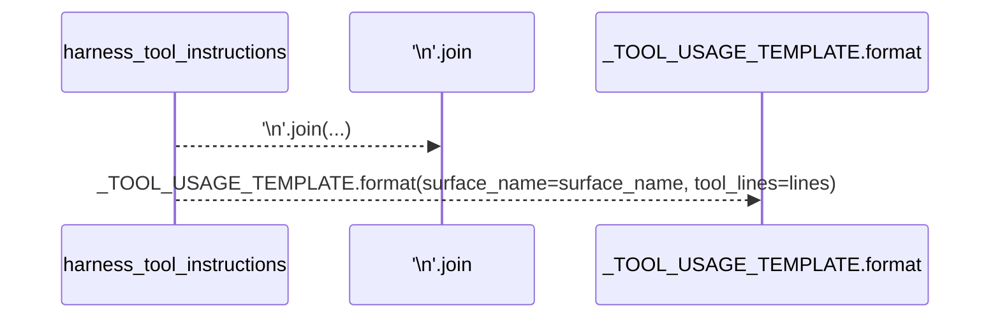
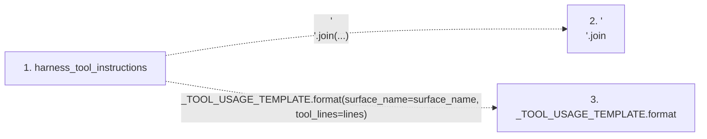

# harness_tool_instructions

**Entry point:** `harness_tool_instructions` (`api`)
**Source:** [instruction_assembly](../modules/instruction_assembly.md)
**Modules touched:** [instruction_assembly](../modules/instruction_assembly.md)

## Call sequence

> Static overview in presentation order, not runtime execution order. Arrows retain captured callers; representative internal continuations and boundary examples precede repeated helper detail.

<!-- Auto-generated from static call edges. Dashed arrows are external or unresolved calls. Reviewed runtime conditions and side effects belong in Behavior. -->

> Call sequence diagram shows 2 of 2 interactions; 0 omitted to keep the visualization within the 30-interaction and generated-diagram limits, with uncertain identities omitted rather than inferred.

> Captured boundary calls: external 0 of 0 (0 omitted); unresolved 2 of 2 (0 omitted). These counts cover the captured static trace.
> Detailed flow queries retain their own coverage and limits; omitted paths may execute at runtime.

## Data flow

<!-- Auto-generated static analysis. Treat values and boundaries as best-effort hints, not runtime proof. -->

### Step data

| Step | Inputs | Reads | Writes | Returns |
|---|---|---|---|---|
| `harness_tool_instructions` | `tools: Sequence[tuple[str, str]]`, `surface_name: str` | - | - | `_TOOL_USAGE_TEMPLATE.format(...)` |
| `'\n'.join` | - | - | - | - |
| `_TOOL_USAGE_TEMPLATE.format` | - | - | - | - |

### Call data

| From | To | Line | Call |
|---|---|---:|---|
| harness_tool_instructions | '\n'.join | 47 | `'\n'.join(...)` |
| harness_tool_instructions | _TOOL_USAGE_TEMPLATE.format | 48 | `_TOOL_USAGE_TEMPLATE.format(surface_name=surface_name, tool_lines=lines)` |

### Boundary effects

*No boundary effects detected.*

### Static analysis gaps

| Kind | Step | Target | Line |
|---|---|---|---:|
| unresolved_call | `harness_tool_instructions` | `'\n'.join` | 47 |
| unresolved_call | `harness_tool_instructions` | `_TOOL_USAGE_TEMPLATE.format` | 48 |

## Behavior

This flow starts at `harness_tool_instructions` and is classified as `api`. The generated call and data-flow sections are bounded static projections; runtime conditions and side effects require source-level confirmation.
