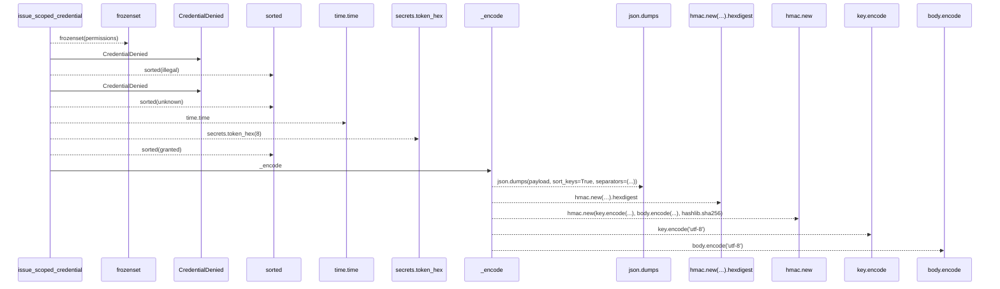
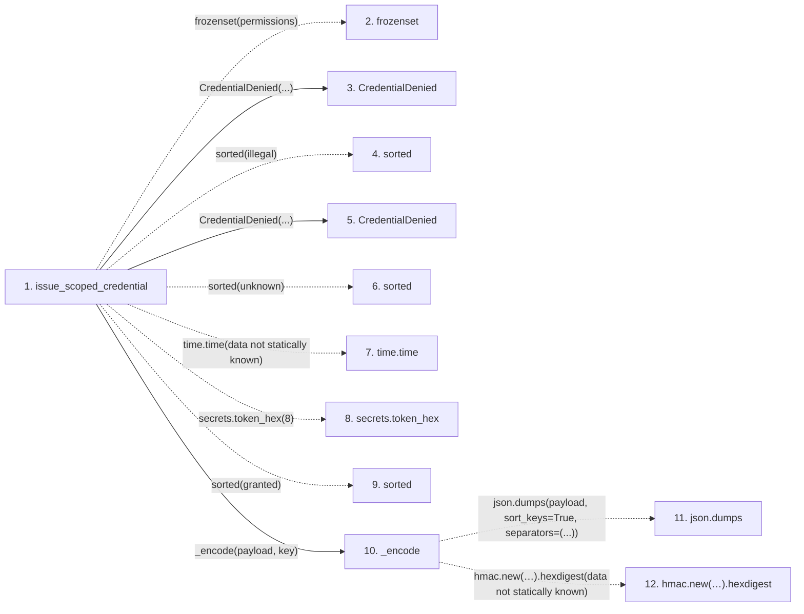

# issue_scoped_credential

**Entry point:** `issue_scoped_credential` (`api`)
**Source:** [scoped_credentials](../modules/scoped_credentials.md)
**Modules touched:** [scoped_credentials](../modules/scoped_credentials.md)

## Call sequence

> Static overview in presentation order, not runtime execution order. Arrows retain captured callers; representative internal continuations and boundary examples precede repeated helper detail.

<!-- Auto-generated from static call edges. Dashed arrows are external or unresolved calls. Reviewed runtime conditions and side effects belong in Behavior. -->

> Call sequence diagram shows 14 of 14 interactions; 0 omitted to keep the visualization within the 30-interaction and generated-diagram limits, with uncertain identities omitted rather than inferred.

> Captured boundary calls: external 8 of 8 (0 omitted); unresolved 3 of 3 (0 omitted). These counts cover the captured static trace.
> Detailed flow queries retain their own coverage and limits; omitted paths may execute at runtime.

## Data flow

<!-- Auto-generated static analysis. Treat values and boundaries as best-effort hints, not runtime proof. -->

### Step data

| Step | Inputs | Reads | Writes | Returns |
|---|---|---|---|---|
| `issue_scoped_credential` | `subject: str`, `run_id: str`, `tenant_id: str`, `permissions: Iterable[str]`, `ttl_s: float`, `key: str`, `now: Optional[float]` | `NON_GRANTABLE_PERMISSIONS`, `SCOPED_PERMISSIONS` | - | `_encode(...)` |
| `frozenset` | - | - | - | - |
| `CredentialDenied` | - | - | - | - |
| `sorted` | - | - | - | - |
| `CredentialDenied` | - | - | - | - |
| `sorted` | - | - | - | - |
| `time.time` | - | - | - | - |
| `secrets.token_hex` | - | - | - | - |
| `sorted` | - | - | - | - |
| `_encode` | `payload: Mapping[str, Any]`, `key: str` | - | - | `...` |
| `json.dumps` | - | - | - | - |
| `hmac.new(…).hexdigest` | - | - | - | - |

### Call data

| From | To | Line | Call |
|---|---|---:|---|
| issue_scoped_credential | frozenset | 79 | `frozenset(permissions)` |
| issue_scoped_credential | CredentialDenied | 82 | `CredentialDenied(...)` |
| issue_scoped_credential | sorted | 83 | `sorted(illegal)` |
| issue_scoped_credential | CredentialDenied | 87 | `CredentialDenied(...)` |
| issue_scoped_credential | sorted | 87 | `sorted(unknown)` |
| issue_scoped_credential | time.time | 88 | `time.time(data not statically known)` |
| issue_scoped_credential | secrets.token_hex | 90 | `secrets.token_hex(8)` |
| issue_scoped_credential | sorted | 94 | `sorted(granted)` |
| issue_scoped_credential | _encode | 98 | `_encode(payload, key)` |
| _encode | json.dumps | 145 | `json.dumps(payload, sort_keys=True, separators=(...))` |
| _encode | hmac.new(…).hexdigest | 146 | `hmac.new(key.encode('utf-8'), body.encode('utf-8'), hashlib.sha256).hexdigest(data not statically known)` |

### Boundary effects

*No boundary effects detected.*

### Static analysis gaps

| Kind | Step | Target | Line |
|---|---|---|---:|
| external_call | `issue_scoped_credential` | `frozenset` | 79 |
| external_call | `issue_scoped_credential` | `sorted` | 83 |
| external_call | `issue_scoped_credential` | `sorted` | 87 |
| external_call | `issue_scoped_credential` | `time.time` | 88 |
| external_call | `issue_scoped_credential` | `secrets.token_hex` | 90 |
| external_call | `issue_scoped_credential` | `sorted` | 94 |
| external_call | `_encode` | `json.dumps` | 145 |
| unresolved_call | `_encode` | `hmac.new(key.encode('utf-8'), body.encode('utf-8'), hashlib.sha256).hexdigest` | 146 |
| step_limit | `issue_scoped_credential` | `first 12 steps` | 0 |

## Behavior

This flow starts at `issue_scoped_credential` and is classified as `api`. The generated call and data-flow sections are bounded static projections; runtime conditions and side effects require source-level confirmation.
