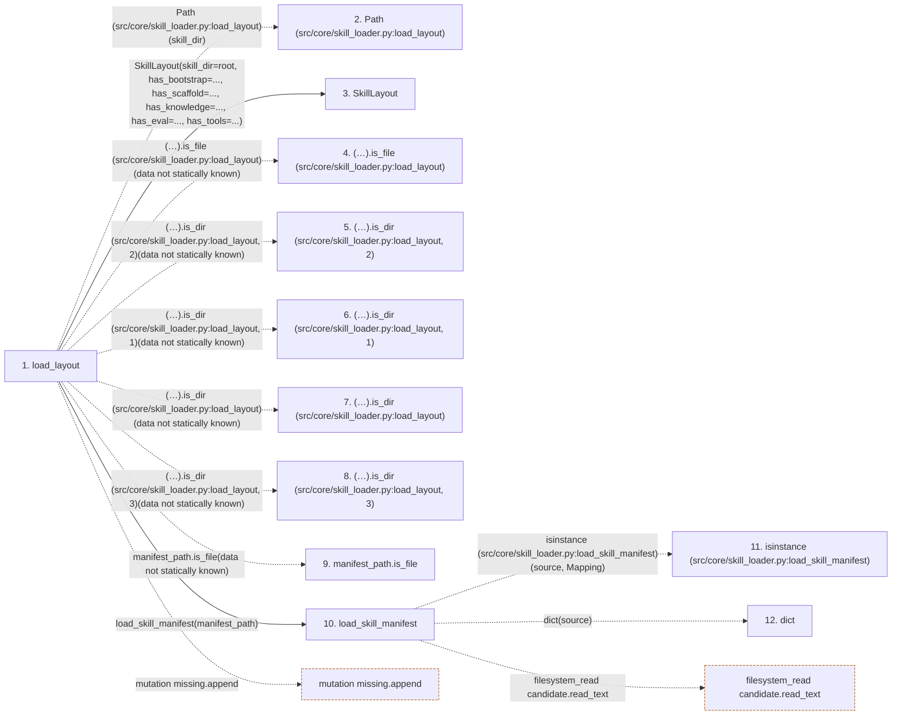

# load_layout

**Entry point:** `load_layout` (`api`)
**Source:** [skill_loader](../modules/skill_loader.md)
**Modules touched:** [skill_loader](../modules/skill_loader.md), [skill_manifest](../modules/skill_manifest.md)

## Call sequence

> Static overview in presentation order, not runtime execution order. Arrows retain captured callers; representative internal continuations and boundary examples precede repeated helper detail.

```mermaid
sequenceDiagram
    participant p0 as load_layout
    participant p1 as load_skill_manifest
    participant p2 as _resolve_caps
    participant p3 as SkillLayout
    participant p4 as PluginEntry
    participant p5 as _interpolate
    participant p6 as _wrap_validation_error
    participant p7 as ManifestValidationError
    participant p8 as PluginCaps
    participant p9 as ManifestVersionError
    participant p10 as _interpolate_string
    participant p11 as Path (src/core/skill_loader.py:load_layout)
    participant p12 as (…).is_file (src/core/skill_loader.py:load_layout)
    participant p13 as (…).is_dir (src/core/skill_loader.py:load_layout, 2)
    participant p14 as (…).is_dir (src/core/skill_loader.py:load_layout, 1)
    participant p15 as (…).is_dir (src/core/skill_loader.py:load_layout)
    participant p16 as (…).is_dir (src/core/skill_loader.py:load_layout, 3)
    participant p17 as manifest_path.is_file
    participant p18 as (…).is_file (src/core/skill_loader.py:load_layout, 1)
    participant p19 as missing.append
    participant p20 as _DEFAULT_PLUGIN_FILES.items
    participant p21 as (…).is_file (src/core/skill_loader.py:load_layout, 2)
    participant p22 as sorted (src/core/skill_loader.py:load_layout)
    participant p23 as set (src/core/skill_loader.py:load_layout)
    participant p24 as isinstance (src/core/skill_loader.py:load_skill_manifest)
    participant p25 as dict
    participant p26 as set (src/core/skill_loader.py:_resolve_caps)
    participant p27 as Path(…).read_text
    participant p28 as Path (src/core/skill_loader.py:load_skill_manifest)
    p0->>p1: load_skill_manifest
    p0->>p2: _resolve_caps
    p0->>p3: SkillLayout
    p0->>p4: PluginEntry
    p1->>p5: _interpolate
    p1->>p6: _wrap_validation_error
    p2->>p7: ManifestValidationError
    p2->>p8: PluginCaps
    p1->>p9: ManifestVersionError
    p5->>p10: _interpolate_string
    p0-->>p11: Path (src/core/skill_loader.py:load_layout)(skill_dir)
    p0-->>p12: (…).is_file (src/core/skill_loader.py:load_layout)
    p0-->>p13: (…).is_dir (src/core/skill_loader.py:load_layout, 2)
    p0-->>p14: (…).is_dir (src/core/skill_loader.py:load_layout, 1)
    p0-->>p15: (…).is_dir (src/core/skill_loader.py:load_layout)
    p0-->>p16: (…).is_dir (src/core/skill_loader.py:load_layout, 3)
    p0-->>p17: manifest_path.is_file
    p0-->>p18: (…).is_file (src/core/skill_loader.py:load_layout, 1)
    p0-->>p19: missing.append(entry.path)
    p0-->>p20: _DEFAULT_PLUGIN_FILES.items
    p0-->>p21: (…).is_file (src/core/skill_loader.py:load_layout, 2)
    p0-->>p22: sorted (src/core/skill_loader.py:load_layout)(set(...))
    p0-->>p23: set (src/core/skill_loader.py:load_layout)(missing)
    p1-->>p24: isinstance (src/core/skill_loader.py:load_skill_manifest)(source, Mapping)
    p1-->>p25: dict(source)
    p2-->>p26: set (src/core/skill_loader.py:_resolve_caps)(declared.env)
    p1-->>p24: isinstance (src/core/skill_loader.py:load_skill_manifest)(source, Path)
    p2-->>p26: set (src/core/skill_loader.py:_resolve_caps)(default.env)
    p1-->>p27: Path(…).read_text(encoding='utf-8')
    p1-->>p28: Path (src/core/skill_loader.py:load_skill_manifest)(source)
```

<!-- Auto-generated from static call edges. Dashed arrows are external or unresolved calls. Reviewed runtime conditions and side effects belong in Behavior. -->

> Call sequence diagram shows 30 of 75 interactions; 45 omitted to keep the visualization within the 30-interaction and generated-diagram limits, with uncertain identities omitted rather than inferred.

> Captured boundary calls: external 9 of 34 (25 omitted); unresolved 11 of 22 (11 omitted). These counts cover the captured static trace.

Omitted captured detail, grouped by actual caller occurrence and target module:

| Caller | Parent step | Target module | Kind | Omitted interactions |
| --- | --- | --- | --- | --- |
| `src/core/skill_loader.py:load_skill_manifest` | 10 | - | external | 9 |
| `src/core/skill_loader.py:load_skill_manifest` | 10 | [src/core/skill_manifest.py](../modules/skill_manifest.md) | internal | 3 |
| `src/core/skill_loader.py:load_skill_manifest` | 10 | - | unresolved | 4 |
| `src/core/skill_loader.py:_interpolate` | 32 | - | external | 4 |
| `src/core/skill_loader.py:_interpolate_string` | 34 | - | unresolved | 2 |
| `src/core/skill_loader.py:_interpolate` | 32 | [src/core/skill_loader.py](../modules/skill_loader.md) | internal | 2 |
| `src/core/skill_loader.py:_interpolate` | 32 | - | unresolved | 1 |
| `src/core/skill_loader.py:_wrap_validation_error` | 44 | - | unresolved | 4 |
> Omission summary shows 8 of 13 groups; 5 further groups are not expanded here. Counts above include all omitted interactions.
> Detailed flow queries retain their own coverage and limits; omitted paths may execute at runtime.

## Data flow

<!-- Auto-generated static analysis. Treat values and boundaries as best-effort hints, not runtime proof. -->

### Step data

| Step | Inputs | Reads | Writes | Returns |
|---|---|---|---|---|
| `load_layout` | `skill_dir: Union[str, Path]`, `manifest: Optional[ResearchSkillManifest]` | `_DEFAULT_CAPS_BY_KIND` | `resolved[...]`, `resolved[...]`, `layout.plugins`, `layout.missing_plugin_paths` | `layout` |
| `Path (src/core/skill_loader.py:load_layout)` | - | - | - | - |
| `SkillLayout` | - | - | - | - |
| `(…).is_file (src/core/skill_loader.py:load_layout)` | - | - | - | - |
| `(…).is_dir (src/core/skill_loader.py:load_layout, 2)` | - | - | - | - |
| `(…).is_dir (src/core/skill_loader.py:load_layout, 1)` | - | - | - | - |
| `(…).is_dir (src/core/skill_loader.py:load_layout)` | - | - | - | - |
| `(…).is_dir (src/core/skill_loader.py:load_layout, 3)` | - | - | - | - |
| `manifest_path.is_file` | - | - | - | - |
| `load_skill_manifest` | `source: Union[str, Path, Mapping[str, Any]]`, `settings_obj: Any`, `skill_params: Optional[Mapping[str, Any]]` | `Mapping`, `Path`, `SCHEMA_VERSION`, `SCHEMA_VERSION`, `SCHEMA_VERSION`, `ValidationError` | - | `ResearchSkillManifest.model_validate(...)` |
| `isinstance (src/core/skill_loader.py:load_skill_manifest)` | - | - | - | - |
| `dict` | - | - | - | - |

### Call data

| From | To | Line | Call |
|---|---|---:|---|
| load_layout | Path (src/core/skill_loader.py:load_layout) | 195 | `Path(skill_dir)` |
| load_layout | SkillLayout | 196 | `SkillLayout(skill_dir=root, has_bootstrap=..., has_scaffold=..., has_knowledge=..., has_eval=..., has_tools=...)` |
| load_layout | (…).is_file (src/core/skill_loader.py:load_layout) | 198 | `(root / 'bootstrap.py').is_file(data not statically known)` |
| load_layout | (…).is_dir (src/core/skill_loader.py:load_layout, 2) | 199 | `(root / 'scaffold').is_dir(data not statically known)` |
| load_layout | (…).is_dir (src/core/skill_loader.py:load_layout, 1) | 200 | `(root / 'knowledge').is_dir(data not statically known)` |
| load_layout | (…).is_dir (src/core/skill_loader.py:load_layout) | 201 | `(root / 'eval').is_dir(data not statically known)` |
| load_layout | (…).is_dir (src/core/skill_loader.py:load_layout, 3) | 202 | `(root / 'tools').is_dir(data not statically known)` |
| load_layout | manifest_path.is_file | 207 | `manifest_path.is_file(data not statically known)` |
| load_layout | load_skill_manifest | 208 | `load_skill_manifest(manifest_path)` |
| load_skill_manifest | isinstance (src/core/skill_loader.py:load_skill_manifest) | 383 | `isinstance(source, Mapping)` |
| load_skill_manifest | dict | 384 | `dict(source)` |

### Boundary effects

| Kind | Target | Step | Line |
|---|---|---|---:|
| mutation | `missing.append` | `load_layout` | 220 |
| filesystem_read | `candidate.read_text` | `load_skill_manifest` | 398 |

### Static analysis gaps

| Kind | Step | Target | Line |
|---|---|---|---:|
| unresolved_call | `load_layout` | `(root / 'bootstrap.py').is_file` | 198 |
| unresolved_call | `load_layout` | `(root / 'scaffold').is_dir` | 199 |
| unresolved_call | `load_layout` | `(root / 'knowledge').is_dir` | 200 |
| unresolved_call | `load_layout` | `(root / 'eval').is_dir` | 201 |
| unresolved_call | `load_layout` | `(root / 'tools').is_dir` | 202 |
| unresolved_call | `load_layout` | `manifest_path.is_file` | 207 |
| external_call | `load_skill_manifest` | `isinstance` | 383 |
| step_limit | `load_layout` | `first 12 steps` | 0 |

## Behavior

This flow starts at `load_layout` and is classified as `api`. The generated call and data-flow sections are bounded static projections; runtime conditions and side effects require source-level confirmation.
