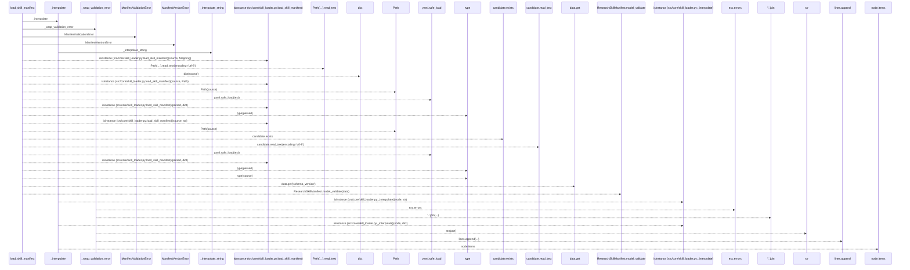
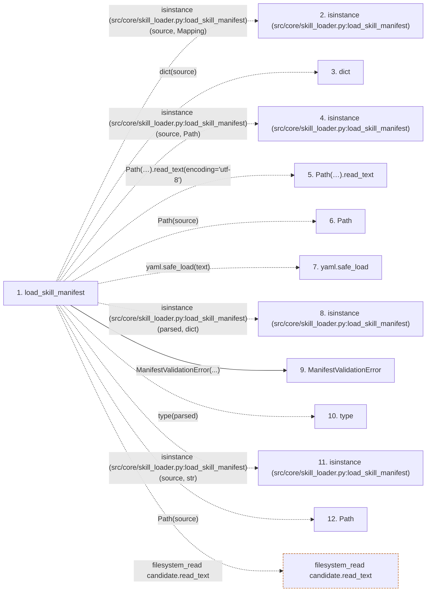

# load_skill_manifest

**Entry point:** `load_skill_manifest` (`api`)
**Source:** [skill_loader](../modules/skill_loader.md)
**Modules touched:** [skill_loader](../modules/skill_loader.md), [skill_manifest](../modules/skill_manifest.md)

## Call sequence

> Static overview in presentation order, not runtime execution order. Arrows retain captured callers; representative internal continuations and boundary examples precede repeated helper detail.

<!-- Auto-generated from static call edges. Dashed arrows are external or unresolved calls. Reviewed runtime conditions and side effects belong in Behavior. -->

> Call sequence diagram shows 30 of 40 interactions; 10 omitted to keep the visualization within the 30-interaction and generated-diagram limits, with uncertain identities omitted rather than inferred.

> Captured boundary calls: external 16 of 18 (2 omitted); unresolved 9 of 12 (3 omitted). These counts cover the captured static trace.

Omitted captured detail, grouped by actual caller occurrence and target module:

| Caller | Parent step | Target module | Kind | Omitted interactions |
| --- | --- | --- | --- | --- |
| `src/core/skill_loader.py:load_skill_manifest` | 1 | [src/core/skill_manifest.py](../modules/skill_manifest.md) | internal | 2 |
| `src/core/skill_loader.py:_interpolate_string` | 25 | - | unresolved | 2 |
| `src/core/skill_loader.py:_interpolate` | 23 | [src/core/skill_loader.py](../modules/skill_loader.md) | internal | 2 |
| `src/core/skill_loader.py:_interpolate` | 23 | - | external | 2 |
| `src/core/skill_loader.py:_wrap_validation_error` | 35 | - | unresolved | 1 |
| `src/core/skill_loader.py:_wrap_validation_error` | 35 | [src/core/skill_manifest.py](../modules/skill_manifest.md) | internal | 1 |
> Detailed flow queries retain their own coverage and limits; omitted paths may execute at runtime.

## Data flow

<!-- Auto-generated static analysis. Treat values and boundaries as best-effort hints, not runtime proof. -->

### Step data

| Step | Inputs | Reads | Writes | Returns |
|---|---|---|---|---|
| `load_skill_manifest` | `source: Union[str, Path, Mapping[str, Any]]`, `settings_obj: Any`, `skill_params: Optional[Mapping[str, Any]]` | `Mapping`, `Path`, `SCHEMA_VERSION`, `SCHEMA_VERSION`, `SCHEMA_VERSION`, `ValidationError` | - | `ResearchSkillManifest.model_validate(...)` |
| `isinstance (src/core/skill_loader.py:load_skill_manifest)` | - | - | - | - |
| `dict` | - | - | - | - |
| `isinstance (src/core/skill_loader.py:load_skill_manifest)` | - | - | - | - |
| `Path(…).read_text` | - | - | - | - |
| `Path` | - | - | - | - |
| `yaml.safe_load` | - | - | - | - |
| `isinstance (src/core/skill_loader.py:load_skill_manifest)` | - | - | - | - |
| `ManifestValidationError` | - | - | - | - |
| `type` | - | - | - | - |
| `isinstance (src/core/skill_loader.py:load_skill_manifest)` | - | - | - | - |
| `Path` | - | - | - | - |

### Call data

| From | To | Line | Call |
|---|---|---:|---|
| load_skill_manifest | isinstance (src/core/skill_loader.py:load_skill_manifest) | 383 | `isinstance(source, Mapping)` |
| load_skill_manifest | dict | 384 | `dict(source)` |
| load_skill_manifest | isinstance (src/core/skill_loader.py:load_skill_manifest) | 385 | `isinstance(source, Path)` |
| load_skill_manifest | Path(…).read_text | 386 | `Path(source).read_text(encoding='utf-8')` |
| load_skill_manifest | Path | 386 | `Path(source)` |
| load_skill_manifest | yaml.safe_load | 387 | `yaml.safe_load(text)` |
| load_skill_manifest | isinstance (src/core/skill_loader.py:load_skill_manifest) | 388 | `isinstance(parsed, dict)` |
| load_skill_manifest | ManifestValidationError | 389 | `ManifestValidationError(...)` |
| load_skill_manifest | type | 390 | `type(parsed)` |
| load_skill_manifest | isinstance (src/core/skill_loader.py:load_skill_manifest) | 393 | `isinstance(source, str)` |
| load_skill_manifest | Path | 396 | `Path(source)` |

### Boundary effects

| Kind | Target | Step | Line |
|---|---|---|---:|
| filesystem_read | `candidate.read_text` | `load_skill_manifest` | 398 |

### Static analysis gaps

| Kind | Step | Target | Line |
|---|---|---|---:|
| external_call | `load_skill_manifest` | `isinstance` | 383 |
| external_call | `load_skill_manifest` | `isinstance` | 385 |
| unresolved_call | `load_skill_manifest` | `Path(source).read_text` | 386 |
| external_call | `load_skill_manifest` | `yaml.safe_load` | 387 |
| external_call | `load_skill_manifest` | `isinstance` | 388 |
| external_call | `load_skill_manifest` | `type` | 390 |
| external_call | `load_skill_manifest` | `isinstance` | 393 |
| step_limit | `load_skill_manifest` | `first 12 steps` | 0 |

## Behavior

This flow starts at `load_skill_manifest` and is classified as `api`. The generated call and data-flow sections are bounded static projections; runtime conditions and side effects require source-level confirmation.
