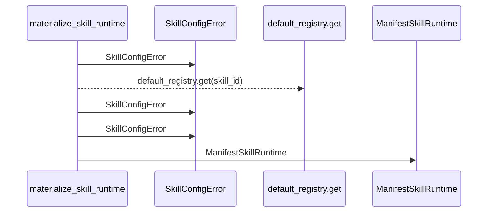
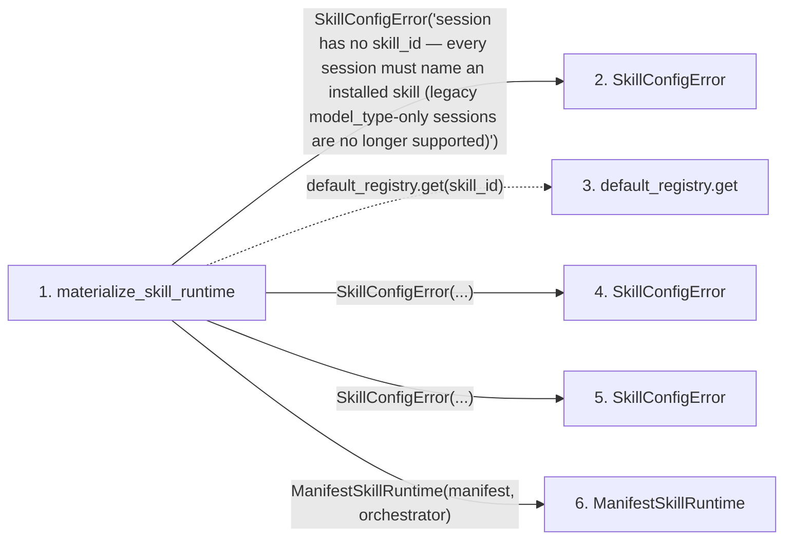

# materialize_skill_runtime

**Entry point:** `materialize_skill_runtime` (`api`)
**Source:** [skill_runtime](../modules/skill_runtime.md)
**Modules touched:** [skill_runtime](../modules/skill_runtime.md)

## Call sequence

> Static overview in presentation order, not runtime execution order. Arrows retain captured callers; representative internal continuations and boundary examples precede repeated helper detail.

<!-- Auto-generated from static call edges. Dashed arrows are external or unresolved calls. Reviewed runtime conditions and side effects belong in Behavior. -->

> Call sequence diagram shows 5 of 5 interactions; 0 omitted to keep the visualization within the 30-interaction and generated-diagram limits, with uncertain identities omitted rather than inferred.

> Captured boundary calls: external 0 of 0 (0 omitted); unresolved 1 of 1 (0 omitted). These counts cover the captured static trace.
> Detailed flow queries retain their own coverage and limits; omitted paths may execute at runtime.

## Data flow

<!-- Auto-generated static analysis. Treat values and boundaries as best-effort hints, not runtime proof. -->

### Step data

| Step | Inputs | Reads | Writes | Returns |
|---|---|---|---|---|
| `materialize_skill_runtime` | `orchestrator: Any`, `config: 'ResearchConfig'` | - | - | `ManifestSkillRuntime(...)` |
| `SkillConfigError` | - | - | - | - |
| `default_registry.get` | - | - | - | - |
| `SkillConfigError` | - | - | - | - |
| `SkillConfigError` | - | - | - | - |
| `ManifestSkillRuntime` | - | - | - | - |

### Call data

| From | To | Line | Call |
|---|---|---:|---|
| materialize_skill_runtime | SkillConfigError | 1177 | `SkillConfigError('session has no skill_id — every session must name an installed skill (legacy model_type-only sessions are no longer supported)')` |
| materialize_skill_runtime | default_registry.get | 1184 | `default_registry.get(skill_id)` |
| materialize_skill_runtime | SkillConfigError | 1186 | `SkillConfigError(...)` |
| materialize_skill_runtime | SkillConfigError | 1192 | `SkillConfigError(...)` |
| materialize_skill_runtime | ManifestSkillRuntime | 1196 | `ManifestSkillRuntime(manifest, orchestrator)` |

### Boundary effects

*No boundary effects detected.*

### Static analysis gaps

| Kind | Step | Target | Line |
|---|---|---|---:|
| unresolved_call | `materialize_skill_runtime` | `default_registry.get` | 1184 |

## Behavior

This flow starts at `materialize_skill_runtime` and is classified as `api`. The generated call and data-flow sections are bounded static projections; runtime conditions and side effects require source-level confirmation.
