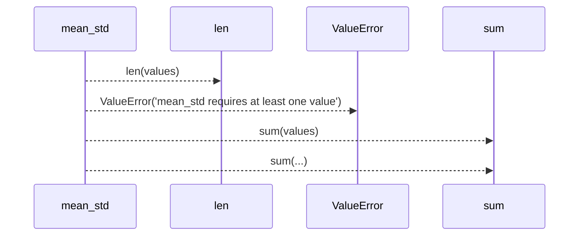
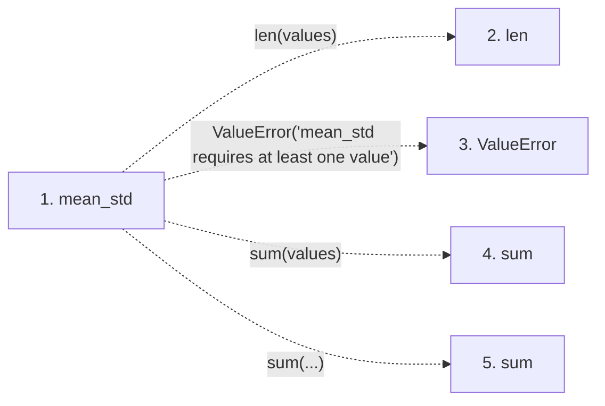

# mean_std

**Entry point:** `mean_std` (`api`)
**Source:** [significance](../modules/significance.md)
**Modules touched:** [significance](../modules/significance.md)

## Call sequence

> Static overview in presentation order, not runtime execution order. Arrows retain captured callers; representative internal continuations and boundary examples precede repeated helper detail.

<!-- Auto-generated from static call edges. Dashed arrows are external or unresolved calls. Reviewed runtime conditions and side effects belong in Behavior. -->

> Call sequence diagram shows 4 of 4 interactions; 0 omitted to keep the visualization within the 30-interaction and generated-diagram limits, with uncertain identities omitted rather than inferred.

> Captured boundary calls: external 4 of 4 (0 omitted); unresolved 0 of 0 (0 omitted). These counts cover the captured static trace.
> Detailed flow queries retain their own coverage and limits; omitted paths may execute at runtime.

## Data flow

<!-- Auto-generated static analysis. Treat values and boundaries as best-effort hints, not runtime proof. -->

### Step data

| Step | Inputs | Reads | Writes | Returns |
|---|---|---|---|---|
| `mean_std` | `values: Sequence[float]` | - | - | `(...)`, `(...)` |
| `len` | - | - | - | - |
| `ValueError` | - | - | - | - |
| `sum` | - | - | - | - |
| `sum` | - | - | - | - |

### Call data

| From | To | Line | Call |
|---|---|---:|---|
| mean_std | len | 45 | `len(values)` |
| mean_std | ValueError | 47 | `ValueError('mean_std requires at least one value')` |
| mean_std | sum | 48 | `sum(values)` |
| mean_std | sum | 51 | `sum(...)` |

### Boundary effects

*No boundary effects detected.*

### Static analysis gaps

| Kind | Step | Target | Line |
|---|---|---|---:|
| external_call | `mean_std` | `ValueError` | 47 |
| external_call | `mean_std` | `sum` | 48 |
| external_call | `mean_std` | `sum` | 51 |

## Behavior

This flow starts at `mean_std` and is classified as `api`. The generated call and data-flow sections are bounded static projections; runtime conditions and side effects require source-level confirmation.
