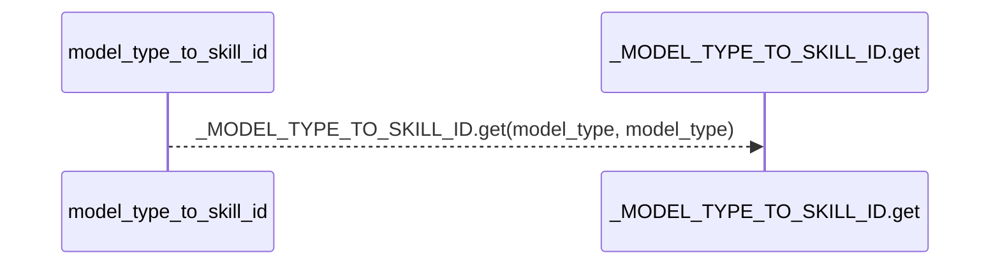
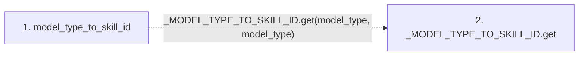

# model_type_to_skill_id

**Entry point:** `model_type_to_skill_id` (`api`)
**Source:** [compat_legacy_alias](../modules/compat_legacy_alias.md)
**Modules touched:** [compat_legacy_alias](../modules/compat_legacy_alias.md)

## Call sequence

> Static overview in presentation order, not runtime execution order. Arrows retain captured callers; representative internal continuations and boundary examples precede repeated helper detail.

<!-- Auto-generated from static call edges. Dashed arrows are external or unresolved calls. Reviewed runtime conditions and side effects belong in Behavior. -->

> Call sequence diagram shows 1 of 1 interactions; 0 omitted to keep the visualization within the 30-interaction and generated-diagram limits, with uncertain identities omitted rather than inferred.

> Captured boundary calls: external 0 of 0 (0 omitted); unresolved 1 of 1 (0 omitted). These counts cover the captured static trace.
> Detailed flow queries retain their own coverage and limits; omitted paths may execute at runtime.

## Data flow

<!-- Auto-generated static analysis. Treat values and boundaries as best-effort hints, not runtime proof. -->

### Step data

| Step | Inputs | Reads | Writes | Returns |
|---|---|---|---|---|
| `model_type_to_skill_id` | `model_type: str` | - | - | `''`, `_MODEL_TYPE_TO_SKILL_ID.get(...)` |
| `_MODEL_TYPE_TO_SKILL_ID.get` | - | - | - | - |

### Call data

| From | To | Line | Call |
|---|---|---:|---|
| model_type_to_skill_id | _MODEL_TYPE_TO_SKILL_ID.get | 45 | `_MODEL_TYPE_TO_SKILL_ID.get(model_type, model_type)` |

### Boundary effects

*No boundary effects detected.*

### Static analysis gaps

| Kind | Step | Target | Line |
|---|---|---|---:|
| unresolved_call | `model_type_to_skill_id` | `_MODEL_TYPE_TO_SKILL_ID.get` | 45 |

## Behavior

This flow starts at `model_type_to_skill_id` and is classified as `api`. The generated call and data-flow sections are bounded static projections; runtime conditions and side effects require source-level confirmation.
