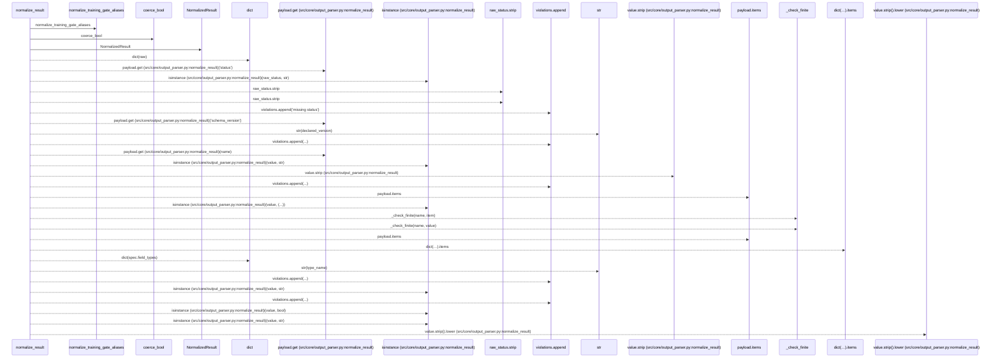
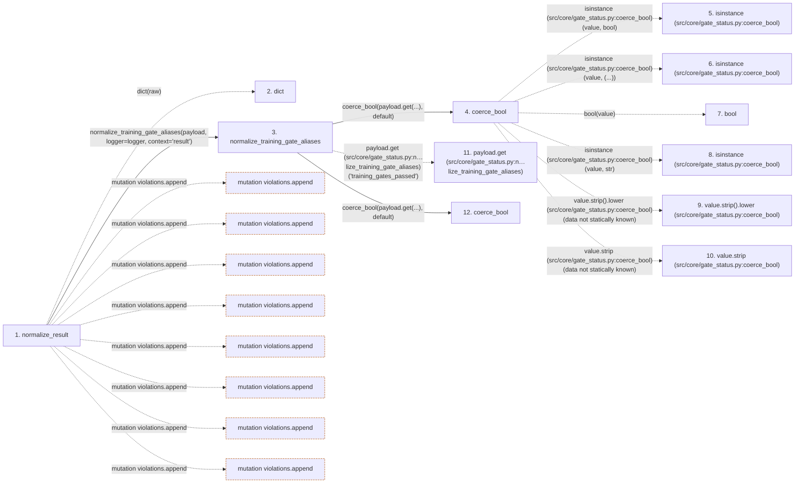

# normalize_result

**Entry point:** `normalize_result` (`api`)
**Source:** [output_parser](../modules/output_parser.md)
**Modules touched:** [gate_status](../modules/gate_status.md), [output_parser](../modules/output_parser.md)

## Call sequence

> Static overview in presentation order, not runtime execution order. Arrows retain captured callers; representative internal continuations and boundary examples precede repeated helper detail.

<!-- Auto-generated from static call edges. Dashed arrows are external or unresolved calls. Reviewed runtime conditions and side effects belong in Behavior. -->

> Call sequence diagram shows 30 of 92 interactions; 62 omitted to keep the visualization within the 30-interaction and generated-diagram limits, with uncertain identities omitted rather than inferred.

> Captured boundary calls: external 10 of 40 (30 omitted); unresolved 17 of 45 (28 omitted). These counts cover the captured static trace.

Omitted captured detail, grouped by actual caller occurrence and target module:

| Caller | Parent step | Target module | Kind | Omitted interactions |
| --- | --- | --- | --- | --- |
| `src/core/gate_status.py:normalize_training_gate_aliases` | 3 | [src/core/gate_status.py](../modules/gate_status.md) | internal | 4 |
| `src/core/gate_status.py:coerce_bool` | 4 | - | external | 4 |
| `src/core/gate_status.py:coerce_bool` | 4 | - | unresolved | 2 |
| `src/core/gate_status.py:normalize_training_gate_aliases` | 3 | - | unresolved | 4 |
| `src/core/output_parser.py:normalize_result` | 1 | - | unresolved | 22 |
| `src/core/output_parser.py:normalize_result` | 1 | - | external | 26 |
> Detailed flow queries retain their own coverage and limits; omitted paths may execute at runtime.

## Data flow

<!-- Auto-generated static analysis. Treat values and boundaries as best-effort hints, not runtime proof. -->

### Step data

| Step | Inputs | Reads | Writes | Returns |
|---|---|---|---|---|
| `normalize_result` | `raw: Mapping[str, Any]`, `spec: ResultSpec` | `logger`, `FIELD_TYPE_VOCABULARY`, `_UNIT_FIELD_TYPES`, `SUCCESS_STATUSES` | `fields[...]`, `fields[...]`, `fields[...]`, `units[...]` | `NormalizedResult(...)` |
| `dict` | - | - | - | - |
| `normalize_training_gate_aliases` | `payload: MutableMapping[str, Any]`, `legacy_value: Any`, `default: bool`, `logger: Optional[logging.Logger]`, `context: str` | - | `payload[...]`, `payload[...]` | `training` |
| `coerce_bool` | `value: Any`, `default: bool` | `_TRUE_VALUES`, `_FALSE_VALUES` | - | `value`, `bool(...)`, `True`, `False`, `default` |
| `isinstance (src/core/gate_status.py:coerce_bool)` | - | - | - | - |
| `isinstance (src/core/gate_status.py:coerce_bool)` | - | - | - | - |
| `bool` | - | - | - | - |
| `isinstance (src/core/gate_status.py:coerce_bool)` | - | - | - | - |
| `value.strip().lower (src/core/gate_status.py:coerce_bool)` | - | - | - | - |
| `value.strip (src/core/gate_status.py:coerce_bool)` | - | - | - | - |
| `payload.get (src/core/gate_status.py:n…lize_training_gate_aliases)` | - | - | - | - |
| `coerce_bool` | `value: Any`, `default: bool` | `_TRUE_VALUES`, `_FALSE_VALUES` | - | `value`, `bool(...)`, `True`, `False`, `default` |

### Call data

| From | To | Line | Call |
|---|---|---:|---|
| normalize_result | dict | 298 | `dict(raw)` |
| normalize_result | normalize_training_gate_aliases | 300 | `normalize_training_gate_aliases(payload, logger=logger, context='result')` |
| normalize_training_gate_aliases | coerce_bool | 83 | `coerce_bool(payload.get(...), default)` |
| coerce_bool | isinstance (src/core/gate_status.py:coerce_bool) | 15 | `isinstance(value, bool)` |
| coerce_bool | isinstance (src/core/gate_status.py:coerce_bool) | 17 | `isinstance(value, (...))` |
| coerce_bool | bool | 18 | `bool(value)` |
| coerce_bool | isinstance (src/core/gate_status.py:coerce_bool) | 19 | `isinstance(value, str)` |
| coerce_bool | value.strip().lower (src/core/gate_status.py:coerce_bool) | 20 | `value.strip().lower(data not statically known)` |
| coerce_bool | value.strip (src/core/gate_status.py:coerce_bool) | 20 | `value.strip(data not statically known)` |
| normalize_training_gate_aliases | payload.get (src/core/gate_status.py:n…lize_training_gate_aliases) | 83 | `payload.get('training_gates_passed')` |
| normalize_training_gate_aliases | coerce_bool | 85 | `coerce_bool(payload.get(...), default)` |

### Boundary effects

| Kind | Target | Step | Line |
|---|---|---|---:|
| mutation | `violations.append` | `normalize_result` | 308 |
| mutation | `violations.append` | `normalize_result` | 315 |
| mutation | `violations.append` | `normalize_result` | 320 |
| mutation | `violations.append` | `normalize_result` | 342 |
| mutation | `violations.append` | `normalize_result` | 349 |
| mutation | `violations.append` | `normalize_result` | 356 |
| mutation | `violations.append` | `normalize_result` | 359 |
| mutation | `violations.append` | `normalize_result` | 365 |

### Static analysis gaps

| Kind | Step | Target | Line |
|---|---|---|---:|
| external_call | `coerce_bool` | `isinstance` | 15 |
| external_call | `coerce_bool` | `isinstance` | 17 |
| external_call | `coerce_bool` | `isinstance` | 19 |
| unresolved_call | `coerce_bool` | `value.strip().lower` | 20 |
| unresolved_call | `coerce_bool` | `value.strip` | 20 |
| unresolved_call | `normalize_training_gate_aliases` | `payload.get` | 83 |
| step_limit | `normalize_result` | `first 12 steps` | 0 |

## Behavior

This flow starts at `normalize_result` and is classified as `api`. The generated call and data-flow sections are bounded static projections; runtime conditions and side effects require source-level confirmation.
