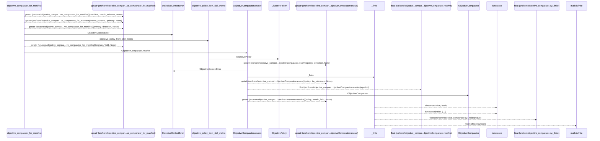
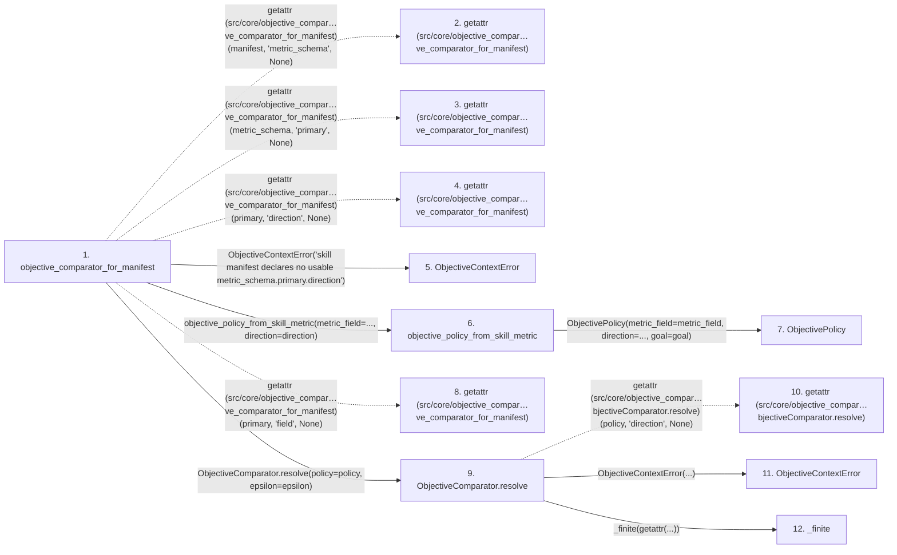

# objective_comparator_for_manifest

**Entry point:** `objective_comparator_for_manifest` (`api`)
**Source:** [objective_comparator](../modules/objective_comparator.md)
**Modules touched:** [execution_contracts](../modules/execution_contracts.md), [objective_comparator](../modules/objective_comparator.md)

## Call sequence

> Static overview in presentation order, not runtime execution order. Arrows retain captured callers; representative internal continuations and boundary examples precede repeated helper detail.

<!-- Auto-generated from static call edges. Dashed arrows are external or unresolved calls. Reviewed runtime conditions and side effects belong in Behavior. -->

> Call sequence diagram shows 19 of 19 interactions; 0 omitted to keep the visualization within the 30-interaction and generated-diagram limits, with uncertain identities omitted rather than inferred.

> Captured boundary calls: external 12 of 12 (0 omitted); unresolved 0 of 0 (0 omitted). These counts cover the captured static trace.
> Detailed flow queries retain their own coverage and limits; omitted paths may execute at runtime.

## Data flow

<!-- Auto-generated static analysis. Treat values and boundaries as best-effort hints, not runtime proof. -->

### Step data

| Step | Inputs | Reads | Writes | Returns |
|---|---|---|---|---|
| `objective_comparator_for_manifest` | `manifest: Any`, `epsilon: Optional[float]`, `metric_field: str` | - | - | `ObjectiveComparator.resolve(...)` |
| `getattr (src/core/objective_compar…ve_comparator_for_manifest)` | - | - | - | - |
| `getattr (src/core/objective_compar…ve_comparator_for_manifest)` | - | - | - | - |
| `getattr (src/core/objective_compar…ve_comparator_for_manifest)` | - | - | - | - |
| `ObjectiveContextError` | - | - | - | - |
| `objective_policy_from_skill_metric` | `metric_field: str`, `direction: Literal['higher_is_better', 'lower_is_better']`, `goal: ObjectiveGoal` | - | - | `ObjectivePolicy(...)` |
| `ObjectivePolicy` | - | - | - | - |
| `getattr (src/core/objective_compar…ve_comparator_for_manifest)` | - | - | - | - |
| `ObjectiveComparator.resolve` | `policy: Any`, `direction: Optional[str]`, `epsilon: Optional[float]`, `metric_field: str` | - | - | `cls(...)` |
| `getattr (src/core/objective_compar…bjectiveComparator.resolve)` | - | - | - | - |
| `ObjectiveContextError` | - | - | - | - |
| `_finite` | `value: Any` | - | - | `None`, `...` |

### Call data

| From | To | Line | Call |
|---|---|---:|---|
| objective_comparator_for_manifest | getattr (src/core/objective_compar…ve_comparator_for_manifest) | 223 | `getattr(manifest, 'metric_schema', None)` |
| objective_comparator_for_manifest | getattr (src/core/objective_compar…ve_comparator_for_manifest) | 224 | `getattr(metric_schema, 'primary', None)` |
| objective_comparator_for_manifest | getattr (src/core/objective_compar…ve_comparator_for_manifest) | 225 | `getattr(primary, 'direction', None)` |
| objective_comparator_for_manifest | ObjectiveContextError | 227 | `ObjectiveContextError('skill manifest declares no usable metric_schema.primary.direction')` |
| objective_comparator_for_manifest | objective_policy_from_skill_metric | 230 | `objective_policy_from_skill_metric(metric_field=..., direction=direction)` |
| objective_policy_from_skill_metric | ObjectivePolicy | 403 | `ObjectivePolicy(metric_field=metric_field, direction=..., goal=goal)` |
| objective_comparator_for_manifest | getattr (src/core/objective_compar…ve_comparator_for_manifest) | 231 | `getattr(primary, 'field', None)` |
| objective_comparator_for_manifest | ObjectiveComparator.resolve | 234 | `ObjectiveComparator.resolve(policy=policy, epsilon=epsilon)` |
| ObjectiveComparator.resolve | getattr (src/core/objective_compar…bjectiveComparator.resolve) | 105 | `getattr(policy, 'direction', None)` |
| ObjectiveComparator.resolve | ObjectiveContextError | 107 | `ObjectiveContextError(...)` |
| ObjectiveComparator.resolve | _finite | 111 | `_finite(getattr(...))` |

### Boundary effects

*No boundary effects detected.*

### Static analysis gaps

| Kind | Step | Target | Line |
|---|---|---|---:|
| external_call | `objective_comparator_for_manifest` | `getattr` | 223 |
| external_call | `objective_comparator_for_manifest` | `getattr` | 224 |
| external_call | `objective_comparator_for_manifest` | `getattr` | 225 |
| external_call | `objective_comparator_for_manifest` | `getattr` | 231 |
| external_call | `ObjectiveComparator.resolve` | `getattr` | 105 |
| step_limit | `objective_comparator_for_manifest` | `first 12 steps` | 0 |

## Behavior

This flow starts at `objective_comparator_for_manifest` and is classified as `api`. The generated call and data-flow sections are bounded static projections; runtime conditions and side effects require source-level confirmation.
