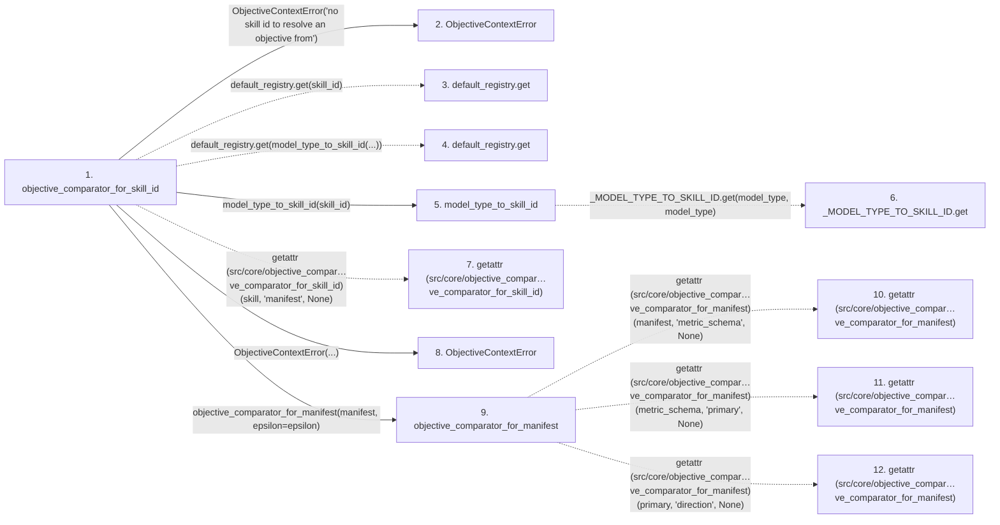

# objective_comparator_for_skill_id

**Entry point:** `objective_comparator_for_skill_id` (`api`)
**Source:** [objective_comparator](../modules/objective_comparator.md)
**Modules touched:** [compat_legacy_alias](../modules/compat_legacy_alias.md), [execution_contracts](../modules/execution_contracts.md), [objective_comparator](../modules/objective_comparator.md)

## Call sequence

> Static overview in presentation order, not runtime execution order. Arrows retain captured callers; representative internal continuations and boundary examples precede repeated helper detail.

```mermaid
sequenceDiagram
    participant p0 as objective_comparator_for_skill_id
    participant p1 as ObjectiveContextError
    participant p2 as default_registry.get
    participant p3 as model_type_to_skill_id
    participant p4 as getattr (src/core/objective_compar…ve_comparator_for_skill_id)
    participant p5 as objective_comparator_for_manifest
    participant p6 as _MODEL_TYPE_TO_SKILL_ID.get
    participant p7 as getattr (src/core/objective_compar…ve_comparator_for_manifest)
    participant p8 as objective_policy_from_skill_metric
    participant p9 as ObjectiveComparator.resolve
    participant p10 as ObjectivePolicy
    participant p11 as getattr (src/core/objective_compar…bjectiveComparator.resolve)
    participant p12 as _finite
    participant p13 as float (src/core/objective_compar…bjectiveComparator.resolve)
    participant p14 as ObjectiveComparator
    participant p15 as isinstance
    participant p16 as float (src/core/objective_comparator.py:_finite)
    participant p17 as math.isfinite
    p0->>p1: ObjectiveContextError
    p0-->>p2: default_registry.get(skill_id)
    p0-->>p2: default_registry.get(model_type_to_skill_id(...))
    p0->>p3: model_type_to_skill_id
    p0-->>p4: getattr (src/core/objective_compar…ve_comparator_for_skill_id)(skill, 'manifest', None)
    p0->>p1: ObjectiveContextError
    p0->>p5: objective_comparator_for_manifest
    p3-->>p6: _MODEL_TYPE_TO_SKILL_ID.get(model_type, model_type)
    p5-->>p7: getattr (src/core/objective_compar…ve_comparator_for_manifest)(manifest, 'metric_schema', None)
    p5-->>p7: getattr (src/core/objective_compar…ve_comparator_for_manifest)(metric_schema, 'primary', None)
    p5-->>p7: getattr (src/core/objective_compar…ve_comparator_for_manifest)(primary, 'direction', None)
    p5->>p1: ObjectiveContextError
    p5->>p8: objective_policy_from_skill_metric
    p5-->>p7: getattr (src/core/objective_compar…ve_comparator_for_manifest)(primary, 'field', None)
    p5->>p9: ObjectiveComparator.resolve
    p8->>p10: ObjectivePolicy
    p9-->>p11: getattr (src/core/objective_compar…bjectiveComparator.resolve)(policy, 'direction', None)
    p9->>p1: ObjectiveContextError
    p9->>p12: _finite
    p9-->>p11: getattr (src/core/objective_compar…bjectiveComparator.resolve)(policy, 'tie_tolerance', None)
    p9-->>p13: float (src/core/objective_compar…bjectiveComparator.resolve)(epsilon)
    p9->>p14: ObjectiveComparator
    p9-->>p11: getattr (src/core/objective_compar…bjectiveComparator.resolve)(policy, 'metric_field', None)
    p12-->>p15: isinstance(value, bool)
    p12-->>p15: isinstance(value, (...))
    p12-->>p16: float (src/core/objective_comparator.py:_finite)(value)
    p12-->>p17: math.isfinite(number)
```

<!-- Auto-generated from static call edges. Dashed arrows are external or unresolved calls. Reviewed runtime conditions and side effects belong in Behavior. -->

> Call sequence diagram shows 27 of 27 interactions; 0 omitted to keep the visualization within the 30-interaction and generated-diagram limits, with uncertain identities omitted rather than inferred.

> Captured boundary calls: external 13 of 13 (0 omitted); unresolved 3 of 3 (0 omitted). These counts cover the captured static trace.
> Detailed flow queries retain their own coverage and limits; omitted paths may execute at runtime.

## Data flow

<!-- Auto-generated static analysis. Treat values and boundaries as best-effort hints, not runtime proof. -->

### Step data

| Step | Inputs | Reads | Writes | Returns |
|---|---|---|---|---|
| `objective_comparator_for_skill_id` | `skill_id: Optional[str]`, `epsilon: Optional[float]`, `default: Optional[ObjectiveComparator]` | - | - | `default`, `default`, `objective_comparator_for_manifest(...)` |
| `ObjectiveContextError` | - | - | - | - |
| `default_registry.get` | - | - | - | - |
| `default_registry.get` | - | - | - | - |
| `model_type_to_skill_id` | `model_type: str` | - | - | `''`, `_MODEL_TYPE_TO_SKILL_ID.get(...)` |
| `_MODEL_TYPE_TO_SKILL_ID.get` | - | - | - | - |
| `getattr (src/core/objective_compar…ve_comparator_for_skill_id)` | - | - | - | - |
| `ObjectiveContextError` | - | - | - | - |
| `objective_comparator_for_manifest` | `manifest: Any`, `epsilon: Optional[float]`, `metric_field: str` | - | - | `ObjectiveComparator.resolve(...)` |
| `getattr (src/core/objective_compar…ve_comparator_for_manifest)` | - | - | - | - |
| `getattr (src/core/objective_compar…ve_comparator_for_manifest)` | - | - | - | - |
| `getattr (src/core/objective_compar…ve_comparator_for_manifest)` | - | - | - | - |

### Call data

| From | To | Line | Call |
|---|---|---:|---|
| objective_comparator_for_skill_id | ObjectiveContextError | 251 | `ObjectiveContextError('no skill id to resolve an objective from')` |
| objective_comparator_for_skill_id | default_registry.get | 255 | `default_registry.get(skill_id)` |
| objective_comparator_for_skill_id | default_registry.get | 264 | `default_registry.get(model_type_to_skill_id(...))` |
| objective_comparator_for_skill_id | model_type_to_skill_id | 264 | `model_type_to_skill_id(skill_id)` |
| model_type_to_skill_id | _MODEL_TYPE_TO_SKILL_ID.get | 45 | `_MODEL_TYPE_TO_SKILL_ID.get(model_type, model_type)` |
| objective_comparator_for_skill_id | getattr (src/core/objective_compar…ve_comparator_for_skill_id) | 267 | `getattr(skill, 'manifest', None)` |
| objective_comparator_for_skill_id | ObjectiveContextError | 271 | `ObjectiveContextError(...)` |
| objective_comparator_for_skill_id | objective_comparator_for_manifest | 274 | `objective_comparator_for_manifest(manifest, epsilon=epsilon)` |
| objective_comparator_for_manifest | getattr (src/core/objective_compar…ve_comparator_for_manifest) | 223 | `getattr(manifest, 'metric_schema', None)` |
| objective_comparator_for_manifest | getattr (src/core/objective_compar…ve_comparator_for_manifest) | 224 | `getattr(metric_schema, 'primary', None)` |
| objective_comparator_for_manifest | getattr (src/core/objective_compar…ve_comparator_for_manifest) | 225 | `getattr(primary, 'direction', None)` |

### Boundary effects

*No boundary effects detected.*

### Static analysis gaps

| Kind | Step | Target | Line |
|---|---|---|---:|
| unresolved_call | `objective_comparator_for_skill_id` | `default_registry.get` | 255 |
| unresolved_call | `objective_comparator_for_skill_id` | `default_registry.get` | 264 |
| unresolved_call | `model_type_to_skill_id` | `_MODEL_TYPE_TO_SKILL_ID.get` | 45 |
| external_call | `objective_comparator_for_skill_id` | `getattr` | 267 |
| external_call | `objective_comparator_for_manifest` | `getattr` | 223 |
| external_call | `objective_comparator_for_manifest` | `getattr` | 224 |
| external_call | `objective_comparator_for_manifest` | `getattr` | 225 |
| step_limit | `objective_comparator_for_skill_id` | `first 12 steps` | 0 |

## Behavior

This flow starts at `objective_comparator_for_skill_id` and is classified as `api`. The generated call and data-flow sections are bounded static projections; runtime conditions and side effects require source-level confirmation.
