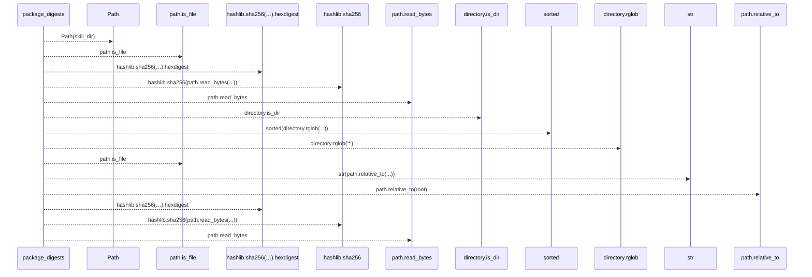
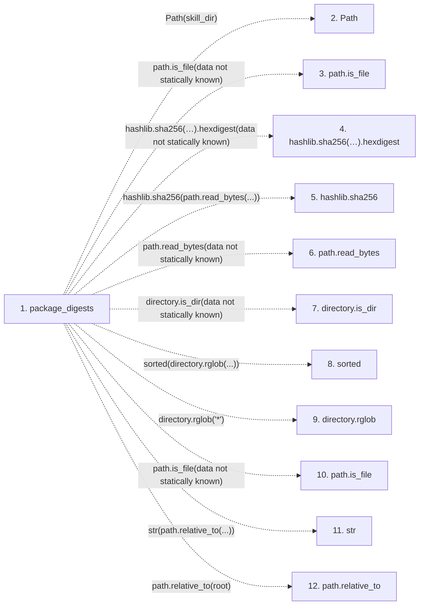

# package_digests

**Entry point:** `package_digests` (`api`)
**Source:** [run_spec](../modules/run_spec.md)
**Modules touched:** [run_spec](../modules/run_spec.md)

## Call sequence

> Static overview in presentation order, not runtime execution order. Arrows retain captured callers; representative internal continuations and boundary examples precede repeated helper detail.

<!-- Auto-generated from static call edges. Dashed arrows are external or unresolved calls. Reviewed runtime conditions and side effects belong in Behavior. -->

> Call sequence diagram shows 14 of 14 interactions; 0 omitted to keep the visualization within the 30-interaction and generated-diagram limits, with uncertain identities omitted rather than inferred.

> Captured boundary calls: external 5 of 5 (0 omitted); unresolved 9 of 9 (0 omitted). These counts cover the captured static trace.
> Detailed flow queries retain their own coverage and limits; omitted paths may execute at runtime.

## Data flow

<!-- Auto-generated static analysis. Treat values and boundaries as best-effort hints, not runtime proof. -->

### Step data

| Step | Inputs | Reads | Writes | Returns |
|---|---|---|---|---|
| `package_digests` | `skill_dir: Optional[str]` | - | `digests[...]`, `digests[...]` | `{...}`, `digests` |
| `Path` | - | - | - | - |
| `path.is_file` | - | - | - | - |
| `hashlib.sha256(…).hexdigest` | - | - | - | - |
| `hashlib.sha256` | - | - | - | - |
| `path.read_bytes` | - | - | - | - |
| `directory.is_dir` | - | - | - | - |
| `sorted` | - | - | - | - |
| `directory.rglob` | - | - | - | - |
| `path.is_file` | - | - | - | - |
| `str` | - | - | - | - |
| `path.relative_to` | - | - | - | - |

### Call data

| From | To | Line | Call |
|---|---|---:|---|
| package_digests | Path | 100 | `Path(skill_dir)` |
| package_digests | path.is_file | 104 | `path.is_file(data not statically known)` |
| package_digests | hashlib.sha256(…).hexdigest | 105 | `hashlib.sha256(path.read_bytes()).hexdigest(data not statically known)` |
| package_digests | hashlib.sha256 | 105 | `hashlib.sha256(path.read_bytes(...))` |
| package_digests | path.read_bytes | 105 | `path.read_bytes(data not statically known)` |
| package_digests | directory.is_dir | 108 | `directory.is_dir(data not statically known)` |
| package_digests | sorted | 109 | `sorted(directory.rglob(...))` |
| package_digests | directory.rglob | 109 | `directory.rglob('*')` |
| package_digests | path.is_file | 110 | `path.is_file(data not statically known)` |
| package_digests | str | 111 | `str(path.relative_to(...))` |
| package_digests | path.relative_to | 111 | `path.relative_to(root)` |

### Boundary effects

*No boundary effects detected.*

### Static analysis gaps

| Kind | Step | Target | Line |
|---|---|---|---:|
| unresolved_call | `package_digests` | `path.is_file` | 104 |
| unresolved_call | `package_digests` | `hashlib.sha256(path.read_bytes()).hexdigest` | 105 |
| external_call | `package_digests` | `hashlib.sha256` | 105 |
| unresolved_call | `package_digests` | `path.read_bytes` | 105 |
| unresolved_call | `package_digests` | `directory.is_dir` | 108 |
| external_call | `package_digests` | `sorted` | 109 |
| unresolved_call | `package_digests` | `directory.rglob` | 109 |
| unresolved_call | `package_digests` | `path.is_file` | 110 |
| unresolved_call | `package_digests` | `path.relative_to` | 111 |
| step_limit | `package_digests` | `first 12 steps` | 0 |

## Behavior

This flow starts at `package_digests` and is classified as `api`. The generated call and data-flow sections are bounded static projections; runtime conditions and side effects require source-level confirmation.
