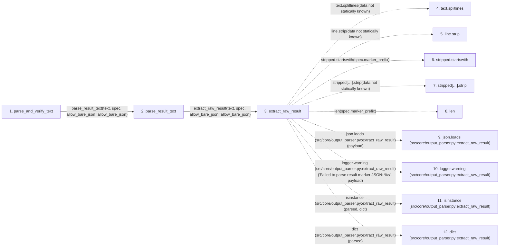

# parse_and_verify_text

**Entry point:** `parse_and_verify_text` (`api`)
**Source:** [output_parser](../modules/output_parser.md)
**Modules touched:** [artifact_reference](../modules/artifact_reference.md), [gate_status](../modules/gate_status.md), [output_parser](../modules/output_parser.md)

## Call sequence

> Static overview in presentation order, not runtime execution order. Arrows retain captured callers; representative internal continuations and boundary examples precede repeated helper detail.

```mermaid
sequenceDiagram
    participant p0 as parse_and_verify_text
    participant p1 as parse_result_text
    participant p2 as _verify_nonce
    participant p3 as extract_raw_result
    participant p4 as normalize_result
    participant p5 as normalize_training_gate_aliases
    participant p6 as _coerce_kv_value
    participant p7 as coerce_bool
    participant p8 as NormalizedResult
    participant p9 as normalize_optional_artifact_ref
    participant p10 as cast
    participant p11 as normalized.to_dict
    participant p12 as logger.warning (src/core/output_parser.py:_verify_nonce)
    participant p13 as isinstance (src/core/output_parser.py:_verify_nonce)
    participant p14 as session_nonce.hex
    participant p15 as str (src/core/output_parser.py:_verify_nonce)
    participant p16 as result.get
    participant p17 as hmac.compare_digest
    participant p18 as str(…).encode
    participant p19 as expected.encode
    participant p20 as text.splitlines
    participant p21 as dict (src/core/output_parser.py:normalize_result)
    participant p22 as line.strip
    participant p23 as stripped.startswith
    participant p24 as payload.get (src/core/output_parser.py:normalize_result)
    participant p25 as stripped[…].strip
    participant p26 as isinstance (src/core/output_parser.py:normalize_result)
    p0->>p1: parse_result_text
    p0->>p2: _verify_nonce
    p1->>p3: extract_raw_result
    p1->>p4: normalize_result
    p4->>p5: normalize_training_gate_aliases
    p3->>p6: _coerce_kv_value
    p4->>p7: coerce_bool
    p4->>p8: NormalizedResult
    p6->>p9: normalize_optional_artifact_ref
    p0-->>p10: cast(IterationResult, normalized.to_dict(...))
    p0-->>p11: normalized.to_dict
    p2-->>p12: logger.warning (src/core/output_parser.py:_verify_nonce)(…)
    p2-->>p13: isinstance (src/core/output_parser.py:_verify_nonce)(session_nonce, bytes)
    p2-->>p14: session_nonce.hex
    p2-->>p15: str (src/core/output_parser.py:_verify_nonce)(session_nonce)
    p2-->>p16: result.get(field)
    p2-->>p12: logger.warning (src/core/output_parser.py:_verify_nonce)('Iteration marker rejected: nonce field r is absent (forged)', field)
    p2-->>p17: hmac.compare_digest(..., expected.encode(...))
    p2-->>p18: str(…).encode('utf-8')
    p2-->>p15: str (src/core/output_parser.py:_verify_nonce)(echoed)
    p2-->>p19: expected.encode('utf-8')
    p2-->>p12: logger.warning (src/core/output_parser.py:_verify_nonce)('Iteration marker rejected: nonce mismatch (expected s, got s) — forged', ..., ...)
    p2-->>p15: str (src/core/output_parser.py:_verify_nonce)(echoed)
    p3-->>p20: text.splitlines
    p4-->>p21: dict (src/core/output_parser.py:normalize_result)(raw)
    p3-->>p22: line.strip
    p3-->>p23: stripped.startswith(spec.marker_prefix)
    p4-->>p24: payload.get (src/core/output_parser.py:normalize_result)('status')
    p3-->>p25: stripped[…].strip
    p4-->>p26: isinstance (src/core/output_parser.py:normalize_result)(raw_status, str)
```

<!-- Auto-generated from static call edges. Dashed arrows are external or unresolved calls. Reviewed runtime conditions and side effects belong in Behavior. -->

> Call sequence diagram shows 30 of 142 interactions; 112 omitted to keep the visualization within the 30-interaction and generated-diagram limits, with uncertain identities omitted rather than inferred.

> Captured boundary calls: external 8 of 56 (48 omitted); unresolved 13 of 72 (59 omitted). These counts cover the captured static trace.

Omitted captured detail, grouped by actual caller occurrence and target module:

| Caller | Parent step | Target module | Kind | Omitted interactions |
| --- | --- | --- | --- | --- |
| `src/core/output_parser.py:extract_raw_result` | 3 | - | external | 7 |
| `src/core/output_parser.py:extract_raw_result` | 3 | - | unresolved | 9 |
| `src/core/output_parser.py:_coerce_kv_value` | 18 | - | unresolved | 4 |
| `src/core/artifact_reference.py:normalize_optional_artifact_ref` | 22 | - | unresolved | 2 |
| `src/core/artifact_reference.py:normalize_optional_artifact_ref` | 22 | - | external | 1 |
| `src/core/output_parser.py:_coerce_kv_value` | 18 | [src/core/gate_status.py](../modules/gate_status.md) | internal | 1 |
| `src/core/gate_status.py:coerce_bool` | 26 | - | external | 4 |
| `src/core/gate_status.py:coerce_bool` | 26 | - | unresolved | 2 |
> Omission summary shows 8 of 13 groups; 5 further groups are not expanded here. Counts above include all omitted interactions.
> Detailed flow queries retain their own coverage and limits; omitted paths may execute at runtime.

## Data flow

<!-- Auto-generated static analysis. Treat values and boundaries as best-effort hints, not runtime proof. -->

### Step data

| Step | Inputs | Reads | Writes | Returns |
|---|---|---|---|---|
| `parse_and_verify_text` | `text: str`, `spec: ResultSpec`, `session_nonce: Optional[bytes]`, `nonce_field: Optional[str]`, `require_signed_metrics: bool`, `allow_bare_json: bool` | `IterationResult` | - | `None`, `_verify_nonce(...)` |
| `parse_result_text` | `text: str`, `spec: ResultSpec`, `allow_bare_json: bool` | - | - | `None`, `normalize_result(...)` |
| `extract_raw_result` | `text: str`, `spec: ResultSpec`, `allow_bare_json: bool` | `json`, `json` | - | `dict(...)`, `...`, `None`, `None`, `...` |
| `text.splitlines` | - | - | - | - |
| `line.strip` | - | - | - | - |
| `stripped.startswith` | - | - | - | - |
| `stripped[…].strip` | - | - | - | - |
| `len` | - | - | - | - |
| `json.loads (src/core/output_parser.py:extract_raw_result)` | - | - | - | - |
| `logger.warning (src/core/output_parser.py:extract_raw_result)` | - | - | - | - |
| `isinstance (src/core/output_parser.py:extract_raw_result)` | - | - | - | - |
| `dict (src/core/output_parser.py:extract_raw_result)` | - | - | - | - |

### Call data

| From | To | Line | Call |
|---|---|---:|---|
| parse_and_verify_text | parse_result_text | 474 | `parse_result_text(text, spec, allow_bare_json=allow_bare_json)` |
| parse_result_text | extract_raw_result | 458 | `extract_raw_result(text, spec, allow_bare_json=allow_bare_json)` |
| extract_raw_result | text.splitlines | 242 | `text.splitlines(data not statically known)` |
| extract_raw_result | line.strip | 243 | `line.strip(data not statically known)` |
| extract_raw_result | stripped.startswith | 244 | `stripped.startswith(spec.marker_prefix)` |
| extract_raw_result | stripped[…].strip | 246 | `stripped[len(spec.marker_prefix):].strip(data not statically known)` |
| extract_raw_result | len | 246 | `len(spec.marker_prefix)` |
| extract_raw_result | json.loads (src/core/output_parser.py:extract_raw_result) | 248 | `json.loads(payload)` |
| extract_raw_result | logger.warning (src/core/output_parser.py:extract_raw_result) | 250 | `logger.warning('Failed to parse result marker JSON: %s', payload)` |
| extract_raw_result | isinstance (src/core/output_parser.py:extract_raw_result) | 252 | `isinstance(parsed, dict)` |
| extract_raw_result | dict (src/core/output_parser.py:extract_raw_result) | 253 | `dict(parsed)` |

### Boundary effects

*No boundary effects detected.*

### Static analysis gaps

| Kind | Step | Target | Line |
|---|---|---|---:|
| unresolved_call | `extract_raw_result` | `text.splitlines` | 242 |
| unresolved_call | `extract_raw_result` | `line.strip` | 243 |
| unresolved_call | `extract_raw_result` | `stripped.startswith` | 244 |
| unresolved_call | `extract_raw_result` | `stripped[len(spec.marker_prefix):].strip` | 246 |
| external_call | `extract_raw_result` | `json.loads` | 248 |
| unresolved_call | `extract_raw_result` | `logger.warning` | 250 |
| external_call | `extract_raw_result` | `isinstance` | 252 |
| step_limit | `parse_and_verify_text` | `first 12 steps` | 0 |

## Behavior

This flow starts at `parse_and_verify_text` and is classified as `api`. The generated call and data-flow sections are bounded static projections; runtime conditions and side effects require source-level confirmation.
