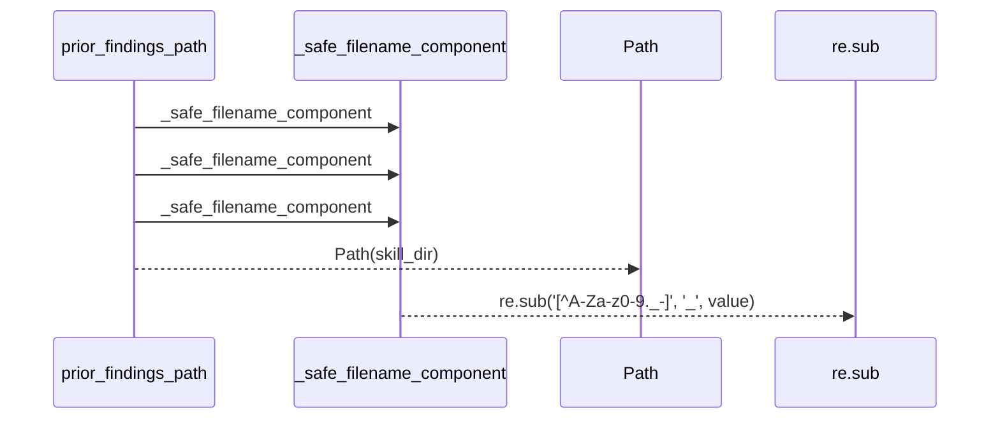
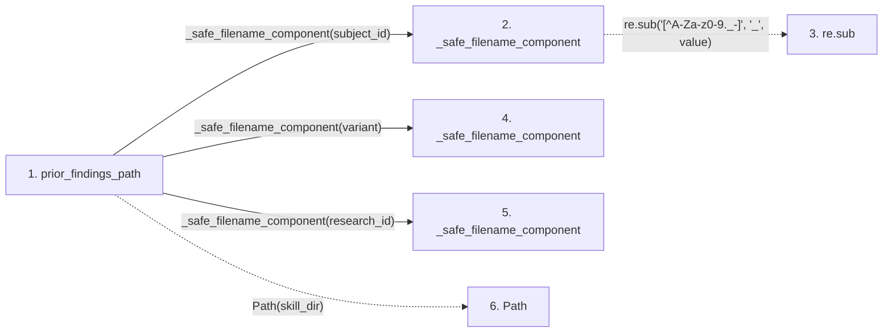

# prior_findings_path

**Entry point:** `prior_findings_path` (`api`)
**Source:** [insights_feedback](../modules/insights_feedback.md)
**Modules touched:** [insights_feedback](../modules/insights_feedback.md)

## Call sequence

> Static overview in presentation order, not runtime execution order. Arrows retain captured callers; representative internal continuations and boundary examples precede repeated helper detail.

<!-- Auto-generated from static call edges. Dashed arrows are external or unresolved calls. Reviewed runtime conditions and side effects belong in Behavior. -->

> Call sequence diagram shows 5 of 5 interactions; 0 omitted to keep the visualization within the 30-interaction and generated-diagram limits, with uncertain identities omitted rather than inferred.

> Captured boundary calls: external 2 of 2 (0 omitted); unresolved 0 of 0 (0 omitted). These counts cover the captured static trace.
> Detailed flow queries retain their own coverage and limits; omitted paths may execute at runtime.

## Data flow

<!-- Auto-generated static analysis. Treat values and boundaries as best-effort hints, not runtime proof. -->

### Step data

| Step | Inputs | Reads | Writes | Returns |
|---|---|---|---|---|
| `prior_findings_path` | `skill_dir: Path`, `subject_id: str`, `variant: str`, `research_id: str` | - | - | `...` |
| `_safe_filename_component` | `value: str` | - | - | `...` |
| `re.sub` | - | - | - | - |
| `_safe_filename_component` | `value: str` | - | - | `...` |
| `_safe_filename_component` | `value: str` | - | - | `...` |
| `Path` | - | - | - | - |

### Call data

| From | To | Line | Call |
|---|---|---:|---|
| prior_findings_path | _safe_filename_component | 47 | `_safe_filename_component(subject_id)` |
| _safe_filename_component | re.sub | 32 | `re.sub('[^A-Za-z0-9._-]', '_', value)` |
| prior_findings_path | _safe_filename_component | 48 | `_safe_filename_component(variant)` |
| prior_findings_path | _safe_filename_component | 49 | `_safe_filename_component(research_id)` |
| prior_findings_path | Path | 51 | `Path(skill_dir)` |

### Boundary effects

*No boundary effects detected.*

### Static analysis gaps

| Kind | Step | Target | Line |
|---|---|---|---:|
| external_call | `_safe_filename_component` | `re.sub` | 32 |

## Behavior

This flow starts at `prior_findings_path` and is classified as `api`. The generated call and data-flow sections are bounded static projections; runtime conditions and side effects require source-level confirmation.
