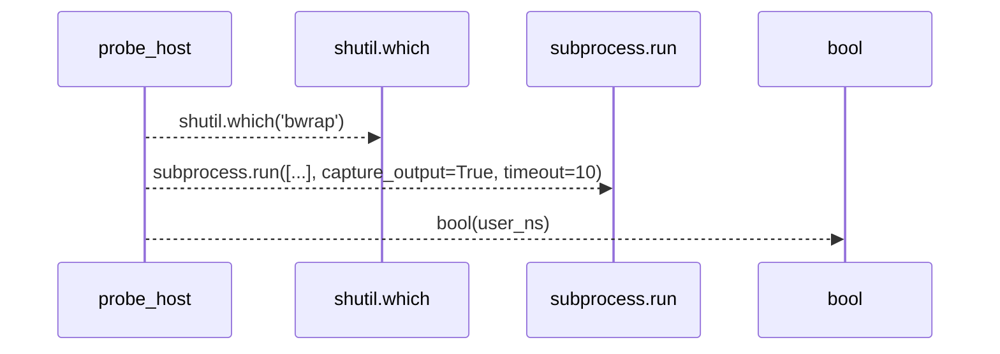
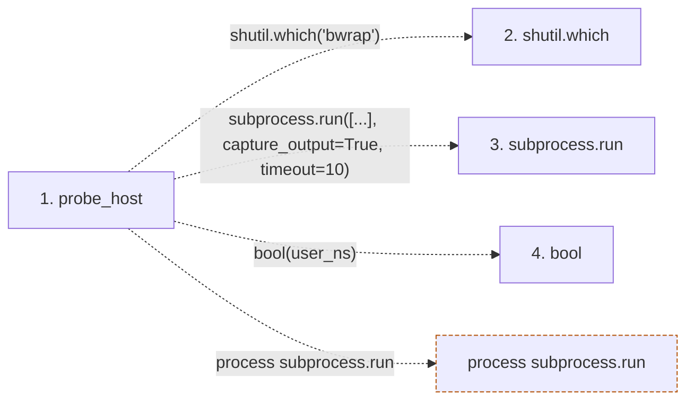

# probe_host

**Entry point:** `probe_host` (`api`)
**Source:** [isolation](../modules/isolation.md)
**Modules touched:** [isolation](../modules/isolation.md)

## Call sequence

> Static overview in presentation order, not runtime execution order. Arrows retain captured callers; representative internal continuations and boundary examples precede repeated helper detail.

<!-- Auto-generated from static call edges. Dashed arrows are external or unresolved calls. Reviewed runtime conditions and side effects belong in Behavior. -->

> Call sequence diagram shows 3 of 3 interactions; 0 omitted to keep the visualization within the 30-interaction and generated-diagram limits, with uncertain identities omitted rather than inferred.

> Captured boundary calls: external 3 of 3 (0 omitted); unresolved 0 of 0 (0 omitted). These counts cover the captured static trace.
> Detailed flow queries retain their own coverage and limits; omitted paths may execute at runtime.

## Data flow

<!-- Auto-generated static analysis. Treat values and boundaries as best-effort hints, not runtime proof. -->

### Step data

| Step | Inputs | Reads | Writes | Returns |
|---|---|---|---|---|
| `probe_host` | `bwrap_bin: Optional[str]` | `subprocess` | `info[...]`, `info[...]`, `info[...]`, `info[...]`, `info[...]` | `info`, `info` |
| `shutil.which` | - | - | - | - |
| `subprocess.run` | - | - | - | - |
| `bool` | - | - | - | - |

### Call data

| From | To | Line | Call |
|---|---|---:|---|
| probe_host | shutil.which | 167 | `shutil.which('bwrap')` |
| probe_host | subprocess.run | 174 | `subprocess.run([...], capture_output=True, timeout=10)` |
| probe_host | bool | 183 | `bool(user_ns)` |

### Boundary effects

| Kind | Target | Step | Line |
|---|---|---|---:|
| process | `subprocess.run` | `probe_host` | 174 |

### Static analysis gaps

| Kind | Step | Target | Line |
|---|---|---|---:|
| external_call | `probe_host` | `shutil.which` | 167 |

## Behavior

This flow starts at `probe_host` and is classified as `api`. The generated call and data-flow sections are bounded static projections; runtime conditions and side effects require source-level confirmation.
