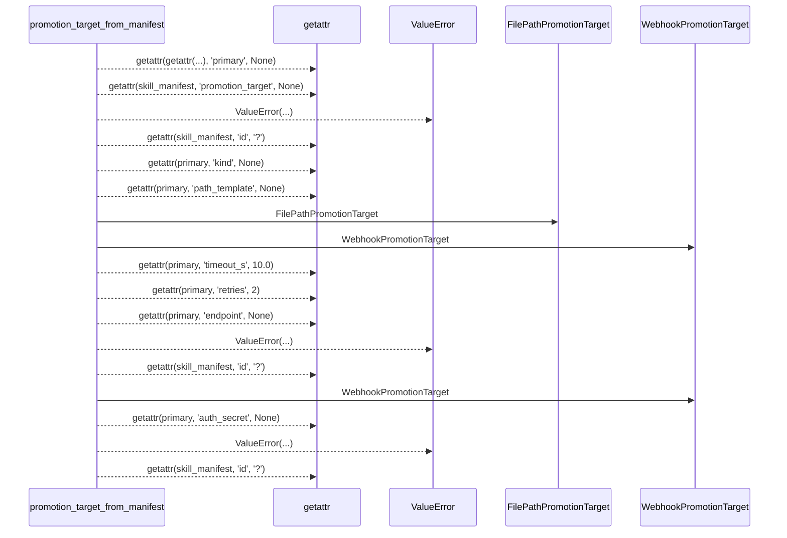
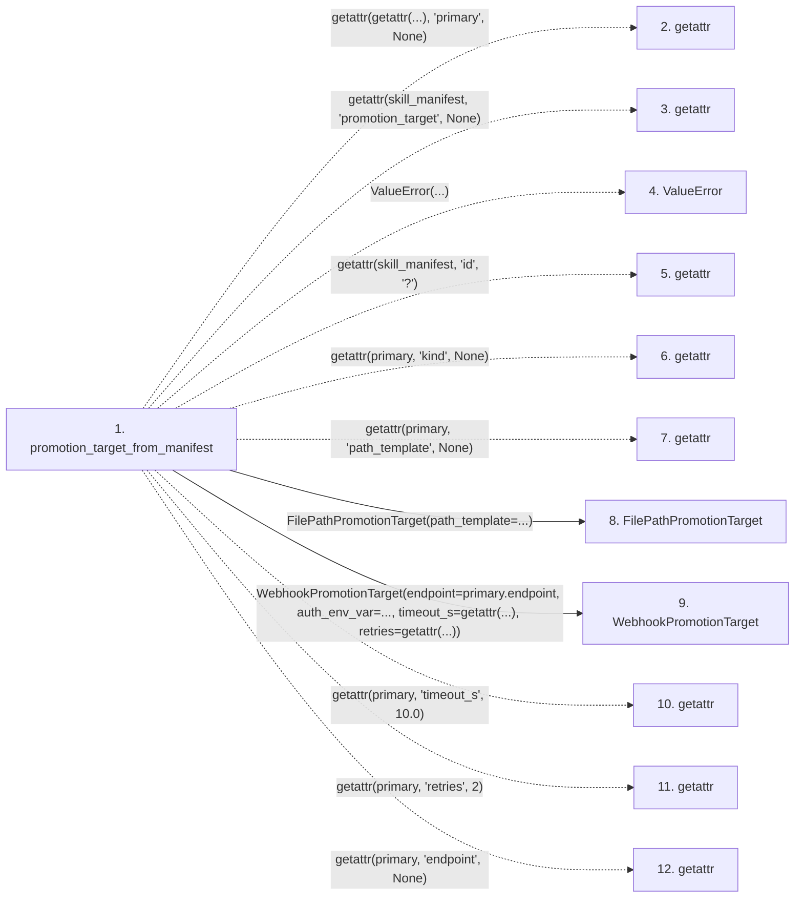

# promotion_target_from_manifest

**Entry point:** `promotion_target_from_manifest` (`api`)
**Source:** [promotion_target](../modules/promotion_target.md)
**Modules touched:** [promotion_target](../modules/promotion_target.md)

## Call sequence

> Static overview in presentation order, not runtime execution order. Arrows retain captured callers; representative internal continuations and boundary examples precede repeated helper detail.

<!-- Auto-generated from static call edges. Dashed arrows are external or unresolved calls. Reviewed runtime conditions and side effects belong in Behavior. -->

> Call sequence diagram shows 17 of 17 interactions; 0 omitted to keep the visualization within the 30-interaction and generated-diagram limits, with uncertain identities omitted rather than inferred.

> Captured boundary calls: external 14 of 14 (0 omitted); unresolved 0 of 0 (0 omitted). These counts cover the captured static trace.
> Detailed flow queries retain their own coverage and limits; omitted paths may execute at runtime.

## Data flow

<!-- Auto-generated static analysis. Treat values and boundaries as best-effort hints, not runtime proof. -->

### Step data

| Step | Inputs | Reads | Writes | Returns |
|---|---|---|---|---|
| `promotion_target_from_manifest` | `skill_manifest: Any` | - | - | `FilePathPromotionTarget(...)`, `WebhookPromotionTarget(...)`, `WebhookPromotionTarget(...)` |
| `getattr` | - | - | - | - |
| `getattr` | - | - | - | - |
| `ValueError` | - | - | - | - |
| `getattr` | - | - | - | - |
| `getattr` | - | - | - | - |
| `getattr` | - | - | - | - |
| `FilePathPromotionTarget` | - | - | - | - |
| `WebhookPromotionTarget` | - | - | - | - |
| `getattr` | - | - | - | - |
| `getattr` | - | - | - | - |
| `getattr` | - | - | - | - |

### Call data

| From | To | Line | Call |
|---|---|---:|---|
| promotion_target_from_manifest | getattr | 464 | `getattr(getattr(...), 'primary', None)` |
| promotion_target_from_manifest | getattr | 465 | `getattr(skill_manifest, 'promotion_target', None)` |
| promotion_target_from_manifest | ValueError | 468 | `ValueError(...)` |
| promotion_target_from_manifest | getattr | 469 | `getattr(skill_manifest, 'id', '?')` |
| promotion_target_from_manifest | getattr | 472 | `getattr(primary, 'kind', None)` |
| promotion_target_from_manifest | getattr | 476 | `getattr(primary, 'path_template', None)` |
| promotion_target_from_manifest | FilePathPromotionTarget | 477 | `FilePathPromotionTarget(path_template=...)` |
| promotion_target_from_manifest | WebhookPromotionTarget | 481 | `WebhookPromotionTarget(endpoint=primary.endpoint, auth_env_var=..., timeout_s=getattr(...), retries=getattr(...))` |
| promotion_target_from_manifest | getattr | 484 | `getattr(primary, 'timeout_s', 10.0)` |
| promotion_target_from_manifest | getattr | 485 | `getattr(primary, 'retries', 2)` |
| promotion_target_from_manifest | getattr | 488 | `getattr(primary, 'endpoint', None)` |

### Boundary effects

*No boundary effects detected.*

### Static analysis gaps

| Kind | Step | Target | Line |
|---|---|---|---:|
| external_call | `promotion_target_from_manifest` | `getattr` | 464 |
| external_call | `promotion_target_from_manifest` | `getattr` | 465 |
| external_call | `promotion_target_from_manifest` | `ValueError` | 468 |
| external_call | `promotion_target_from_manifest` | `getattr` | 469 |
| external_call | `promotion_target_from_manifest` | `getattr` | 472 |
| external_call | `promotion_target_from_manifest` | `getattr` | 476 |
| external_call | `promotion_target_from_manifest` | `getattr` | 484 |
| external_call | `promotion_target_from_manifest` | `getattr` | 485 |
| external_call | `promotion_target_from_manifest` | `getattr` | 488 |
| step_limit | `promotion_target_from_manifest` | `first 12 steps` | 0 |

## Behavior

This flow starts at `promotion_target_from_manifest` and is classified as `api`. The generated call and data-flow sections are bounded static projections; runtime conditions and side effects require source-level confirmation.
