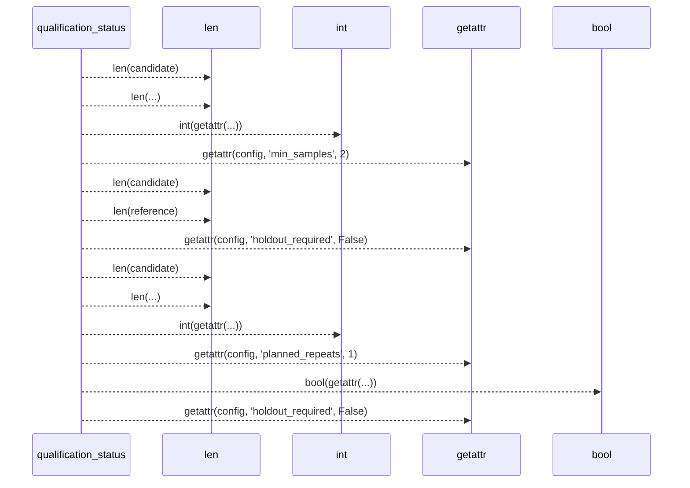
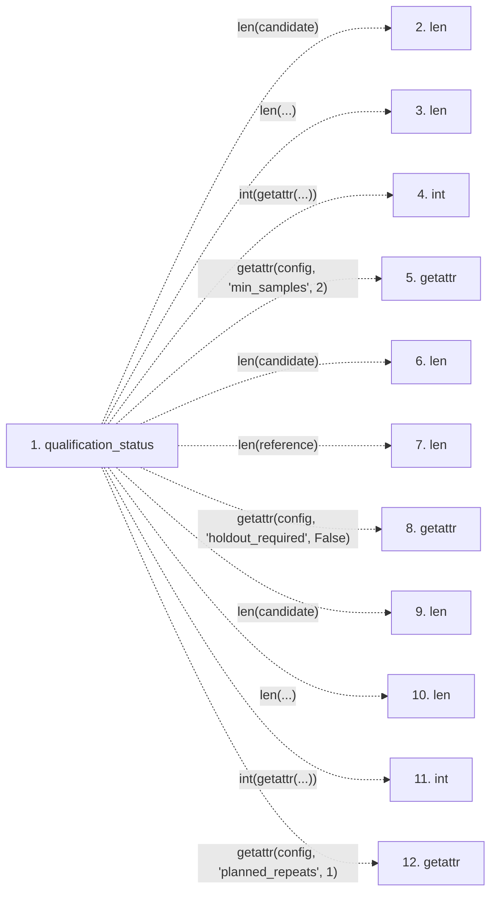

# qualification_status

**Entry point:** `qualification_status` (`api`)
**Source:** [significance](../modules/significance.md)
**Modules touched:** [significance](../modules/significance.md)

## Call sequence

> Static overview in presentation order, not runtime execution order. Arrows retain captured callers; representative internal continuations and boundary examples precede repeated helper detail.

<!-- Auto-generated from static call edges. Dashed arrows are external or unresolved calls. Reviewed runtime conditions and side effects belong in Behavior. -->

> Call sequence diagram shows 13 of 13 interactions; 0 omitted to keep the visualization within the 30-interaction and generated-diagram limits, with uncertain identities omitted rather than inferred.

> Captured boundary calls: external 13 of 13 (0 omitted); unresolved 0 of 0 (0 omitted). These counts cover the captured static trace.
> Detailed flow queries retain their own coverage and limits; omitted paths may execute at runtime.

## Data flow

<!-- Auto-generated static analysis. Treat values and boundaries as best-effort hints, not runtime proof. -->

### Step data

| Step | Inputs | Reads | Writes | Returns |
|---|---|---|---|---|
| `qualification_status` | `candidate: Sequence[float]`, `reference: Optional[Sequence[float]]`, `config: Any`, `verdict: Optional[str]`, `holdout_evidence: Optional[bool]` | `INCONCLUSIVE`, `INCONCLUSIVE`, `INCONCLUSIVE` | - | `{...}`, `{...}` |
| `len` | - | - | - | - |
| `len` | - | - | - | - |
| `int` | - | - | - | - |
| `getattr` | - | - | - | - |
| `len` | - | - | - | - |
| `len` | - | - | - | - |
| `getattr` | - | - | - | - |
| `len` | - | - | - | - |
| `len` | - | - | - | - |
| `int` | - | - | - | - |
| `getattr` | - | - | - | - |

### Call data

| From | To | Line | Call |
|---|---|---:|---|
| qualification_status | len | 209 | `len(candidate)` |
| qualification_status | len | 210 | `len(...)` |
| qualification_status | int | 218 | `int(getattr(...))` |
| qualification_status | getattr | 218 | `getattr(config, 'min_samples', 2)` |
| qualification_status | len | 219 | `len(candidate)` |
| qualification_status | len | 220 | `len(reference)` |
| qualification_status | getattr | 223 | `getattr(config, 'holdout_required', False)` |
| qualification_status | len | 232 | `len(candidate)` |
| qualification_status | len | 233 | `len(...)` |
| qualification_status | int | 237 | `int(getattr(...))` |
| qualification_status | getattr | 237 | `getattr(config, 'planned_repeats', 1)` |

### Boundary effects

*No boundary effects detected.*

### Static analysis gaps

| Kind | Step | Target | Line |
|---|---|---|---:|
| external_call | `qualification_status` | `getattr` | 218 |
| external_call | `qualification_status` | `getattr` | 223 |
| external_call | `qualification_status` | `getattr` | 237 |
| step_limit | `qualification_status` | `first 12 steps` | 0 |

## Behavior

This flow starts at `qualification_status` and is classified as `api`. The generated call and data-flow sections are bounded static projections; runtime conditions and side effects require source-level confirmation.
